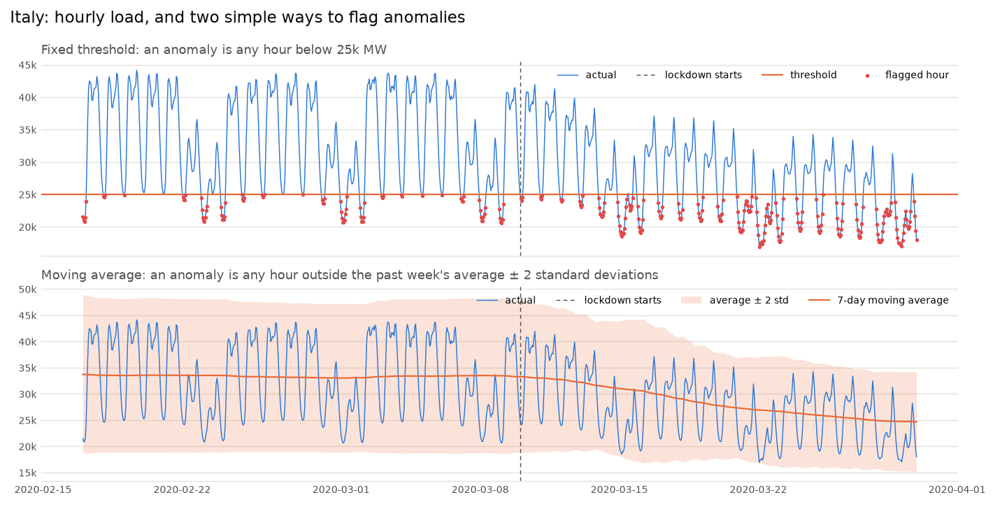
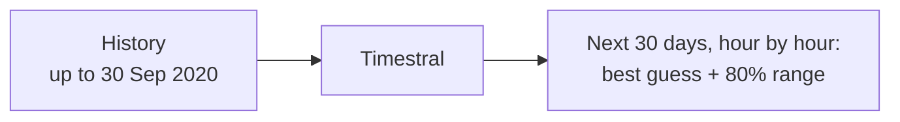
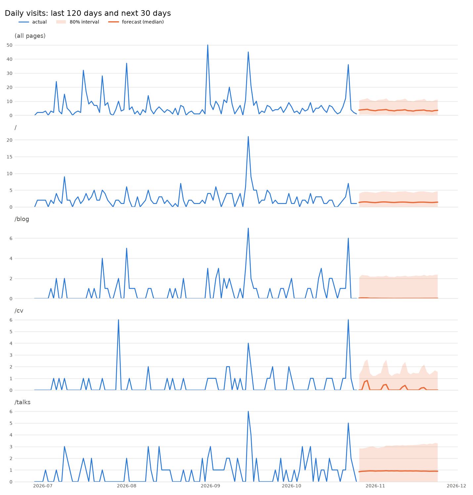
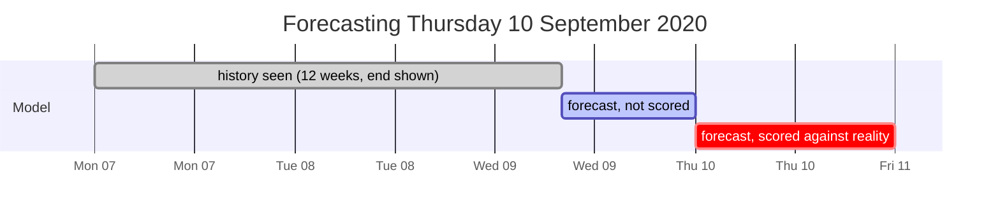
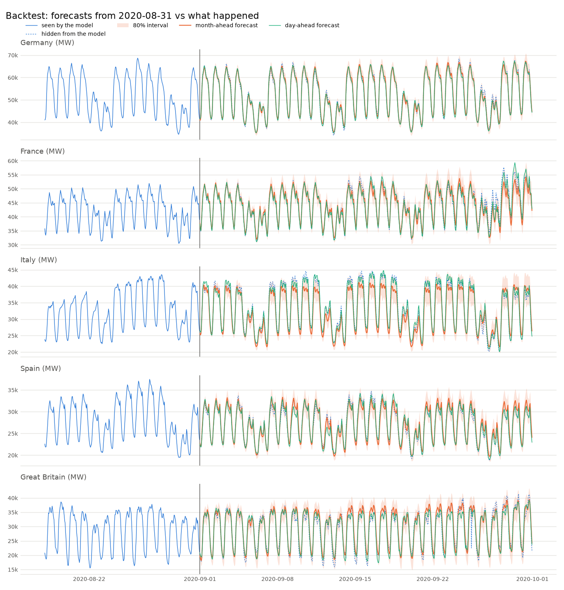
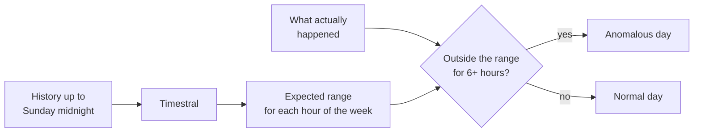
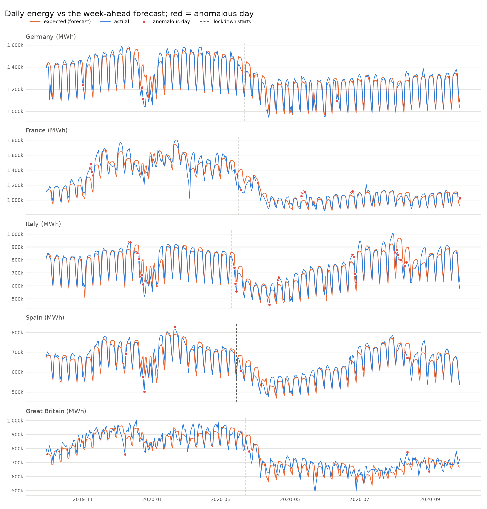

# zero-shot-forecasting

Automated anomaly detection on real data with a **time series foundation model**, no
machine learning experience needed.

## The input

Hourly electricity demand (load) in five European countries, in megawatts (MW), from
2015 to September 2020. It comes from
[Open Power System Data](https://data.open-power-system-data.org/time_series/), which
collects what Europe's grid operators publish on the ENTSO-E Transparency Platform.
A few sample rows:

| time (UTC) | Germany | France | Italy | Spain | Great Britain |
|---|---|---|---|---|---|
| 2020-03-02 06:00 | 65,838 | 66,270 | 35,176 | 29,200 | 38,178 |
| 2020-03-02 07:00 | 66,800 | 68,659 | 40,259 | 31,353 | 42,669 |
| 2020-03-02 08:00 | 67,032 | 70,363 | 41,955 | 32,759 | 44,722 |
| 2020-03-02 09:00 | 67,977 | 70,442 | 42,109 | 33,539 | 44,679 |
| 2020-03-02 10:00 | 68,588 | 70,845 | 42,817 | 33,390 | 45,250 |

That is 50,400 rows, one per hour. Each column is one **time series**: one number per
hour, nothing else.

## The goal: automated anomaly detection

Find the hours and days when demand did something unexpected, in every country, without
writing rules by hand. The data contains a real, unmistakable anomaly to check against:
the COVID-19 lockdowns of March 2020.

## Why simple rules don't work

Here is Italy around its lockdown (10 March 2020), with two common ways to set an alert:



**A fixed threshold** ("if demand is below 25,000 MW, raise an alert") can't tell a
lockdown from a Sunday. Demand swings every day, from ~21,000-25,000 MW at night to
~44,000 MW around noon, and every week, with weekends far below weekdays. Before the lockdown, the
threshold already fired on **15% of hours**: every night and every weekend. During the
lockdown, weekday afternoons at 34,000 MW passed without a word. Move the line up and
the false alarms grow; move it down and the lockdown disappears. And the right line is
different for each country, each season, each year.

**A moving average** ("alert if an hour is more than 2 standard deviations from the
past week's average") does worse: it flagged **0% of hours**, before or during the
lockdown. The daily swing is so large that the standard deviation is ~6,000 MW, so the
band is ~24,000 MW wide and nothing ever leaves it. The average itself only drifts down
a week after the drop. Shorter windows or tighter bands chase the daily cycle and fire
every morning instead.

You *can* build something better by hand: an average per hour of the week, a seasonal
decomposition, a holiday calendar, a trend term, then tune it for each series. That is
real modelling work, repeated for every metric you watch. What's needed is a model that
already knows what "normal" looks like, *for this hour, this weekday, this time of
year*, from the data alone.

## Time series foundation models

A large language model (LLM) is pretrained once on a huge amount of text. It then
continues text it has never seen: you give it a prompt, it writes what comes next.

A **time series foundation model (TSFM)** is the same idea for numbers. It is pretrained
once on a large and varied collection of time series. You give it the history of a
series it has never seen, and it forecasts what comes next: **zero-shot**, with no
training, fitting or tuning on your data.

| | LLM | TSFM |
|---|---|---|
| Pretrained on | lots of text | lots of time series |
| You give it | a prompt | the history: an array of numbers |
| It gives back | the next words | the next values, with a range of how sure it is |
| Training on your data | none | none |

That's why no ML experience is needed: there are no features to design, no model to
choose, no parameters to tune. The whole API used here is two calls:

```python
from timestral import TimestralForecaster

forecaster = TimestralForecaster.from_pretrained("mistralai/Timestral-209M")
result = forecaster.forecast(history, prediction_length=24)  # history: (series, hours) array
result.quantile(0.5)   # best guess for each of the next 24 hours
result.quantile(0.99)  # a value it is 99% sure won't be exceeded
```

This project uses **[Timestral](https://mistral.ai/news/timestral/)**, Mistral's TSFM
(the 209M-parameter model, an 837 MB download). Public holidays are passed as an extra
input, since they lower demand and are known in advance; everything else, it works out
from the history.

All runs were made on a **MacBook Air (M1, 2020), 16 GB of RAM, on the CPU** (no GPU):

| Command | What it does | Time |
|---|---|---|
| `main.py forecast` | the next 30 days, 5 countries | ~45 s |
| `main.py backtest` | 30 days of day-ahead forecasts, 5 countries | ~55 s |
| `main.py anomalies` | a year of week-ahead forecasts, 5 countries | ~2 min |

## What a TSFM can do

The same model, called in three different ways.

### 1. Forecast

Give it the history up to now; it returns every hour of the next 30 days, each with a
range.





It continues the daily and weekly rhythm, and the range widens the further out it goes.
Germany's first weekend dips deeper because Saturday 3 October is a public holiday.

### 2. Backtest: can the forecasts be trusted?

The future can't be checked yet, so go back in time: forecast a past month as if it
hadn't happened, and compare with what did. Here, every day of September 2020 is
forecast at 08:00 the morning before, from the 12 weeks up to then: exactly when and
what the grid operators forecast.



Repeat for each of the 30 days. On average the forecasts were **1.5-2.2% off** in
Germany, France, Italy and Spain (4.8% in Great Britain). That beats the grid
operators' own forecasts in Germany and Great Britain, which use weather forecasts that
Timestral doesn't have. And the 80% ranges held 79-89% of the real values: when the
model says it is 80% sure, it is about right.



### 3. Detect anomalies

If the forecasts and their ranges can be trusted, an anomaly is simply **what the model
was confident would not happen**. Replay the past one week at a time: forecast each
week only from the hours before it, then flag the days when actual demand fell outside
the model's 1%-99% range for at least 6 hours.





With no rules and no tuning per country, it flags the first lockdown week in Italy,
France, Spain and Great Britain, France's reopening in May as a spike, and the days the
holiday calendar doesn't cover, such as Christmas week and Italy's August shutdown.
Before the pandemic, ~1% of hours fell above and ~1% below the range, as they should:
it doesn't cry wolf.

## A new frontier in software observability

Software systems are full of time series with exactly this shape: daily and weekly
cycles, holidays, slow growth, sudden shifts. Most alerting still relies on the fixed
thresholds and moving averages shown above. A TSFM could:

- **Replace static alert thresholds** on request rates, latency, error rates, queue
  depth, CPU and memory with "outside the expected range for this hour", so Monday
  morning peaks and Sunday night lulls stop paging anyone.
- **Watch business metrics** (sign-ups, checkouts, payments, log-ins) where a quiet
  drop, such as a broken checkout button, matters more than a spike.
- **Scale to thousands of metrics** with no per-metric setup: every series goes into
  the same batch, like the five countries here.
- **Catch slow drifts** (a memory leak, a growing backlog, a gradual slowdown after a
  deploy) by forecasting a week ahead instead of a day, as the lockdowns showed.
- **Plan capacity and cost**: forecast traffic, storage or cloud spend weeks ahead,
  with a range rather than one number.
- **Check releases**: compare a metric after a deploy with what the model expected
  from before it.
- **Use known events as inputs**: launches, sales or maintenance windows, passed in
  advance like the public holidays here.

What it won't do: tell you *why* something happened, or know about anything you don't
pass in.

## Quick start

```sh
uv sync                     # installs timestral from GitHub, plus pandas, matplotlib, holidays
uv run main.py signal       # the chart above: fixed threshold and moving average (no model)
uv run main.py forecast
uv run main.py backtest
uv run main.py anomalies
```

The first run downloads the data (124 MB, into `data/`) and the model (837 MB, into the
Hugging Face cache). Every command prints a summary and writes a CSV or a chart to
`output/`.

## More

- [05-walkthrough.md](docs/05-walkthrough.md): the full details: the data, every
  command and option, all the results and the limitations.
- [01-concepts.md](docs/01-concepts.md): the statistical ideas (quantile, covariate,
  backtesting...) explained without assuming any statistics background.
- [02-capabilities.md](docs/02-capabilities.md): what Timestral can and can't do.
- [03-python-library.md](docs/03-python-library.md): the `timestral` Python API and
  every setting.
- [04-anomaly-detection.md](docs/04-anomaly-detection.md): how forecast-based anomaly
  detection works and how to tune it.
