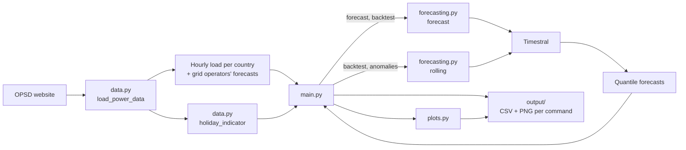
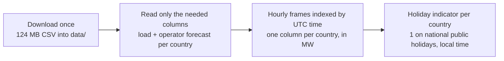
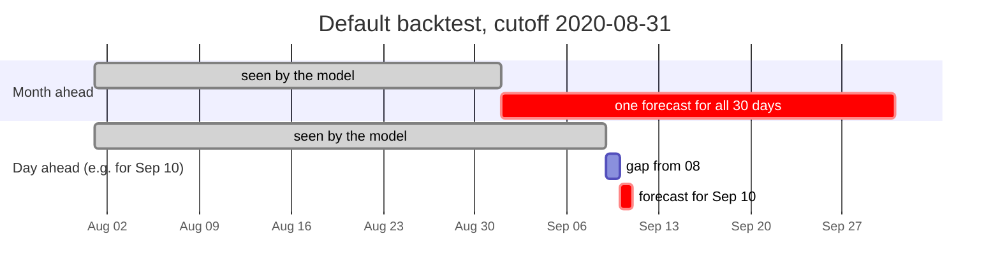
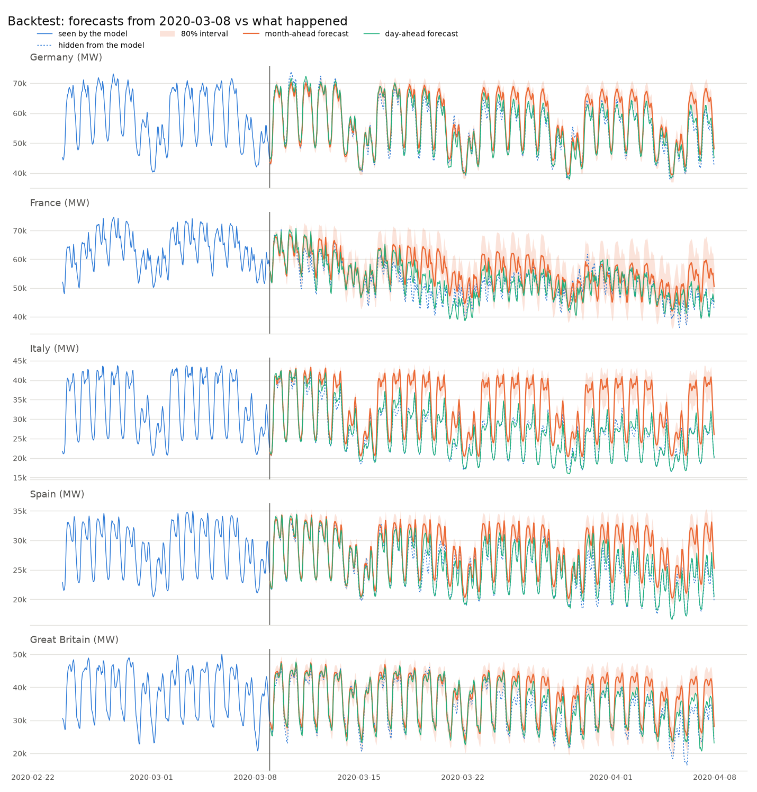
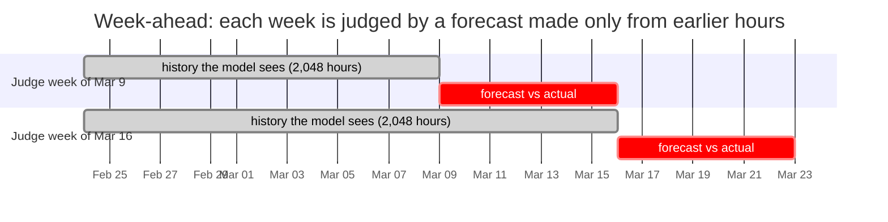
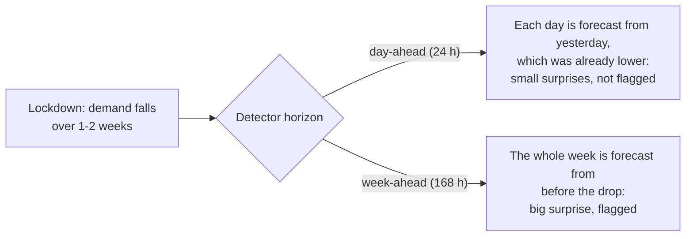

# zero-shot-forecasting

## Goal

Explore what **time series foundation models (TSFMs)** can do on real data.

A TSFM is pretrained once, on a large and varied collection of time series. It then
forecasts series it has never seen *zero-shot*: you give it the history and it
forecasts right away, with no training, fitting or tuning on your data. That is a
big change from classic forecasting, where you build and fit a model for each
dataset.

This project puts that promise to the test with
[Timestral](https://mistral.ai/news/timestral/), Mistral's TSFM, on hourly electricity
demand in five European countries, 2015-2020, including the COVID-19 lockdowns. It
covers three common tasks:

1. **Forecast** demand for the next 30 days, hour by hour.
2. **Backtest**: hide a past month, forecast it from the data before it, and score
   the forecast against what actually happened, and against the forecasts the grid
   operators themselves published.
3. **Detect anomalies**: find past days that the model would not have expected, such
   as the start of the lockdowns.

Nothing is trained or fine-tuned anywhere in this project. The pretrained model gets
the history as context and returns a probabilistic forecast directly.

More documentation in [`docs/`](docs):

- [01-concepts.md](docs/01-concepts.md): the statistical ideas (quantile, covariate,
  multivariate, backtesting...) explained without assuming any statistics background.
- [02-capabilities.md](docs/02-capabilities.md): what Timestral can and can't do, and which
  parts this project uses.
- [03-python-library.md](docs/03-python-library.md): the `timestral` Python API, every
  setting you can change, and their measured effect on speed and accuracy.
- [04-anomaly-detection.md](docs/04-anomaly-detection.md): how forecast-based anomaly
  detection works, how this project implements it, and how to tune it.

## Quick start

```sh
uv sync                                   # installs timestral from GitHub, plus pandas, matplotlib, holidays
uv run main.py forecast                   # ~1 min
uv run main.py backtest                   # ~2 min
uv run main.py backtest --cutoff 2020-03-08   # the same, just before the lockdowns
uv run main.py anomalies                  # ~2 min (week-ahead)
uv run main.py anomalies --horizon 24     # ~11 min (day-ahead)
```

The first run downloads two things once: the data (124 MB, into `data/`) and the
Timestral-209M model (837 MB, into the Hugging Face cache). Times are for a laptop
CPU. Every command prints a summary and writes a CSV and a chart to `output/`.

```
uv run main.py [--countries DE,FR,IT,ES,GB] [--model HF_ID] [--no-holidays] forecast  [--days 30]
uv run main.py [...] backtest  [--days 30] [--cutoff YYYY-MM-DD] [--context 2048]
uv run main.py [...] anomalies [--start 2019-09-30] [--end YYYY-MM-DD] [--horizon 168] [--context 2048] [--min-hours 6]
```

`--model mistralai/Timestral-28M` is about 6x faster and only slightly less accurate
(1.86% vs 1.81% average day-ahead error in September 2020). `--no-holidays` drops the
public-holiday covariate: about 4x faster, but less accurate around holidays.

## The data

The data is the **[Open Power System Data](https://data.open-power-system-data.org/time_series/)
(OPSD) time series package**, version 2020-10-06. OPSD collects European power-system
data into clean, documented files. This package comes from the **ENTSO-E
Transparency Platform**, where Europe's grid operators are legally required to
publish their data.

| | |
|---|---|
| File | `time_series_60min_singleindex.csv`, 124 MB |
| Resolution | one row per hour, timestamps in UTC |
| Period | 2015-01-01 to 2020-09-30: 50,400 hours, almost six years |
| Coverage | about 30 European countries: electricity load, the grid operators' load forecasts, solar and wind generation, some prices |

This project uses two columns per country:

- **Actual load** (`<country>_load_actual_entsoe_transparency`): the electricity
  demand on the grid, in megawatts (MW), for each hour. This is what is forecast.
- **Grid operator's forecast** (`<country>_load_forecast_entsoe_transparency`): the
  day-ahead forecast that country's grid operator (TSO) published. Grid operators
  must publish it by two hours before the day-ahead market closes (12:00 CET) on the
  day before. Built with weather forecasts and years of tuning, it is a professional
  baseline to compare Timestral against.

The five countries:

| Country | Average load | Missing hours | First lockdown | Load in April 2020 vs April 2019 |
|---|---|---|---|---|
| Germany (DE) | 55 GW | 0 | 22 March 2020 | -9% |
| France (FR) | 53 GW | 41 | 17 March 2020 | -17% |
| Italy (IT) | 33 GW | 2 | 10 March 2020 | -22% |
| Spain (ES) | 28 GW | 20 | 15 March 2020 | -17% |
| Great Britain (GB) | 35 GW | 6 | 23 March 2020 | -14% |

(1 GW = 1,000 MW. For Great Britain the file has `GB_GBN`, Great Britain without
Northern Ireland. The lockdown dates are when the measures were announced or took
effect, give or take a day; Germany's is the nationwide contact ban.)

Why this dataset suits a TSFM demo:

- **Rich, regular patterns.** Daily, weekly and yearly cycles at once: in Germany in
  2019, Sundays averaged ~46 GW against ~59 GW on weekdays, and January ~62 GW
  against July ~54 GW.
- **Long history.** 50,400 hours, more than Timestral's 32,768-step context, so the
  model can use all it can read.
- **A useful covariate.** Public holidays lower demand and are known years ahead,
  which makes them a natural known-future covariate.
- **A professional baseline**, right in the data: the grid operators' own forecasts.
- **A real, unmistakable anomaly**: the spring 2020 lockdowns.
- **Five countries** to forecast in one batch, at very different scales.

**Licence and attribution.** The data is by Open Power System Data, from ENTSO-E
Transparency. The OPSD files don't state a data licence, so this repo doesn't
redistribute them: `data.py` downloads the file into `data/`, which git ignores.
Check the [OPSD](https://open-power-system-data.org/) and
[ENTSO-E](https://transparency.entsoe.eu/) terms before republishing the data.

## How the code is laid out

| File | What it does |
|---|---|
| `data.py` | Downloads the OPSD file once, extracts load and grid-operator forecasts per country, builds the holiday indicator |
| `forecasting.py` | The Timestral wrapper: pandas in, pandas out. `forecast()` for one forecast, `rolling()` for a forecast every day or week |
| `plots.py` | Matplotlib charts, one small panel per country |
| `main.py` | The three commands: `forecast`, `backtest`, `anomalies` |



### Step 1: from the OPSD file to time series (`data.py`)



- `load_power_data()` returns two frames, `load` and `tso_forecast`, each with one
  column per country and one row per hour. The few missing hours stay `NaN`, which
  Timestral treats as missing.
- `holiday_indicator()` marks every hour that falls on a national public holiday in
  that country (using the `holidays` package, in local time). Holidays are known in
  advance, so this can be computed for the forecast horizon too.

### Step 2: calling Timestral (`forecasting.py`)

The whole Timestral API used here is two calls:

```python
from timestral import TimestralForecaster

forecaster = TimestralForecaster.from_pretrained("mistralai/Timestral-209M", quantile_real_cap_k=1.0)
result = forecaster.forecast(
    context,                    # (countries, hours) array of load, NaN = missing
    prediction_length=720,      # 30 days
    known_covariates=holidays,  # (countries, 1, hours + 720): 1 on public holidays, else 0
)
result.quantiles                # (countries, 1, 720, 21): 21 quantiles per forecast hour
result.quantile(0.9)            # (countries, 1, 720)
```

A few things worth knowing:

- **All countries go in one batch.** Each column becomes one row of `context`, and
  Timestral forecasts every row independently in one call. Germany and Spain, at very
  different scales, sit side by side: Timestral rescales each row internally.
- **The output is a distribution, not one number.** For every future hour you get
  21 quantiles (1%, 5%, 10%, ..., 95%, 99%). The demo keeps a lower and an upper
  quantile as an interval, plus the median (the best guess per hour) and the mean
  (`_mean()`, the area under the quantile curve), which is what adds up into energy
  totals.
- **Public holidays are a known-future covariate.** Timestral recognises a row of 0s
  and 1s as an indicator. It makes no difference in an ordinary month and a large one
  around holidays: over Christmas 2019, the day-ahead error fell from 4.25% to 3.30%
  (Italy: 6.41% to 3.82%). Any covariate costs about 4x in speed.
- **`rolling()` is the workhorse** for backtests and anomalies. It forecasts block
  after block (each day, or each week), every block only from the 2,048 hours (~12
  weeks) before it. Every (block, country) pair becomes a row of one batch.
- **`quantile_real_cap_k=1.0`.** With the holiday covariate, the 99% quantile for
  Christmas Day in Great Britain blew up to 37.8 million MW; medians were fine. This
  library setting keeps every forecast within one "typical swing" of the range the
  history has seen. See [03-python-library.md](docs/03-python-library.md#capping-extreme-quantiles-quantile_real_cap_k).

### Requirement 1: forecast the next month (`main.py forecast`)

`forecast()` gives the model the full history (it reads the last 32,768 hours, ~3.7
years) and asks for the next 720 hours, with the holidays over that period.

```
Forecast for 2020-10-01 00:00 .. 2020-10-30 23:00 UTC

    last 30 days GWh (actual)  next 30 days GWh (forecast)  peak MW (actual)  peak MW (forecast)
DE                      37905                        39507             68303               68709
FR                      31821                        34962             57680               59257
IT                      24123                        22248             44649               40129
ES                      19392                        18608             34676               31519
GB                      21172                        23703             41408               44089
```

Germany is forecast to use about **39.5 TWh** (39,507 GWh) in October 2020, 4% more
than in September; France and Britain more (heating season), Italy and Spain slightly
less. GWh add up the hourly mean forecasts; peaks are the highest hourly median.


The forecast continues the daily and weekly rhythm, and its 80% band widens slowly the
further out it goes. Two details show the model at work: France and Great Britain
trend upwards into the heating season, and Germany's first weekend dips deeper than
the others because Saturday 3 October is German Unity Day, which the holiday covariate
announced.

### Requirement 2: how good is the forecast? (`main.py backtest`)

To test a forecast honestly, give the model only the history up to a cutoff, forecast
the period after it, and compare with what really happened. The backtest does two
kinds of forecast over the 30 days after the cutoff (default 2020-08-31; pick another
with `--cutoff`):

- **Month ahead**: one forecast for all 30 days, made at the cutoff, as the `forecast`
  command does.
- **Day ahead**: every day at 08:00 UTC, a forecast for the *next* day, from the 2,048
  hours before it. 08:00 UTC is when the grid operators' own forecasts must be ready
  (10:00 CET, two hours before the day-ahead market closes), so Timestral never knows
  more than they did.



Scores are the **mean absolute percentage error** (MAPE): how many % off the forecast
was, on average over all hours. Lower is better.

```
Model saw data up to 2020-08-31; forecast 2020-09-01 .. 2020-09-30 (UTC)

    month-ahead timestral  month-ahead last-week  day-ahead timestral  day-ahead grid operator  day-ahead last-week  month-ahead in 80% interval
DE                   1.53                   2.97                 1.50                     2.03                 2.26                          98%
FR                   2.31                   4.20                 1.80                     1.65                 2.94                          96%
IT                   4.43                   5.22                 2.21                     1.89                 5.14                          90%
ES                   2.67                   7.05                 1.91                     0.92                 4.18                          97%
GB                   4.96                   6.75                 4.76                     6.50                 6.72                          97%
```

How to read it:

- **Against "last week"** (repeat the same hour one week earlier), Timestral wins
  everywhere, month ahead and day ahead.
- **Against the grid operators**, day ahead, Timestral wins in **Germany and Great
  Britain** and loses in **France, Italy and Spain**. The operators feed weather
  forecasts into their models; Timestral sees only past load and holidays. Spain's
  operator is remarkably accurate (0.92%).
- **Even a month ahead**, Timestral beat the operators' *day-ahead* forecasts in
  Germany (1.53% vs 2.03%) and Great Britain (4.96% vs 6.50%).
- **In 80% interval**: the share of hours inside the month-ahead 10%-90% band. If the
  band were perfectly calibrated, it would be about 80%. At 90-98% the bands are too
  wide: cautious, so they can be trusted, but less informative than they could be.


#### The same, just before the lockdowns

`uv run main.py backtest --cutoff 2020-03-08` makes the model forecast 9 March to
7 April 2020 from data up to 8 March, the day before Italy locked down:

```
    month-ahead timestral  month-ahead last-week  day-ahead timestral  day-ahead grid operator  day-ahead last-week  month-ahead in 80% interval
DE                   5.25                   7.96                 2.61                     4.45                 4.32                          55%
FR                   9.66                  25.85                 4.34                     2.95                11.49                          70%
IT                  23.56                  28.06                 2.54                     2.71                 8.88                           4%
ES                  11.17                  14.72                 2.62                     2.48                 6.46                          32%
GB                   9.81                  14.64                 5.67                     8.01                 8.64                          67%
```

- **The month-ahead forecast had no way to know.** In Italy it was off by 23.6% on
  average, and only 4% of hours fell inside its 80% band: the model was confidently
  wrong, as anyone would have been on 8 March.
- **The day-ahead forecasts adapted within days**, because they re-read the latest
  history every day. During the lockdown they beat the grid operators in Germany,
  Italy and Great Britain. The operators struggled too: their errors were 1.2x (Great
  Britain) to 2.7x (Spain) their September 2020 level.



### Requirement 3: anomalies in the past (`main.py anomalies`)

The idea: **an anomaly is a period the model was confident would not happen.**

`rolling()` replays the past block by block. Every block is forecast only from the
2,048 hours before it, like a forecaster running every week would have. An hour is
"outside" when actual load falls outside the forecast's **1%-99% interval**; a day is
**anomalous** when at least 6 of its 24 hours are outside (`--min-hours`).
Consecutive anomalous days of the same country form one **episode**.



**The horizon decides what you can see.** The lockdown drops built up over a week or
two. A *day-ahead* detector re-reads yesterday every day, so it adapts step by step
and never sees a big surprise: it misses the lockdowns entirely. A *week-ahead*
detector (the default, `--horizon 168`) forecasts a whole week from the history before
it, so the first lockdown week stands out. Day-ahead is better at sharp one-day
events.



Week-ahead, with holidays (the default), 30 September 2019 to 27 September 2020:

```
Calibration up to 2020-02-29: 0.6% of hours above the 99% line, 1.2% below the 1% line (expected: about 1% each).

country  kind      first       last  days  avg deviation %
     FR spike 2019-11-07 2019-11-10     4             16.8
     FR spike 2020-05-11 2020-05-14     4             10.8
     IT  drop 2019-12-18 2019-12-21     4             -8.3
     IT spike 2020-06-25 2020-06-28     4             10.0
     IT  drop 2020-08-03 2020-08-06     4            -13.4
     IT  drop 2020-03-13 2020-03-15     3            -11.3
     DE  drop 2019-12-23 2019-12-24     2            -17.6
     ES  drop 2019-12-24 2019-12-25     2            -15.3
...
     ES  drop 2020-03-19 2020-03-19     1            -11.4
     FR  drop 2020-03-19 2020-03-19     1            -19.9
     GB  drop 2020-03-26 2020-03-26     1            -13.4
...
```

- **Calibration first**: before the pandemic, about 1% of hours fell above the 99% line
  and about 1% below the 1% line, as they should. The band can be trusted, so what
  falls outside it is worth a look.
- **The lockdowns**: the first lockdown week is flagged in Italy (13-15 March, -11%),
  France (19 March, -20%), Spain (19 March, -11%) and Great Britain (26 March, -13%).
  Germany's drop (~9%) was too small and gradual to stand out.
- **France's reopening** on 11 May 2020 shows as a spike: demand came back faster than
  a forecast made from lockdown weeks expected.
- **What the holiday calendar doesn't know**: Christmas week, August shutdowns in
  Italy and Spain, regional holidays in Germany.


Each panel shows a country's daily energy: blue is actual, orange is what the
week-ahead forecast expected, red dots are anomalous days, and the dashed line marks
the start of the lockdown. The orange line follows the lockdown drop one week late,
exactly how a rolling forecaster behaves.

What each detector caught around the lockdowns:

| Country | Lockdown starts | Day-ahead (`--horizon 24`) | Week-ahead (default) |
|---|---|---|---|
| Italy | 10 March | nothing | 13-15 March, -11% |
| Spain | 15 March | nothing | 19 March, -11% |
| France | 17 March | nothing | 19 March, -20% |
| Great Britain | 23 March | nothing | 26 March, -13% |
| Germany | 22 March | nothing | nothing |

The day-ahead detector flags 29 single days instead (`output/anomalies-24h.png`): sharp
one-day events such as the daylight-saving switches, France's reopening day and days
right after holidays.

**The holiday covariate matters here.** Without it (`--no-holidays`), the week-ahead
detector flags 70 days instead of 52, and 2.6% of pre-pandemic hours fall below the 1%
line instead of 1.2%: New Year, Easter, 1 May and other holidays all look like
anomalies.

More on how it works, the results day by day, and the pitfalls (clock changes, the
holiday calendar, an exploding 99% line on Christmas Day) in
[04-anomaly-detection.md](docs/04-anomaly-detection.md).

## Limitations

- **No weather.** Electricity demand depends on temperature, and the grid operators
  use weather forecasts. OPSD has no weather data; a temperature forecast as a
  known-future covariate is the obvious next step.
- **UTC hours.** The model sees UTC, so on the two daylight-saving switches each year
  the daily pattern shifts by an hour, and those days can look odd.
- **National holidays only.** Regional holidays (German states, Spanish regions) and
  "bridge" days around holidays (such as 23-24 December) aren't in the calendar.
- **Data ends in September 2020.** The 30-day forecast is for October 2020, a month
  that can be checked against ENTSO-E's later data, but not with this file.
- **Speed.** The day-ahead anomaly replay (~1,800 forecasts with the holiday
  covariate) takes ~11 minutes on a laptop CPU. `--model mistralai/Timestral-28M` or
  `--no-holidays` cut that sharply; see the
  [performance tips](docs/03-python-library.md#performance-tips).
