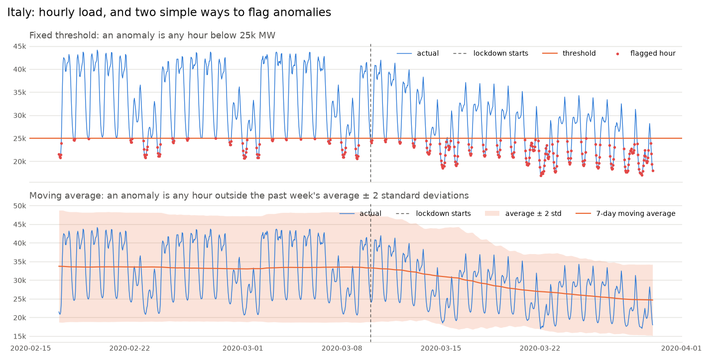
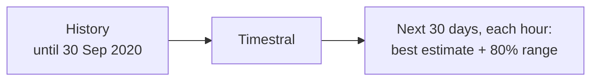
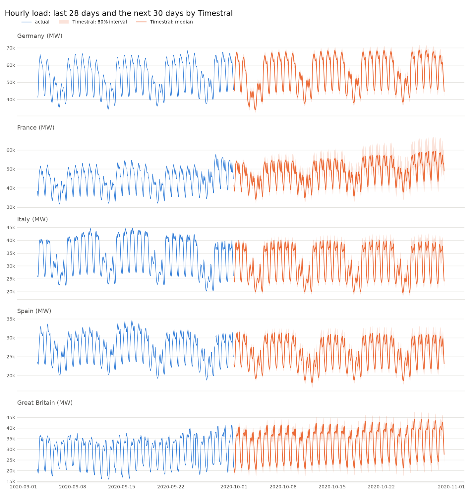
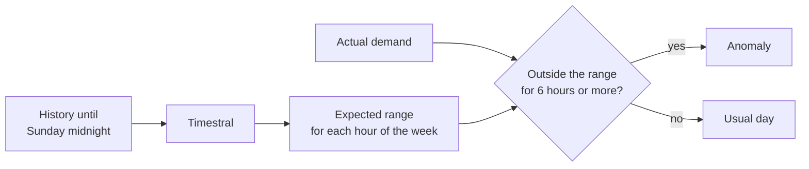
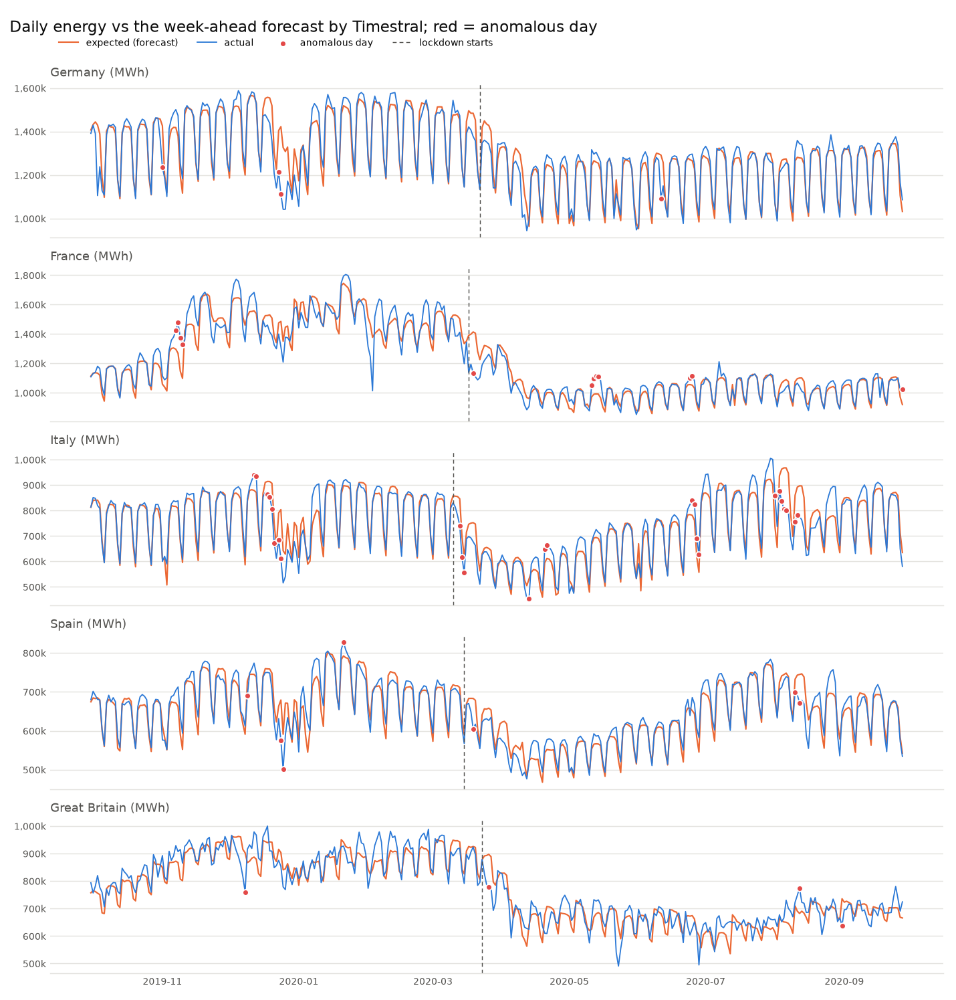
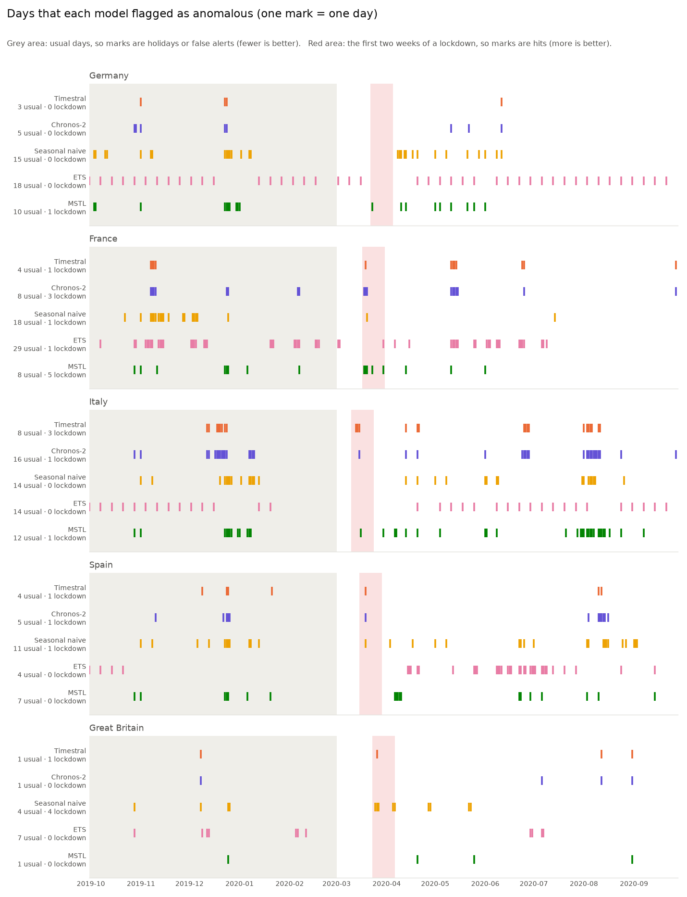

# zero-shot-forecasting

This project finds anomalies in real data with a time series foundation model. You do
not need experience in machine learning to use it.

## The input

The input is the hourly electricity demand (load) of five European countries, from 2015
to September 2020. The unit is megawatts (MW). The data comes from
[Open Power System Data](https://data.open-power-system-data.org/time_series/). This
source collects the data that the European grid operators publish on the ENTSO-E
Transparency Platform.

Sample rows:

| time (UTC) | Germany | France | Italy | Spain | Great Britain |
|---|---|---|---|---|---|
| 2020-03-02 06:00 | 65,838 | 66,270 | 35,176 | 29,200 | 38,178 |
| 2020-03-02 07:00 | 66,800 | 68,659 | 40,259 | 31,353 | 42,669 |
| 2020-03-02 08:00 | 67,032 | 70,363 | 41,955 | 32,759 | 44,722 |
| 2020-03-02 09:00 | 67,977 | 70,442 | 42,109 | 33,539 | 44,679 |
| 2020-03-02 10:00 | 68,588 | 70,845 | 42,817 | 33,390 | 45,250 |

The data has 50,400 rows, one row for each hour. Each column is one time series: one
number for each hour.

The data contains a real anomaly: the COVID-19 lockdowns of March 2020. We use it to
examine the results.

## Why simple rules do not work

The chart shows Italy before and after the start of its lockdown on 10 March 2020. It
also shows two usual methods to find anomalies.



**A fixed threshold.** The rule is: "If the demand is less than 25,000 MW, send an
alert." This rule cannot find the difference between a lockdown and a Sunday:

- The demand changes much during each day. At night it is 21,000-25,000 MW. At noon it
  is approximately 44,000 MW.
- The demand also changes during each week. On weekends it is much lower than on
  weekdays.
- Before the lockdown, the rule sent an alert for 15% of all hours: each night and each
  weekend.
- During the lockdown, the demand on weekday afternoons was 34,000 MW. The rule did not
  send an alert for these hours.

If you increase the threshold, you get more false alerts. If you decrease it, the rule
does not find the lockdown. Also, each country, season and year needs a different
threshold.

**A moving average.** The rule is: "If an hour is more than 2 standard deviations from
the average of the last week, send an alert." This rule sent an alert for 0% of the
hours, before and during the lockdown:

- The daily change in demand is large. Thus the standard deviation is approximately
  6,000 MW, and the band is approximately 24,000 MW wide. No hour goes out of this band.
- The average decreases only one week after the demand decreases.
- A shorter window or a narrower band follows the daily cycle. Then the rule sends an
  alert each morning.

You can make a better model yourself. For example, you can use an average for each hour
of the week, a seasonal decomposition, a holiday calendar and a trend. But you must
adjust this model for each time series. You must do this work again for each metric that
you monitor.

Thus you need a model that knows the usual pattern for each hour, each weekday and each
season. The model must learn this pattern from the data only.

## Time series foundation models

A large language model (LLM) learns from a very large quantity of text. This occurs one
time, before you use the model. Then you give the model a prompt, and the model writes
the next text.

A time series foundation model (TSFM) uses the same method for numbers. It learns from a
very large set of different time series. Then you give it the history of a new time
series, and it forecasts the next values. This is "zero-shot" forecasting: you do not
train, fit or adjust the model on your data.

| | LLM | TSFM |
|---|---|---|
| Learns from | a large quantity of text | a large set of time series |
| Input | a prompt | the history: a list of numbers |
| Output | the next words | the next values, with a range that shows the uncertainty |
| Training on your data | none | none |

Thus you do not need experience in machine learning. You do not design features, select
a model or adjust parameters. This project uses only two calls:

```python
from timestral import TimestralForecaster

forecaster = TimestralForecaster.from_pretrained("mistralai/Timestral-209M")
result = forecaster.forecast(history, prediction_length=24)  # history: (series, hours) array
result.quantile(0.5)   # the best estimate for each of the next 24 hours
result.quantile(0.99)  # the value that the model is 99% sure the demand stays below
```

This project uses [Timestral](https://mistral.ai/news/timestral/), the TSFM from
Mistral. The model has 209 million parameters, and the download is 837 MB. Public
holidays decrease the demand, and we know their dates before they occur. Thus we give
the holidays to the model as an extra input. The model gets all other information from
the history.

We ran all the commands on a MacBook Air (M1, 2020) with 16 GB of RAM. The model ran on
the CPU, without a GPU.

Each command first reads the data file (124 MB, 50,400 rows). Then it gives a part of the
history to the model. In this table, one value is the load of one country for one hour. The model also
gets one holiday value (0 or 1) for each of these hours.

| Command | Function | Input to the model | Output of the model | Time |
|---|---|---|---|---|
| `main.py forecast` | Forecasts the next 30 days for 5 countries | 5 forecasts, each from 32,768 hours: 163,840 values | 3,600 hours (720 × 5) | 42 s |
| `main.py anomalies` | Makes one year of week-ahead forecasts for 5 countries | 260 forecasts, each from 2,048 hours: 532,480 values | 43,680 hours (8,736 × 5) | 96 s |
| `main.py compare` | Does `forecast` and `anomalies` with each of the 3 models | 3 × the two rows above | 3 × the two rows above | about 5 min |

## The functions of a TSFM

This project uses the same model in three different ways. Then it compares three models.

### 1. Forecast

You give the model the history until now. The model gives each hour of the next 30
days, with a range for each hour.





The forecast continues the daily and weekly pattern. The range becomes wider for dates
that are farther in the future. In Germany, the first weekend is lower than the other
weekends, because Saturday 3 October is a public holiday.

### 2. Score the forecasts

We cannot examine a forecast for the future yet. Thus we forecast the past, and compare
the forecasts with the actual demand. Each forecast may use only the data from before the
period that it forecasts:

```
            week 1           week 2           week 3          ...
history ███████████│░░░░░░░│
history ██████████████████│░░░░░░░│
history █████████████████████████│░░░░░░░│
        ███ = what the model sees (the 12 weeks before)   ░░░ = what it forecasts, then we compare
```

For each week from 30 September 2019, the model forecasts the 7 days from the 12 weeks
before them. The model never sees the week that we compare. We score the weeks before
the pandemic (to 29 February 2020), because no model can forecast a lockdown.

The results for Timestral:

- The average error was 4.2% (3.2-5.6%, by country). The simple method "same hour last
  week" had an average error of 6.0%.
- 81% of the actual values were in the 80% range. Thus the ranges are correct.

### 3. Find anomalies

The scores show that we can trust the forecasts and their ranges. Thus an anomaly is
a value that the model did not expect. The procedure is:

1. Divide the past into weeks.
2. For each week, make a forecast from the hours before that week only.
3. Find the days when the actual demand was outside the 1%-99% range for 6 hours or
   more. These days are anomalies.





There are no rules and no adjustments for each country. The model found these
anomalies:

- The first week of the lockdown in Italy, France, Spain and Great Britain.
- The reopening of France in May 2020, as an increase.
- Days that are not in the holiday calendar, for example the week of Christmas and the
  August closures in Italy.

Before the pandemic, approximately 1% of the hours were above the range, and 1% were
below it. This is the correct quantity. Thus the model does not send too many false
alerts.

### 4. Compare models

`uv run main.py compare` does steps 1-3 again with three open-weight TSFMs: Timestral
(Mistral), [Chronos-2](https://huggingface.co/amazon/chronos-2) (Amazon) and
[TimesFM 3](https://huggingface.co/google/timesfm-3.0-pytorch) (Google). Each model gets
the same data, the same 260 week-ahead forecasts to make and the same scores. Then a
summary table names the better model for each score.

| Section | Criterion | Timestral | Chronos-2 | TimesFM 3 | Better |
|---|---|---|---|---|---|
| forecasting | **Quantile loss (WQL) %**, main score, lower is better | 3.21 | 3.33 | **3.18** | TimesFM 3 |
| forecasting | Error of the median (MAPE) %; "last week" gets 6.02 | 4.24 | 4.38 | **4.19** | TimesFM 3 |
| forecasting | Hours in the 80% range, best: 80 | **81.1** | 77.1 | 76.7 | Timestral |
| cost | Seconds for the 260 forecasts on a CPU | 100 | **26** | 44 | Chronos-2 |
| anomalies | **Hours outside 1%-99% before the pandemic %**, main score, best: 2 | **1.8** | 3.1 | not possible | Timestral |
| anomalies | Anomalous days before the pandemic, fewer is better | **20** | 35 | not possible | Timestral |
| anomalies | Lockdown days found in the first 14 days, more is better | **6** | 5 | not possible | Timestral |

- **Forecasting:** the three models are almost equal. TimesFM 3 has the best score, but
  the difference from Timestral is only 1%. All three are much better than "same hour
  last week".
- **Anomaly detection:** Timestral is better. Its 1%-99% range is the most correct, so
  it sends the fewest false alerts. The range of Chronos-2 is too narrow, so Chronos-2
  sends 75% more alerts on usual days. TimesFM 3 gives only the 10%-90% range, so it
  cannot do this check.

The chart shows each day that Timestral and Chronos-2 flagged as anomalous, one mark for
each day. TimesFM 3 is not in it. How to read it:

- **The grey area is usual days** (before the pandemic). A mark there is a holiday or a
  false alert. Chronos-2 has more marks in the grey area, for example in Italy in
  November and January.
- **The red area is the first two weeks of each lockdown.** A mark there is a hit: the
  model found the lockdown.
- **The labels on the left give the counts** for each model and country: marks in the
  grey area ("usual") and in the red area ("lockdown"). In total, Timestral has 20 usual
  and 6 lockdown, and Chronos-2 has 35 usual and 5 lockdown.
- The marks after the red area (for example in May and August) are later events, such as
  the reopening of France and the August closures. Both models find most of them.



For how we score the models, and for all the results, see
[docs/06-comparing-models.md](docs/06-comparing-models.md).

For books, papers, benchmarks and tools about this area, see
[docs/07-further-reading.md](docs/07-further-reading.md).

## Possible uses in software observability

Software systems have many time series with the same properties: daily and weekly
cycles, holidays, slow growth and sudden changes. Most alerts use fixed thresholds or
moving averages, as in the chart above. A TSFM can help in these tasks:

- **Alerts without fixed thresholds.** Monitor request rates, latency, error rates,
  queue length, CPU and memory. Send an alert when a value is outside the expected
  range for that hour. Then the usual Monday peak and Sunday low do not cause alerts.
- **Business metrics.** Monitor sign-ups, purchases, payments and log-ins. A small
  decrease (for example, a defective checkout button) can be more important than an
  increase.
- **Many metrics.** Monitor thousands of metrics without a configuration for each
  metric. All the time series go into one batch, as the five countries do here.
- **Slow changes.** Find a memory leak, a queue that increases or a slow decrease in
  performance after a release. Use a forecast for one week, not one day, as with the
  lockdowns.
- **Capacity and cost.** Forecast traffic, storage or cloud cost for the next weeks,
  with a range and not only one value.
- **Releases.** After a release, compare a metric with the value that the model
  expected from the data before the release.
- **Known events.** Give the model the dates of launches, sales or maintenance before
  they occur, as with the public holidays here.

A TSFM does not tell you why a change occurred. It does not know about events that you
do not give to it.

## Quick start

```sh
uv sync                     # installs timestral from GitHub, chronos-forecasting, timesfm, pandas, matplotlib, holidays
uv run main.py signal       # the chart above: fixed threshold and moving average (no model)
uv run main.py forecast
uv run main.py anomalies
uv run main.py compare      # steps 1-3 with Timestral, Chronos-2 and TimesFM 3, and the summary table
```

Add `--model chronos-2` or `--model timesfm-3` to a command to use a different model.

The first run downloads the data (124 MB, into `data/`) and the model (837 MB, into the
Hugging Face cache). Each command shows a summary and writes a CSV file or a chart to
`output/`.
