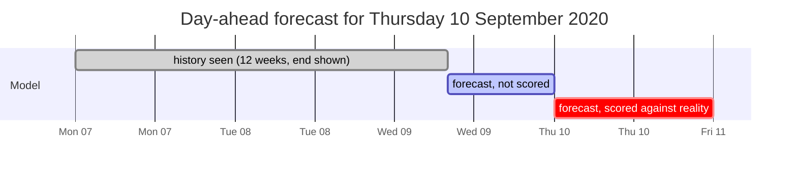
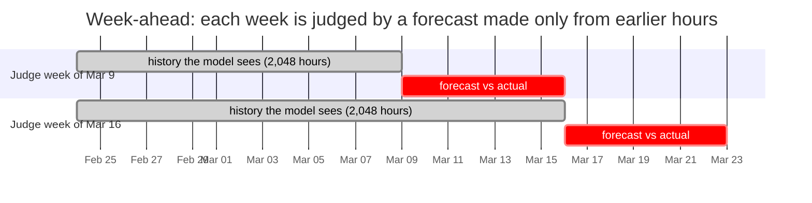

# zero-shot-forecasting

## Goal

Explore what **time series foundation models (TSFMs)** can do on real data.

A TSFM is pretrained once, on a large and varied collection of time series. It then
forecasts series it has never seen *zero-shot*: you give it the history and it
forecasts right away, with no training, fitting or tuning on your data. That is a
big change from classic forecasting, where you build and fit a model for each
dataset.

This project puts that promise to the test with
[Timestral](https://mistral.ai/news/timestral/), Mistral's TSFM, on hourly electricity
demand in five European countries, 2015-2020, including the COVID-19 lockdowns. It
covers three common tasks:

1. **Forecast** demand for the next 30 days, hour by hour.
2. **Backtest**: replay a past month day by day, forecasting each day from the
   morning before, and score those forecasts against what actually happened, and
   against the forecasts the grid operators themselves published.
3. **Detect anomalies**: find past days that the model would not have expected, such
   as the start of the lockdowns.

Nothing is trained or fine-tuned anywhere in this project. The pretrained model gets
the history as context and returns a probabilistic forecast directly.

More documentation in [`docs/`](docs):

- [01-concepts.md](docs/01-concepts.md): the statistical ideas (quantile, covariate,
  multivariate, backtesting...) explained without assuming any statistics background.
- [02-capabilities.md](docs/02-capabilities.md): what Timestral can and can't do, and which
  parts this project uses.
- [03-python-library.md](docs/03-python-library.md): the `timestral` Python API, every
  setting you can change, and their measured effect on speed and accuracy.
- [04-anomaly-detection.md](docs/04-anomaly-detection.md): how forecast-based anomaly
  detection works, how this project implements it, and how to tune it.

## Quick start

```sh
uv sync                                   # installs timestral from GitHub, plus pandas, matplotlib, holidays
uv run main.py forecast                   # ~1 min
uv run main.py backtest                   # ~1 min
uv run main.py anomalies                  # ~2 min
```

The first run downloads two things once: the data (124 MB, into `data/`) and the
Timestral-209M model (837 MB, into the Hugging Face cache). Times are for a laptop
CPU. Every command prints a summary and writes a CSV and a chart to `output/`.

```
uv run main.py [--countries DE,FR,IT,ES,GB] [--model HF_ID] [--no-holidays] forecast  [--days 30]
uv run main.py [...] backtest  [--days 30] [--cutoff YYYY-MM-DD] [--context 2048]
uv run main.py [...] anomalies [--start 2019-09-30] [--end YYYY-MM-DD] [--horizon 168] [--context 2048] [--min-hours 6]
```

`--model mistralai/Timestral-28M` is about 6x faster and only slightly less accurate
(1.86% vs 1.81% average day-ahead error in September 2020). `--no-holidays` drops the
public-holiday covariate: about 4x faster, but less accurate around holidays.

## The data

The data is the **[Open Power System Data](https://data.open-power-system-data.org/time_series/)
(OPSD) time series package**, version 2020-10-06. OPSD collects European power-system
data into clean, documented files. This package comes from the **ENTSO-E
Transparency Platform**, where Europe's grid operators are legally required to
publish their data.

| | |
|---|---|
| File | `time_series_60min_singleindex.csv`, 124 MB |
| Resolution | one row per hour, timestamps in UTC |
| Period | 2015-01-01 to 2020-09-30: 50,400 hours, almost six years |
| Coverage | about 30 European countries: electricity load, the grid operators' load forecasts, solar and wind generation, some prices |

This project uses two columns per country:

- **Actual load** (`<country>_load_actual_entsoe_transparency`): the electricity
  demand on the grid, in megawatts (MW), for each hour. This is what is forecast.
- **Grid operator's forecast** (`<country>_load_forecast_entsoe_transparency`): the
  day-ahead forecast that country's grid operator (TSO) published. Grid operators
  must publish it by two hours before the day-ahead market closes (12:00 CET) on the
  day before. Built with weather forecasts and years of tuning, it is a professional
  baseline to compare Timestral against.

The five countries:

| Country | Average load | Missing hours | First lockdown | Load in April 2020 vs April 2019 |
|---|---|---|---|---|
| Germany (DE) | 55 GW | 0 | 22 March 2020 | -9% |
| France (FR) | 53 GW | 41 | 17 March 2020 | -17% |
| Italy (IT) | 33 GW | 2 | 10 March 2020 | -22% |
| Spain (ES) | 28 GW | 20 | 15 March 2020 | -17% |
| Great Britain (GB) | 35 GW | 6 | 23 March 2020 | -14% |

(1 GW = 1,000 MW. For Great Britain the file has `GB_GBN`, Great Britain without
Northern Ireland. The lockdown dates are when the measures were announced or took
effect, give or take a day; Germany's is the nationwide contact ban.)

Why this dataset suits a TSFM demo:

- **Rich, regular patterns.** Daily, weekly and yearly cycles at once: in Germany in
  2019, Sundays averaged ~46 GW against ~59 GW on weekdays, and January ~62 GW
  against July ~54 GW.
- **Long history.** 50,400 hours, more than Timestral's 32,768-step context, so the
  model can use all it can read.
- **A useful covariate.** Public holidays lower demand and are known years ahead,
  which makes them a natural known-future covariate.
- **A professional baseline**, right in the data: the grid operators' own forecasts.
- **A real, unmistakable anomaly**: the spring 2020 lockdowns.
- **Five countries** to forecast in one batch, at very different scales.

**Licence and attribution.** The data is by Open Power System Data, from ENTSO-E
Transparency. The OPSD files don't state a data licence, so this repo doesn't
redistribute them: `data.py` downloads the file into `data/`, which git ignores.
Check the [OPSD](https://open-power-system-data.org/) and
[ENTSO-E](https://transparency.entsoe.eu/) terms before republishing the data.

## Examples

### 1. Forecast the next month (`main.py forecast`)

The model reads the whole history (the last 32,768 hours it can take, ~3.7 years, up to
30 September 2020 23:00 UTC) and, in **one go**, forecasts every hour of the next 30
days: 720 numbers per country. Nothing new is learned along the way: the forecast for
29 October is made on 30 September, like the one for 1 October.

```
Forecast for 2020-10-01 00:00 .. 2020-10-30 23:00 UTC

    last 30 days GWh (actual)  next 30 days GWh (forecast)  peak MW (actual)  peak MW (forecast)
DE                      37905                        39507             68303               68709
FR                      31821                        34962             57680               59257
IT                      24123                        22248             44649               40129
ES                      19392                        18608             34676               31519
GB                      21172                        23703             41408               44089
```

Germany is forecast to use about **39.5 TWh** (39,507 GWh) in October 2020, 4% more
than in September; France and Britain more (heating season), Italy and Spain slightly
less. GWh add up the hourly mean forecasts; peaks are the highest hourly median.


The forecast continues the daily and weekly rhythm, and its 80% band widens slowly the
further out it goes: the model is less sure about the end of the month than about
tomorrow. Germany's first weekend dips deeper than the others because Saturday
3 October is German Unity Day, which the holiday covariate announced.

### 2. How good is the forecast? (`main.py backtest`)

We can't score the October forecast: the data ends in September. So we go back in time,
forecast a month we *do* know, and compare with what happened. This is a
**backtest**.

The backtest makes **day-ahead** forecasts, the kind the grid operators publish, so
the two can be compared fairly. *Day ahead* means: each day, forecast only the next
day. For example, to forecast **Thursday 10 September 2020**:

1. On **Wednesday 9 September at 08:00 UTC**, give the model the 2,048 hours (~12
   weeks) of load up to that moment. Nothing later.
2. The model forecasts the hours from there to the end of Thursday. The 16 hours left
   of Wednesday are thrown away; **Thursday's 24 hours** are kept.
3. Compare those 24 hours with Thursday's actual load, and with the forecast the grid
   operator published on Wednesday morning.



Why 08:00 UTC? It is when the grid operators' forecasts must be ready (10:00 CET, two
hours before the day-ahead electricity market closes). Forecasting from then means
Timestral never knows more than the operators did.

The same is done for each of the 30 days of September 2020: 30 separate forecasts per
country, each made the morning before, each from the 12 weeks before it. (Pick another
month with `--cutoff`, the day before the first day to forecast.)

The score is the **mean absolute percentage error** (MAPE): how many % off the forecast
was, on average over all 720 hours. Lower is better.

```
Day-ahead forecasts for 2020-09-01 .. 2020-09-30 (UTC), each made at 08:00 UTC the day before from the 2048 hours up to then

Mean absolute percentage error (MAPE), lower is better:

    timestral  grid operator  last week timestral in 80% interval
DE       1.50           2.03       2.26                       87%
FR       1.80           1.65       2.94                       79%
IT       2.21           1.89       5.14                       89%
ES       1.91           0.92       4.18                       86%
GB       4.76           6.50       6.72                       80%
```

How to read it:

- **Against "last week"** (repeat the same hour one week earlier), Timestral wins in
  every country.
- **Against the grid operators**, Timestral wins in **Germany and Great Britain** and
  loses in **France, Italy and Spain**. The operators feed weather forecasts into their
  models; Timestral sees only past load and holidays. Spain's operator is remarkably
  accurate (0.92%).
- **In 80% interval**: the share of hours that fell inside Timestral's 10%-90% band.
  If the band means what it says, that is about 80%, and it is: 79-89%.


### 3. Anomalies in the past (`main.py anomalies`)

The idea: **an anomaly is a period the model was confident would not happen.**

The anomaly detector replays the past one week at a time, with **week-ahead**
forecasts: like the day-ahead backtest, but each forecast covers the next 7 days.
To judge the week starting **Monday 9 March 2020**, the model gets the 2,048 hours up
to Sunday midnight and forecasts the whole week. Then it does the same for the week of
16 March, and so on, from 30 September 2019 to 27 September 2020.



An hour is "outside" when actual load falls outside the forecast's **1%-99%
interval**; a day is **anomalous** when at least 6 of its 24 hours are outside
(`--min-hours`). Consecutive anomalous days of the same country form one **episode**.

Why a week and not a day? The lockdowns cut demand gradually, over a week or two. A
forecast made the day before has already seen yesterday's lower demand, so each day
looks only slightly off. A forecast made at the start of the week hasn't, so the whole
drop shows. (`--horizon 24` switches to day-ahead, which suits sharp one-day events
instead.)

```
Calibration up to 2020-02-29: 0.6% of hours above the 99% line, 1.2% below the 1% line (expected: about 1% each).

country  kind      first       last  days  avg deviation %
     FR spike 2019-11-07 2019-11-10     4             16.8
     FR spike 2020-05-11 2020-05-14     4             10.8
     IT  drop 2019-12-18 2019-12-21     4             -8.3
     IT spike 2020-06-25 2020-06-28     4             10.0
     IT  drop 2020-08-03 2020-08-06     4            -13.4
     IT  drop 2020-03-13 2020-03-15     3            -11.3
     DE  drop 2019-12-23 2019-12-24     2            -17.6
     ES  drop 2019-12-24 2019-12-25     2            -15.3
...
     ES  drop 2020-03-19 2020-03-19     1            -11.4
     FR  drop 2020-03-19 2020-03-19     1            -19.9
     GB  drop 2020-03-26 2020-03-26     1            -13.4
...
```

- **Calibration first**: before the pandemic, about 1% of hours fell above the 99% line
  and about 1% below the 1% line, as they should. The band can be trusted, so what
  falls outside it is worth a look.
- **The lockdowns**: the first lockdown week is flagged in Italy (13-15 March, -11%),
  France (19 March, -20%), Spain (19 March, -11%) and Great Britain (26 March, -13%).
  Germany's drop (~9%) was too small and gradual to stand out.
- **France's reopening** on 11 May 2020 shows as a spike: demand came back faster than
  a forecast made from lockdown weeks expected.
- **What the holiday calendar doesn't know**: Christmas week, August shutdowns in
  Italy and Spain, regional holidays in Germany.


Each panel shows a country's daily energy: blue is actual, orange is what the
week-ahead forecast expected, red dots are anomalous days, and the dashed line marks
the start of the lockdown. The orange line follows the lockdown drop one week late,
exactly how a forecaster running every week behaves.

More on how it works, the day-ahead variant, and the pitfalls (clock changes, the
holiday calendar, an exploding 99% line on Christmas Day) in
[04-anomaly-detection.md](docs/04-anomaly-detection.md).

## Limitations

- **No weather.** Electricity demand depends on temperature, and the grid operators
  use weather forecasts. OPSD has no weather data; a temperature forecast as a
  known-future covariate is the obvious next step.
- **UTC hours.** The model sees UTC, so on the two daylight-saving switches each year
  the daily pattern shifts by an hour, and those days can look odd.
- **National holidays only.** Regional holidays (German states, Spanish regions) and
  "bridge" days around holidays (such as 23-24 December) aren't in the calendar.
- **Data ends in September 2020.** The 30-day forecast is for October 2020, a month
  that can be checked against ENTSO-E's later data, but not with this file.
- **Speed.** The day-ahead anomaly replay (~1,800 forecasts with the holiday
  covariate) takes ~11 minutes on a laptop CPU. `--model mistralai/Timestral-28M` or
  `--no-holidays` cut that sharply; see the
  [performance tips](docs/03-python-library.md#performance-tips).
