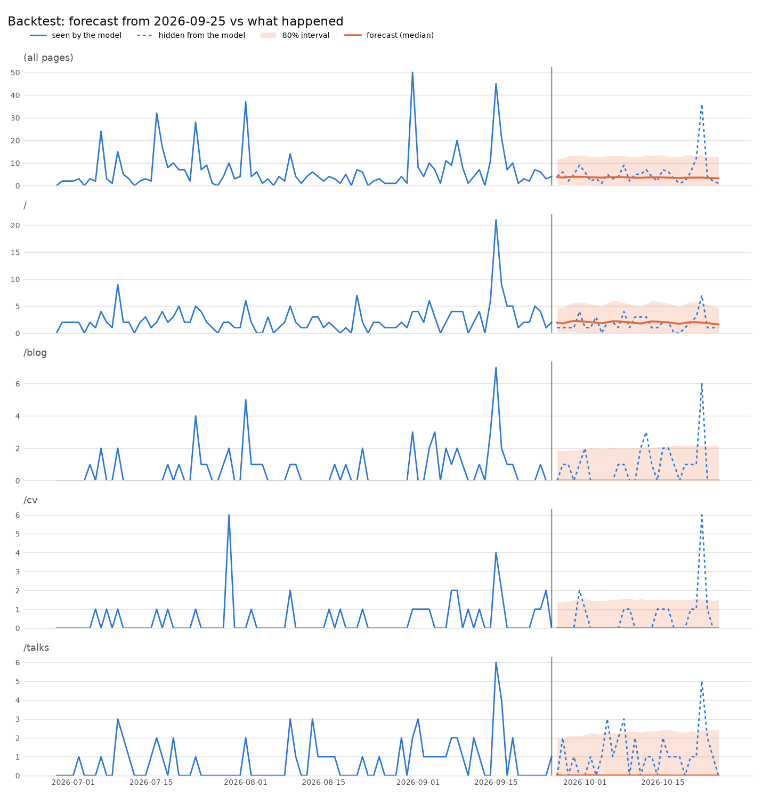
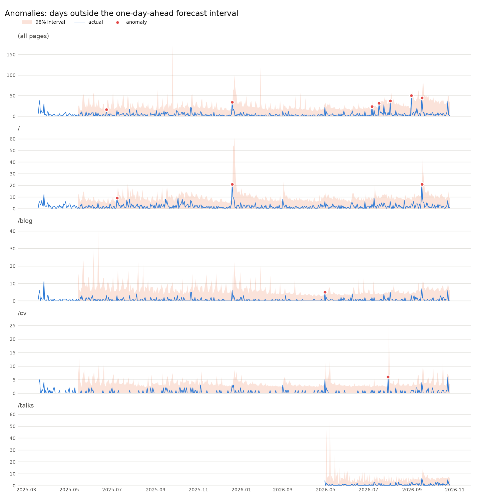

# zero-shot-forecasting

## Goal

Explore what **time series foundation models (TSFMs)** can do on real data.

A TSFM is pretrained once, on a large and varied collection of time series. It then
forecasts series it has never seen *zero-shot*: you give it the history and it
forecasts right away, with no training, fitting or tuning on your data. That is a
big change from classic forecasting, where you build and fit a model for each
dataset.

This project puts that promise to the test with
[Timestral](https://mistral.ai/news/timestral/), Mistral's TSFM, on a small and noisy
real dataset: daily page visits to [my website](https://mourjo.me). It covers three common tasks:

1. **Forecast** the visits for the next 30 days.
2. **Backtest**: hide the last month, forecast it from the data before it, and score
   the forecast against what actually happened.
3. **Detect anomalies**: find past days that the model would not have expected.

Nothing is trained or fine-tuned anywhere in this project. The pretrained model gets
the history as context and returns a probabilistic forecast directly.

More documentation in [`docs/`](docs):

- [01-concepts.md](docs/01-concepts.md): the statistical ideas (quantile, covariate,
  multivariate, backtesting...) explained without assuming any statistics background.
- [02-capabilities.md](docs/02-capabilities.md): what Timestral can and can't do, and which
  parts this project uses.
- [03-python-library.md](docs/03-python-library.md): the `timestral` Python API, every
  setting you can change, and their measured effect on speed and accuracy.
- [04-anomaly-detection.md](docs/04-anomaly-detection.md): how forecast-based anomaly
  detection works, how this project implements it, and how to tune it.

## Quick start

```sh
uv sync                        # installs timestral from GitHub, plus pandas and matplotlib
uv run main.py forecast        # the first run downloads the 209M model (837 MB) from Hugging Face once
uv run main.py backtest
uv run main.py anomalies       # ~5 min on a laptop CPU with the 209M model
```

Every command prints a summary and writes a CSV and a chart to `output/`. To swap the
model, use `--model`; for example, `--model mistralai/Timestral-28M` is about 5x faster
(4 sizes exist: 5M, 28M, 123M, 209M).

```
uv run main.py --help
uv run main.py [--csv FILE] [--pages N] [--model HF_ID] forecast  [--horizon 30]
uv run main.py [--csv FILE] [--pages N] [--model HF_ID] backtest  [--horizon 30] [--cutoff YYYY-MM-DD]
uv run main.py [--csv FILE] [--pages N] [--model HF_ID] anomalies [--min-context 56] [--min-excess 2]
```

## The data

`daily_pages.csv` is exported from the analytics of [my site](https://mourjo.me) with `daily_pages.sql`: one row per
`(day, path)` with the number of visitors, from 2025-03-18 to 2026-10-25.

It is small and noisy, which makes it a realistic test: the whole site gets about
5 visits a day, a single page often gets 0, and an occasional post shared somewhere
gives a spike of 30-50.

## How the code is laid out

| File | What it does |
|---|---|
| `data.py` | Turns the CSV into one column per series, one row per calendar day |
| `forecasting.py` | The Timestral wrapper: pandas in, pandas out |
| `plots.py` | Matplotlib charts, one small panel per series |
| `main.py` | The three commands: `forecast`, `backtest`, `anomalies` |

### Step 1: from rows to time series (`data.py`)

Timestral needs evenly spaced series, but the export only has rows for days that had
visits. `load_daily_visits` pivots it into a frame with:

- a row for **every** calendar day, where a missing row means 0 visits;
- a column `(all pages)` for the site-wide total, plus the `--pages` (default 4) most
  visited paths: `/`, `/blog`, `/cv`, `/talks`.

Days before a page's first visit are `NaN`, not 0. `/talks` only appeared in April
2026, and its earlier months are "page did not exist" rather than "nobody came".
Timestral treats `NaN` as missing, so those days don't drag its forecast down.

### Step 2: calling Timestral (`forecasting.py`)

The whole Timestral API used here is two calls:

```python
from timestral import TimestralForecaster

forecaster = TimestralForecaster.from_pretrained("mistralai/Timestral-209M")
result = forecaster.forecast(
    context,                    # (series, days) array, NaN = missing
    prediction_length=30,
    categorical_known_covariates=weekday,  # (series, 1, days + 30), day of week 0..6
)
result.quantiles                # (series, 1, 30, 21): 21 quantiles per forecast day
result.quantile(0.9)            # (series, 1, 30)
```

A few things worth knowing:

- **All series go in one batch.** Each column becomes one row of `context`, and
  Timestral forecasts every row independently in one call.
- **The output is a distribution, not one number.** For every future day you get
  21 quantiles (1%, 5%, 10%, ..., 95%, 99%). The demo keeps a lower and an upper
  quantile as an interval, plus the median and the mean.
- **Median vs mean.** The median is the best single guess for one day, but on a
  page that gets 0 visits on most days the median *is* 0. Adding up 30 zeros gives
  a monthly total of 0, which is wrong. So totals add up the **mean**, which
  `_mean()` computes as the area under the 21-point quantile curve.
- **Covariates.** The day of the week is passed as a *known-future categorical
  covariate*: it is known for the forecast days too, so the model can use it.
  Timestral target-encodes the categories by itself. Honest note: on this data it
  made no measurable difference (I backtested 4 different months with and without
  it), because there is little weekly rhythm in a handful of visits a day. It is
  kept as an example of how to pass covariates.

### Requirement 1: forecast the next month (`main.py forecast`)

`forecast()` gives the full history as context and asks for 30 days.

```
Forecast for 2026-10-26 .. 2026-11-24

             last 30 days (actual)  next 30 days (forecast)  10% quantile  90% quantile
(all pages)                    164                      162            13           328
/                               54                       61             0           135
/blog                           27                       25             0            68
/cv                             17                       18             0            50
/talks                          33                       36             0            92
```

So about **160 visits** across the site next month, similar to the month just gone.
The quantile columns add up the daily 10% and 90% quantiles. That gives a rough
range, not an exact interval for the total, because quantiles don't add up exactly.


The forecast is flat with a wide band. That is the right answer for this data: the
spikes are real but unpredictable (they come from a post being shared), so the model
puts them in the upper tail instead of guessing a date for them.

### Requirement 2: how good is the forecast? (`main.py backtest`)

To test a forecast honestly, give the model only the history up to a cutoff, forecast
the days after it, and compare with what really happened. By default the cutoff is
30 days before the end of the data; pick another one with `--cutoff 2026-06-25`.

```
Model saw data up to 2026-09-25; forecast 2026-09-26 .. 2026-10-25

             actual total  forecast total  MAE/day timestral  MAE/day last-week  in 80% interval
(all pages)         164.0          179.03               3.10               3.60              97%
/                    54.0           76.03               1.12               1.63              90%
/blog                27.0           20.81               0.90               0.83              90%
/cv                  17.0           14.21               0.57               0.50              93%
/talks               33.0           24.52               1.10               1.03              87%
```

How to read it:

- **actual vs forecast total**: the monthly total was 164 and the forecast said 179,
  about 9% too high.
- **MAE/day**: the mean absolute error of the daily median forecast, in visits.
  It is compared with a naive baseline, **last-week**, which repeats the last 7 days
  the model saw. A forecast is only worth something if it beats such a simple rule.
  Timestral wins clearly on the busier series (all pages, `/`) and roughly ties on
  the sparse pages, where almost any forecast near 0 is about as good as the others.
- **in 80% interval**: the share of real days that fell inside the 10%-90% band. If
  the band is calibrated, this is about 80%. Here it is a bit higher (87-97%), so the
  bands are slightly wide. That is cautious, but it means the bands can be trusted.



Solid line: what the model saw. Dotted line: the month it had to forecast. The
2026-10-21 spike (35 visits) lands above the band, which is expected: nothing before
the cutoff hinted at it.

### Requirement 3: anomalies in the past (`main.py anomalies`)

The idea: **an anomaly is a day the model was confident would not happen.**

`one_step_ahead()` replays history day by day. For every day, it forecasts that day
using **only the days before it**, like a forecaster running every night would have.
That day is an anomaly if the real count falls outside the 1%-99% interval. The
model never sees the day it judges, so a spike can't hide itself by raising its own
forecast.

Doing this one day at a time would take ~540 calls per series. Instead, each
`(day, series)` pair becomes one row of a single batch. The rows have different
history lengths, so the shorter ones are left-padded with `NaN`, which Timestral
treats as missing. That makes about 2,700 rows of up to 586 days each, sent in
batches of 256.

Two filters keep the list useful on low-traffic data:

- `--min-excess 2`: a day must fall outside the interval by at least 2 visits. On a
  page whose 99% quantile is 0.4, a single visit is "outside the interval" but not
  interesting.
- `--min-context 56`: each series needs 8 weeks of its own history before it is
  judged. Without this, the day `/talks` went live would count as an anomaly.

```
12 anomalies, largest first:

       day      series  visitors  low  median  high  kind  excess
2026-08-31 (all pages)      50.0  0.0    1.98 19.35 spike   30.65
2025-12-19 (all pages)      34.0  0.0    1.44 15.38 spike   18.62
2025-12-19           /      21.0  0.0    1.18  6.89 spike   14.11
2026-07-16 (all pages)      32.0  0.0    2.45 21.75 spike   10.25
2026-08-01 (all pages)      37.0  0.0    3.32 27.93 spike    9.07
2026-09-15           /      21.0  0.0    2.45 12.41 spike    8.59
...
```



The orange band is the 98% interval the model expected for each day, and the red
dots are the days outside it. Looking up what actually happened on those days:

- **2026-08-31**: 50 visits spread over **44 different pages**, about 1 each. No
  single page looks unusual, so it only shows up in `(all pages)`. That pattern looks
  like a crawler, not readers.
- **2026-07-16**: 27 of the 32 visits went to one old post, *overcoming barriers to
  entry: writing with Obsidian*. It was probably shared somewhere that day.
- **2025-12-19** and **2026-09-15**: the home page `/` jumped to 21 visits, along with
  `/blog`, `/talks` and `/cv`. Someone (or something) went looking at the site itself.
- **2026-08-01**: the day *Bengal said no to computers, I won't say no to AI* was
  published.

The band also teaches something: right after a spike, it widens for a few days
(for example, after December 2025). The model has seen that spikes come with
after-shocks, so it expects more of them.

No drops (days far *below* the interval) were found. With so few visits, the 1%
quantile is almost always 0, and a day can't go below 0.

## Limitations

- **Sparse counts.** With 0-5 visits a day per page, the real signal is mostly the
  site-wide total. Forecasting weekly totals would be smoother, but the point here
  was to use the daily data as it is.
- **Sum of quantiles is not the quantile of the sum.** The total range in the
  `forecast` output is a rough guide. For an exact interval on the monthly total,
  forecast the cumulative series, or sample paths.
- **Mean from quantiles.** `_mean()` treats the quantile curve as linear between
  levels and flat in the outer 1% tails, so the mean of a heavy-tailed day comes out
  a little low.
- **Speed.** The anomaly replay is the slow part (~5 min with the 209M model on a
  laptop CPU). `--model mistralai/Timestral-28M` takes about 1 min.
