# Timestral, explained without statistics

This note explains the ideas behind Timestral, and behind this project, for someone
who has never studied statistics. It starts with what Timestral can do, then explains
each term as it comes up. The examples use this repo's data: hourly electricity demand
in five European countries, 2015-2020 (see the [README](../README.md#the-data)).

Related: [02-capabilities.md](02-capabilities.md) for a tour of what Timestral can do, and
[03-python-library.md](03-python-library.md) for the Python API and its settings.

- [What Timestral is](#what-timestral-is)
- [Time series](#time-series)
- [Forecasting](#forecasting)
- [Foundation model and zero-shot](#foundation-model-and-zero-shot)
- [Context and horizon](#context-and-horizon)
- [Probabilistic forecasts: quantiles and intervals](#probabilistic-forecasts-quantiles-and-intervals)
- [Median and mean](#median-and-mean)
- [Univariate and multivariate](#univariate-and-multivariate)
- [Covariates](#covariates)
- [Missing values](#missing-values)
- [Other details Timestral handles for you](#other-details-timestral-handles-for-you)
- [Checking a forecast: backtesting](#checking-a-forecast-backtesting)
- [Measuring error, and baselines](#measuring-error-and-baselines)
- [Calibration: can the ranges be trusted?](#calibration-can-the-ranges-be-trusted)
- [Anomaly detection with a forecaster](#anomaly-detection-with-a-forecaster)
- [What Timestral cannot do](#what-timestral-cannot-do)
- [Glossary](#glossary)

## What Timestral is

Timestral is a family of models from Mistral that **predict how a sequence of numbers
will continue**. You give it the past, for example how much electricity a country used
every hour, and it tells you what the next hours or days will probably look like. It
also says how sure it is.

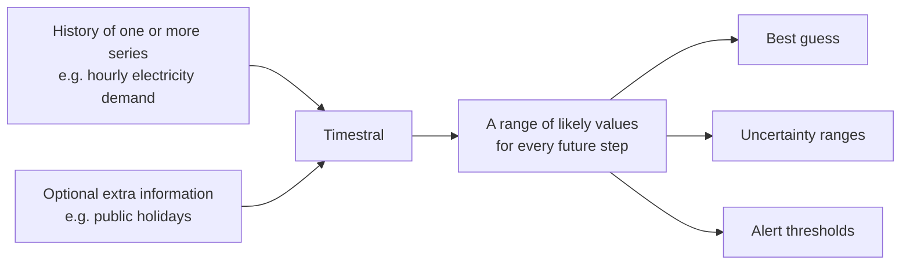

In one sentence, from its announcement: Timestral is a *time-series foundation model
for multivariate probabilistic forecasting, with past-only and known-future covariates*.
That sentence is full of jargon. The rest of this note explains each piece:

| Term in the sentence | In plain words | Section |
|---|---|---|
| time series | numbers recorded over time, at a regular pace | [Time series](#time-series) |
| forecasting | guessing the future values | [Forecasting](#forecasting) |
| foundation model | trained once on lots of data, then used as is on yours | [Foundation model](#foundation-model-and-zero-shot) |
| probabilistic | returns a range of likely values, not one number | [Quantiles](#probabilistic-forecasts-quantiles-and-intervals) |
| multivariate | can predict several related measurements together | [Multivariate](#univariate-and-multivariate) |
| covariates | extra information that helps, but isn't itself predicted | [Covariates](#covariates) |

The models come in four sizes: 5M, 28M, 123M and 209M *parameters*. Parameters are
the numbers the model learned during training; more parameters usually means more
accurate but slower. Even the largest runs on an ordinary laptop CPU.

## Time series

A **time series** is a list of measurements taken at regular intervals, in order. Here
is Germany's electricity demand on a Tuesday morning, in megawatts (MW):

```
hour (UTC)          load (MW)
2020-09-29 04:00       56,641
2020-09-29 05:00       61,230
2020-09-29 06:00       63,396
2020-09-29 07:00       64,699
2020-09-29 08:00       66,008
```

Other examples: daily website visits, a machine's temperature every minute, weekly
sales. Two things make it a time series and not just a list of numbers:

- **Order matters.** The last hour tells you something about the next. Shuffle the
  rows and the information is gone.
- **The spacing is regular.** One value per hour (or day, or minute). Each slot is
  called a **time step**. If the raw data skips slots, they have to be filled in, or
  marked as missing (see [missing values](#missing-values)).

Time series often contain recognisable patterns. Electricity demand has nearly all of
them:

- **Seasonality**: patterns that repeat on a fixed cycle. Demand has three at once: a
  **daily** cycle (low at night, high during the day), a **weekly** one (in Germany in
  2019, Sundays averaged ~46 GW against ~59 GW on weekdays) and a **yearly** one
  (January ~62 GW, July ~54 GW, because of heating and lighting).
- **Trend**: a slow rise or fall over months or years.
- **Noise**: random ups and downs that no pattern explains.
- **Events**: holidays, heatwaves, strikes, and in 2020 the COVID-19 lockdowns, which
  pushed demand far below normal for weeks.

## Forecasting

**Forecasting** means estimating future values of a time series from its past values.
A weather forecast is the familiar example: it can't know tomorrow, but it can say
what is likely, based on what usually follows conditions like today's.

A forecast can never be perfect, because the future contains things the past didn't
hint at. A good forecast captures what *is* predictable (the usual level, the daily
and weekly rhythm, the season) and is honest about what isn't (see
[probabilistic forecasts](#probabilistic-forecasts-quantiles-and-intervals)).

Grid operators forecast electricity demand every day, because supply has to match it
second by second. That makes it a good test: there are professional forecasts to
compare with.

## Foundation model and zero-shot

Traditionally, you built a forecasting model for each dataset: pick a method, fit
it to your history, tune it, repeat for every new dataset.

A **foundation model** works differently. Mistral trained Timestral once, on a huge
and varied collection of time series from many domains. From that, it learned general
patterns that occur in time series everywhere: trends, weekly and daily cycles, sudden
jumps that fade, slow drifts.

**Zero-shot** means using the model on your data *without any extra training*. You
hand it your history and it forecasts right away. This project is entirely zero-shot:
nothing is trained, and the code is two calls, load and forecast.

The analogy: a traditional model is a tailor who measures you and sews a suit from
scratch. A foundation model is an experienced tailor who has seen millions of bodies
and can tell, at a glance, what fits you.

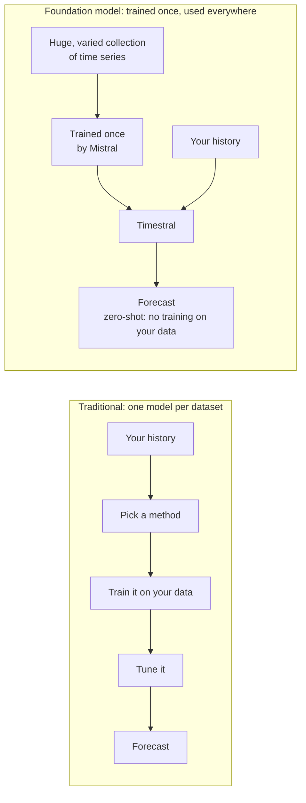

Mistral also offers fine-tuning (further training on your own data) through Mistral
Forge, for cases where zero-shot isn't good enough. This project doesn't need it.

## Context and horizon

Two numbers describe every forecast:

- **Context**: how much past you show the model. Timestral can read up to **32,768
  time steps**; at one step per hour, that is about 3.7 years. If you give it more, it
  keeps the most recent part. This project's data has ~50,000 hours, so the monthly
  forecast reads the last 32,768.
- **Horizon** (or *prediction length*): how far into the future you ask it to look.
  This project asks for 30 days, which is 720 hours.

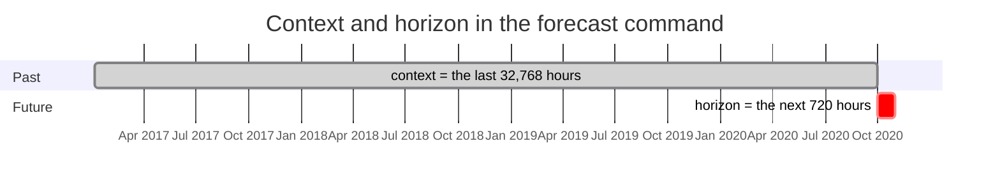

The further out the horizon, the less certain the forecast. Timestral predicts up to
1,024 steps in one go, so 720 hours fit in one pass. For longer horizons it predicts a
block, adds its own predictions to the context, and predicts the next block from there.

## Probabilistic forecasts: quantiles and intervals

Most simple forecasts give one number: "tomorrow at 9 am, Germany will need 65 GW".
That hides something important: is it "65, give or take 1", or "65, but it could
easily be 50"?

Timestral is **probabilistic**: for every future time step it describes the whole
range of plausible values. It does this with **quantiles**.

### Quantiles

A **quantile** is a value with a stated chance of not being exceeded. Suppose for
tomorrow 9 am Timestral says the 90% quantile is 66,611 MW. That means: in 9 out of 10
situations like this one, demand stays **at or below 66,611 MW**, and in 1 in 10 it
goes higher.

Timestral returns **21 quantiles** for every forecast step, at these levels:

```
1%  5%  10%  15%  20%  25%  30%  35%  40%  45%  50%  55%  60%  65%  70%  75%  80%  85%  90%  95%  99%
```

Together they sketch the full shape of what might happen. This is a real forecast from
this project: Germany at 07:00 UTC on 2020-09-29, made from the history up to the
midnight before.

```
level        1%      10%      25%      50%      75%      90%      99%
MW       62,602   63,935   64,565   65,211   65,919   66,611   68,201
```

Read it as: "almost surely at least 62.6 GW, most likely about 65.2 GW, rarely above
68.2 GW". The actual value turned out to be 64,699 MW, comfortably inside the range.

The 50% quantile has its own name: the **median**. It is the middle value, with even
odds of the real value being above or below it.

### Intervals

Two quantiles together make an **interval** (or *prediction interval*): a range the
real value should fall in with a stated probability.

- 10% to 90% quantile = an **80% interval**: the real value should land inside it about
  8 times out of 10. The `forecast` and `backtest` charts shade this band.
- 1% to 99% quantile = a **98% interval**: the real value should fall outside it only
  about 2 times in 100. The `anomalies` command uses this one.

A **wider** interval means the model is less sure. Bands are narrow a day ahead and
widen further out, and they widen around holidays, where demand is harder to predict.

## Median and mean

Both describe a "typical" value, in different ways:

- The **median** is the middle value: half the outcomes are below it, half above.
- The **mean** (the average) is the total divided by the count.

They differ when values are lopsided. Take a shop whose sales over 10 days were:

```
0  0  0  0  0  0  0  1  2  7
```

The median is **0** (the middle of the sorted list). The mean is (1 + 2 + 7) / 10 =
**1**. Both are correct; they answer different questions:

- "What should I guess for any single day?" → the median, 0. It is the guess that is
  closest to right on most days.
- "How many sales over 10 days in total?" → mean × 10 = 10. The median would say
  0 × 10 = 0, which is obviously wrong.

Electricity demand is not lopsided like that: for Germany in 2019, the median hour was
55.5 GW and the mean 56.0 GW. Still, the rule holds: this project uses the median as
the best guess for each hour, and adds up means for totals, such as the energy (GWh)
used in the next 30 days. Timestral doesn't return the mean directly; `forecasting.py`
estimates it from the 21 quantiles.

## Univariate and multivariate

These words say **how many measurements one series has at each time step**.

- **Univariate** ("one variable"): one number per time step. Germany's hourly demand
  is univariate.
- **Multivariate** ("many variables"): several numbers per time step that belong
  together. Germany's demand, solar generation and wind generation every hour would be
  multivariate. Each of those measurements is called a **variate**.

Timestral can forecast multivariate series **jointly**: it looks at all the variates
of a series together, so a relationship between them can inform the forecast.

This is different from forecasting **many independent series at once**, which
Timestral also does. Its input has the shape `(series, variates, time)`:

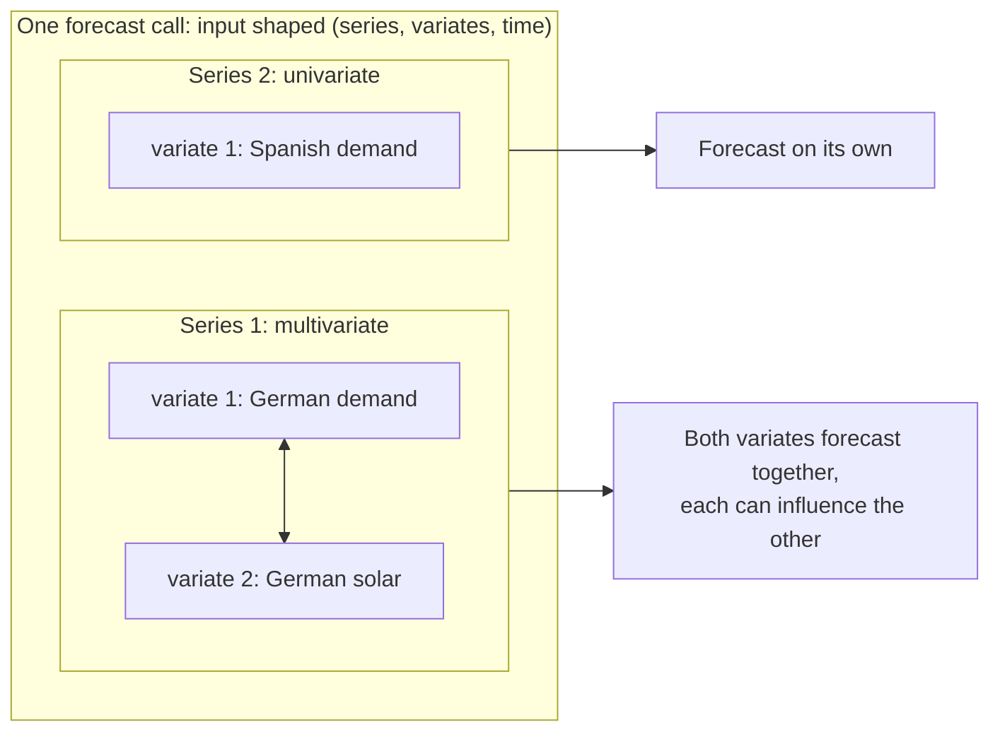

This project sends each country as **its own univariate series**, all five in one
batch. Each country is forecast independently; batching just makes it faster.
[02-capabilities.md](02-capabilities.md#5-multivariate-forecasting) describes what
happened when the countries were forecast jointly instead.

## Covariates

A **covariate** is extra information that may help predict the series, but which you
don't need predicted. The series you *do* want predicted is called the **target**.

For electricity demand, possible covariates include:

- public holidays (offices and factories close, demand drops),
- temperature and its forecast (heating in winter, air conditioning in summer),
- hours of daylight,
- planned events, such as a big factory's maintenance shutdown.

Timestral sorts covariates by **when they are known**:

| Kind | Known for... | Example | Timestral argument |
|---|---|---|---|
| **Past-only** | the past only | measured wind generation (you can't know next week's) | `past_covariates` |
| **Known-future** | the past *and* the forecast horizon | public holidays, a weather forecast, a planned shutdown | `known_covariates` |

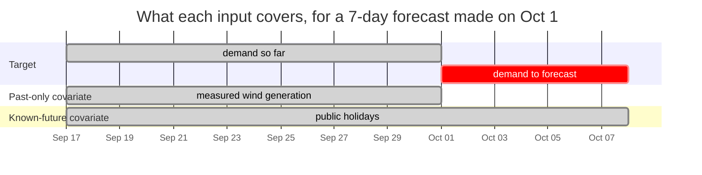

Known-future covariates are especially useful: if you tell the model "Friday is a
public holiday", it can lower its forecast for Friday. A past-only covariate can only
help the model understand the history better.

Covariates also come in two kinds of **values**:

- **Numeric**: a real quantity, such as temperature, price or ad spend.
- **Categorical**: a label from a fixed set, such as day of week (Mon...Sun), machine
  state (on / off / maintenance) or country. You pass categories as number codes
  (Monday = 0, ..., Sunday = 6). Since "Sunday = 6" isn't really six times "Tuesday = 1",
  Timestral converts each category to a number that means something. For one target,
  it uses that category's average target value in the history, so "Sunday" becomes
  "the average demand on Sundays". This is called **target encoding**, and Timestral
  does it for you.

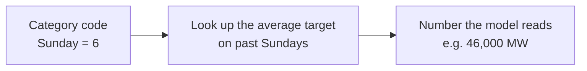

A covariate that is only 0 or 1 ("is today a public holiday?") is an **indicator**.
Timestral recognises these automatically.

Covariates *condition* the forecast; they are not forecast themselves. The model reads
them as hints and only outputs a forecast for the target.

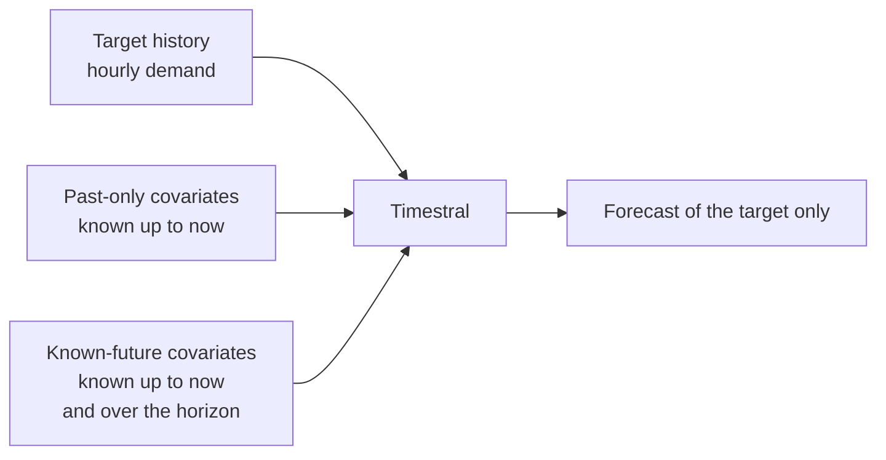

This project passes each country's **public holidays** as a known-future indicator. It
makes no difference in an ordinary month, and a big one around holidays: over
Christmas 2019, the average day-ahead error fell from 4.25% to 3.30% (Italy: 6.41% to
3.82%).

## Missing values

Real data has gaps: a meter fails, a report doesn't arrive, a feed is late. Timestral
accepts **NaN** ("not a number") to mean *missing*, and simply works around those
slots.

Missing is not the same as zero. A missing hour of French demand doesn't mean France
used no electricity; filling it with 0 would teach the model a blackout that never
happened. This project's data has a handful of missing hours (41 in France over almost
six years), left as NaN.

## Other details Timestral handles for you

You don't need these to use Timestral, but they explain some of its behaviour:

- **Non-negative values.** If every value in the context is 0 or more (demand, sales,
  counts), Timestral never predicts a negative value.
- **Scale doesn't matter.** Timestral rescales each series internally, so Germany
  (~55 GW on average) and Spain (~28 GW) can share a batch, and 5 visits a day would
  work too.
- **Patches.** Internally, Timestral reads the series in short chunks of consecutive
  steps, called *patches*, much like a language model reads words instead of letters.
- **How it was trained.** It was trained to make its quantiles right: a 90% quantile
  should be exceeded about 10% of the time, no more, no less. The scoring rule for
  that is called the *pinball loss*. Its 21 quantiles also never cross, so the 90%
  value is always at least the 80% value.

## Checking a forecast: backtesting

You can't know if a forecast for next month is good until next month is over. But you
*can* test the method on the past: **backtesting**.

1. Pick a **cutoff** date in the past, for example 2020-08-31.
2. Give the model only the data up to the cutoff.
3. Ask it to forecast the 30 days after the cutoff.
4. Compare its forecast with what really happened in those 30 days.

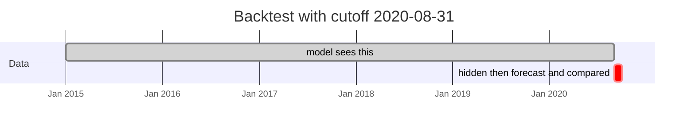

The key rule: **the model must not see the period it is judged on.** If it did, it
would be like grading a student on an exam they've already seen the answers to. Using
information you wouldn't have had at the time is called **look-ahead** (or *leakage*),
and it makes results look far better than they really are.

A single backtest is one sample: one month might be easy, the next one hard. Testing
several cutoffs (`--cutoff`) gives a fairer picture, and a cutoff just before an
upheaval shows how a forecast copes with it:

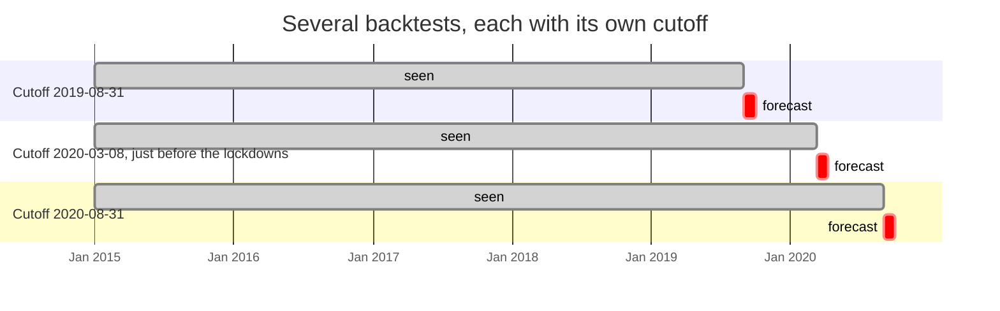

## Measuring error, and baselines

### MAPE

This project scores forecasts with the **mean absolute percentage error (MAPE)**: how
far off the forecast was, as a percentage of the real value, averaged over every hour.
Whether the forecast was too high or too low doesn't matter. With round numbers:

```
hour     forecast (MW)   actual (MW)   miss (MW)   miss as % of actual
07:00           64,000        64,000           0                    0%
08:00           66,000        65,000       1,000                  1.5%
09:00           63,000        60,000       3,000                  5.0%
                                                   MAPE = (0 + 1.5 + 5.0) / 3 = 2.2%
```

Percentages make countries of different sizes comparable: 1,000 MW off is a small miss
in Germany and a large one in Spain. Lower is better. (The related **mean absolute
error**, MAE, is the same average without dividing by the actual value, so it stays in
MW.)

### Baselines

An error number means little on its own. Is 2% good? It depends on how hard the data
is. So you compare with a **baseline**: a simpler forecast that any serious method
should beat. This project uses two:

- **Last week**: "each hour will be the same as the same hour one week earlier".
  (Repeating the last full cycle like this is called a *seasonal naive* forecast.)
- **The grid operator**: the day-ahead forecast each country's grid operator
  published, which comes with the data. This is a professional forecast, built with
  weather forecasts and years of tuning: a high bar.

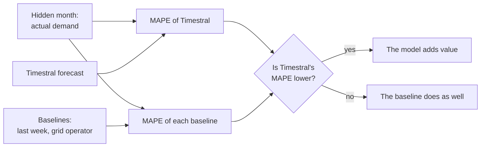

In the September 2020 backtest, Timestral beat "last week" in every country, and beat
the grid operators' own day-ahead forecasts in Germany and Great Britain. The operators
won in France, Italy and Spain.

## Calibration: can the ranges be trusted?

A probabilistic forecast makes a promise: "the real value will fall inside my 80%
interval about 80% of the time". **Calibration** checks whether it keeps that promise.

You count how often the real values actually landed inside the interval. This share
is called **coverage**:

- about 80% → **well calibrated**: the ranges mean what they say;
- much less than 80% → **overconfident**: the ranges are too narrow, and you will be
  surprised too often;
- much more than 80% → **underconfident**: the ranges are too wide. It is safe, but
  less informative than it could be.

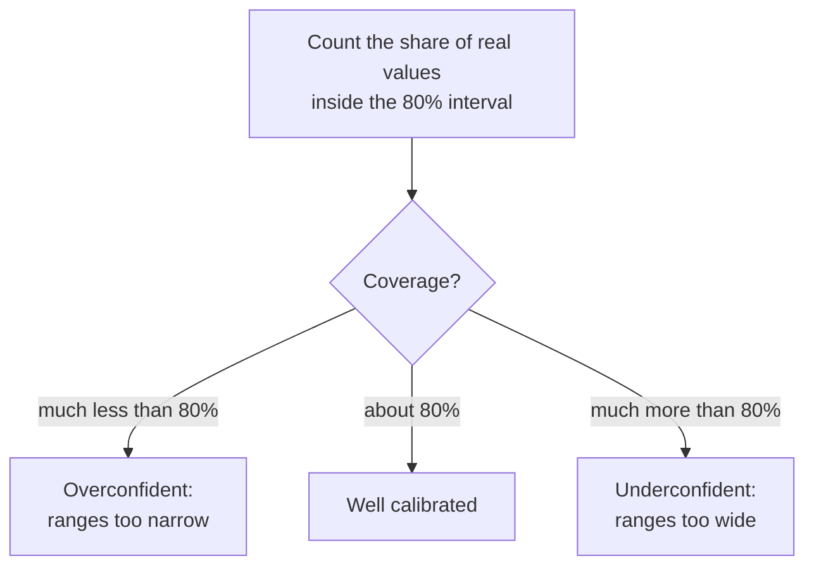

In this project, the day-ahead forecasts' 80% interval covered 79-89% of the hours in
September 2020: close to the promise, and slightly on the wide side, the safer side to
be on.

Calibration matters because the ranges are what you base decisions on: "how much
generation must stand by to be 99% safe?" is a question about a quantile, not about
the median.

## Anomaly detection with a forecaster

An **anomaly** (or *outlier*) is a value that doesn't fit the usual pattern: a sudden
traffic spike, a sensor reading that jumps, a day of demand far below normal.

Timestral has no separate "anomaly detection" feature. It doesn't need one: a
probabilistic forecaster already knows what "normal" looks like. The method:

1. For each past day, forecast it **using only the hours before it**.
2. If the real values fall far outside the forecast interval, flag it.

```
demand
       |  ░░░░░░░░░░░░░░░░░░░░░  ← 98% interval of the day-ahead forecast
       |  ░░░░░░░░░░░░░░░░░░░░░
       |
       |                ● ● ●    ← actual: far below the band for days on end
       |__________________________
                        lockdown starts
```

Step 1 matters for the same reason as in backtesting: if the model saw the unusual day
when forecasting it, the unusual values would pull the forecast towards themselves and
partly hide. Forecasting each period only from what came before is called **rolling**
(or *walk-forward*) forecasting. It reproduces what a forecaster running every night
would have predicted.

Why this beats a fixed threshold like "alert below 40 GW":

- **It adapts.** 40 GW is normal on a Sunday night and alarming on a Tuesday noon.
- **It knows patterns.** Daily, weekly and yearly cycles, and holidays when told about
  them, are all part of "expected".
- **It is tunable by probability.** Using the 98% interval means accepting that about
  2 in 100 normal hours fall outside it anyway; a rule such as "at least 6 hours in a
  day" turns those into far fewer alerts.

An anomaly only says *that* something unusual happened, not *why*. That the spring
2020 anomalies line up with the lockdown dates is something a person has to check.

For the full picture (kinds of anomalies, how this project implements it, tuning,
results, pitfalls), see [04-anomaly-detection.md](04-anomaly-detection.md).

## What Timestral cannot do

- **Predict events it has no hint of.** Nothing in the history of January 2020 said
  Europe would lock down in March. A forecast can show unusual values as *possible* (a
  wide range) but can't say *when*. Telling it about planned events through a
  known-future covariate helps.
- **Know the weather.** Unless you pass temperature or a weather forecast as a
  covariate, a cold snap or heatwave surprises it. This is the main reason grid
  operators, who use weather forecasts, still beat it in some countries.
- **Explain causes.** It finds patterns, not reasons. A forecast that rises in
  December says December has been high before, not why.
- **Work from nothing.** With very little history, or a series that changed
  completely, the past says little about the future, and the forecast reflects that.

## Glossary

| Term | Meaning |
|---|---|
| **Anomaly** / outlier | A value that doesn't fit the usual pattern |
| **Backtest** | Testing a forecast on past data the model wasn't shown |
| **Baseline** | A simpler forecast, used as a bar to beat |
| **Calibration** | Whether a model's probabilities hold true in practice |
| **Categorical** | A value that is a label from a fixed set (Mon, Tue, ...) rather than a quantity |
| **Context** | The past values the model is given |
| **Covariate** | Extra information that helps the forecast but isn't forecast itself |
| **Coverage** | The share of real values that landed inside an interval |
| **Cutoff** | In a backtest, the last day the model may see |
| **Foundation model** | A model trained once on broad data, then used on many tasks |
| **GW / MW** | Gigawatt / megawatt: power, how much electricity is used at one moment (1 GW = 1,000 MW) |
| **GWh / MWh** | Gigawatt-hour / megawatt-hour: energy, power used over time |
| **Grid operator** (TSO) | The company that runs a country's high-voltage grid and balances supply with demand |
| **Horizon** | How many steps ahead to forecast |
| **Indicator** | A covariate that is only 0 or 1 (event / no event) |
| **Interval** | A range between two quantiles, such as 10%-90% (an 80% interval) |
| **Known-future covariate** | A covariate whose future values you already know (holidays, schedules) |
| **Load** | Electricity demand: the power drawn from the grid |
| **Look-ahead** / leakage | Accidentally using information from the period being predicted |
| **MAE** | Mean absolute error: average size of the forecast's misses, in the data's unit |
| **MAPE** | Mean absolute percentage error: average size of the misses, as % of the actual value |
| **Mean** | The average: total divided by count |
| **Median** | The middle value; the 50% quantile |
| **Multivariate** | Several measurements per time step, forecast together |
| **NaN** | "Not a number"; marks a missing value |
| **Parameters** | The numbers a model learned in training; a rough measure of its size |
| **Past-only covariate** | A covariate known only up to the present |
| **Probabilistic forecast** | A forecast that gives a range of likely values with their probabilities |
| **Quantile** | A value with a stated chance of not being exceeded (90% quantile: exceeded 1 time in 10) |
| **Rolling forecast** / walk-forward | Forecasting each period only from the data before it, period after period |
| **Seasonality** | A pattern that repeats on a fixed cycle (daily, weekly, yearly) |
| **Seasonal naive** | A baseline that repeats the last full cycle |
| **Target** | The series you want forecast |
| **Target encoding** | Turning a category into the average target value seen with it |
| **Time series** | Measurements taken at regular intervals, in order |
| **Time step** | One slot in a time series (one hour, one day) |
| **Trend** | A slow, sustained rise or fall |
| **Univariate** | One measurement per time step |
| **Variate** | One of the measurements in a multivariate series |
| **Zero-shot** | Using a model on new data without training it further |
