# Timestral, explained without statistics

This note explains the ideas behind Timestral, and behind this project, for someone
who has never studied statistics. It starts with what Timestral can do, then explains
each term as it comes up. The examples use the website visits data from this repo.

Related: [02-capabilities.md](02-capabilities.md) for a tour of what Timestral can do, and
[03-python-library.md](03-python-library.md) for the Python API and its settings.

- [What Timestral is](#what-timestral-is)
- [Time series](#time-series)
- [Forecasting](#forecasting)
- [Foundation model and zero-shot](#foundation-model-and-zero-shot)
- [Context and horizon](#context-and-horizon)
- [Probabilistic forecasts: quantiles and intervals](#probabilistic-forecasts-quantiles-and-intervals)
- [Median and mean](#median-and-mean)
- [Univariate and multivariate](#univariate-and-multivariate)
- [Covariates](#covariates)
- [Missing values](#missing-values)
- [Other details Timestral handles for you](#other-details-timestral-handles-for-you)
- [Checking a forecast: backtesting](#checking-a-forecast-backtesting)
- [Measuring error, and baselines](#measuring-error-and-baselines)
- [Calibration: can the ranges be trusted?](#calibration-can-the-ranges-be-trusted)
- [Anomaly detection with a forecaster](#anomaly-detection-with-a-forecaster)
- [What Timestral cannot do](#what-timestral-cannot-do)
- [Glossary](#glossary)

## What Timestral is

Timestral is a family of models from Mistral that **predict how a sequence of numbers
will continue**. You give it the past, for example the number of visits your website
got each day, and it tells you what the next days will probably look like. It also
says how sure it is.


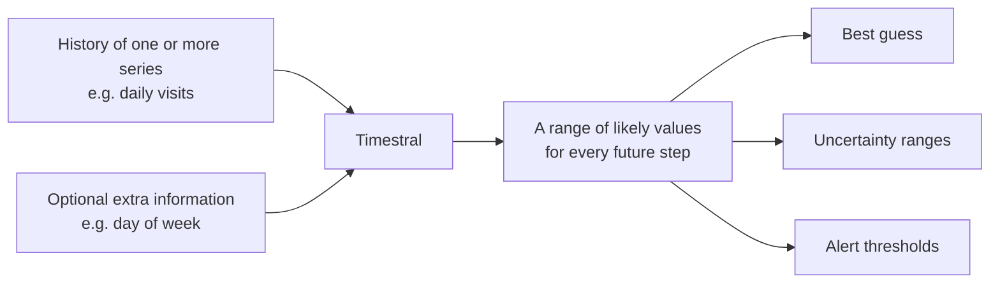

In one sentence, from its announcement: Timestral is a *time-series foundation model
for multivariate probabilistic forecasting, with past-only and known-future covariates*.
That sentence is full of jargon. The rest of this note explains each piece:

| Term in the sentence | In plain words | Section |
|---|---|---|
| time series | numbers recorded over time, at a regular pace | [Time series](#time-series) |
| forecasting | guessing the future values | [Forecasting](#forecasting) |
| foundation model | trained once on lots of data, then used as is on yours | [Foundation model](#foundation-model-and-zero-shot) |
| probabilistic | returns a range of likely values, not one number | [Quantiles](#probabilistic-forecasts-quantiles-and-intervals) |
| multivariate | can predict several related measurements together | [Multivariate](#univariate-and-multivariate) |
| covariates | extra information that helps, but isn't itself predicted | [Covariates](#covariates) |

The models come in four sizes: 5M, 28M, 123M and 209M *parameters*. Parameters are
the numbers the model learned during training; more parameters usually means more
accurate but slower. Even the largest runs on an ordinary laptop CPU.

## Time series

A **time series** is a list of measurements taken at regular intervals, in order:

```
day          visits
2026-10-19        3
2026-10-20        7
2026-10-21       35
2026-10-22        4
```

Examples: daily website visits, hourly electricity use, a machine's temperature every
minute, weekly sales. Two things make it a time series and not just a list of numbers:

- **Order matters.** Yesterday tells you something about today. Shuffle the rows and
  the information is gone.
- **The spacing is regular.** One value per day (or hour, or minute). Each slot is
  called a **time step**. If the raw data skips days, they have to be filled in first.
  This project's export has no row for a day with zero visits, so `data.py` adds those
  days back with 0.

Time series often contain recognisable patterns:

- **Trend**: a slow rise or fall over months.
- **Seasonality**: a pattern that repeats, such as weekdays vs weekends, or summer vs
  winter.
- **Noise**: random ups and downs that no pattern explains.
- **Spikes**: rare, sudden jumps, such as a blog post being shared somewhere.

## Forecasting

**Forecasting** means estimating future values of a time series from its past values.
A weather forecast is the familiar example: it can't know tomorrow, but it can say
what is likely, based on what usually follows conditions like today's.

A forecast can never be perfect, because the future contains things the past didn't
hint at. A good forecast captures what *is* predictable (the usual level, the trend,
the weekly rhythm) and is honest about what isn't (see
[probabilistic forecasts](#probabilistic-forecasts-quantiles-and-intervals)).

## Foundation model and zero-shot

Traditionally, you built a forecasting model for each dataset: pick a method, fit
it to your history, tune it, repeat for every new dataset.

A **foundation model** works differently. Mistral trained Timestral once, on a huge
and varied collection of time series from many domains. From that, it learned general
patterns that occur in time series everywhere: trends, weekly and daily cycles, sudden
jumps that fade, slow drifts.

**Zero-shot** means using the model on your data *without any extra training*. You
hand it your history and it forecasts right away. This project is entirely zero-shot:
nothing is trained, and the code is two calls, load and forecast.

The analogy: a traditional model is a tailor who measures you and sews a suit from
scratch. A foundation model is an experienced tailor who has seen millions of bodies
and can tell, at a glance, what fits you.


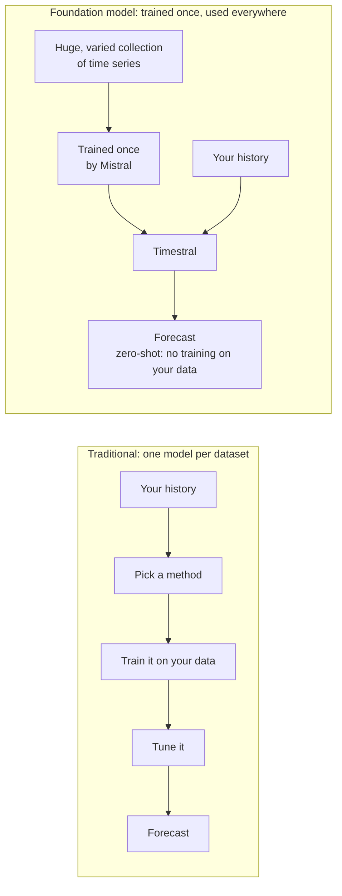

Mistral also offers fine-tuning (further training on your own data) through Mistral
Forge, for cases where zero-shot isn't good enough. This project doesn't need it.

## Context and horizon

Two numbers describe every forecast:

- **Context**: how much past you show the model. Timestral can read up to **32,768
  time steps**; that is about 90 years of daily data, or 3.7 years of hourly data. If
  you give it more, it keeps the most recent part.
- **Horizon** (or *prediction length*): how far into the future you ask it to look.
  This project asks for 30 days.

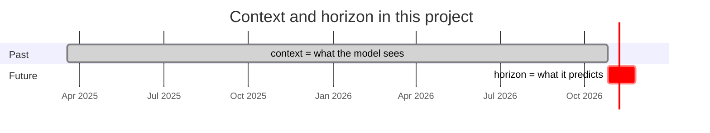

The further out the horizon, the less certain the forecast. Timestral predicts up to
1,024 steps in one go. For longer horizons it predicts a block, adds its own predictions
to the context, and predicts the next block from there.

## Probabilistic forecasts: quantiles and intervals

Most simple forecasts give one number: "tomorrow you'll get 4 visits". That hides
something important: is it "4, give or take 1", or "4, but it could easily be 30"?

Timestral is **probabilistic**: for every future time step it describes the whole
range of plausible values. It does this with **quantiles**.

### Quantiles

A **quantile** is a value with a stated chance of not being exceeded. Suppose for
tomorrow Timestral says the 90% quantile is 12 visits. That means: on 9 out of 10 days
like tomorrow, you'd expect **12 visits or fewer**, and on 1 in 10, more than 12.

Timestral returns **21 quantiles** for every forecast step, at these levels:

```
1%  5%  10%  15%  20%  25%  30%  35%  40%  45%  50%  55%  60%  65%  70%  75%  80%  85%  90%  95%  99%
```

Together they sketch the full shape of what might happen. For one forecast day, it
might look like this:

```
level    1%   10%   25%   50%   75%   90%   99%
visits    0     1     2     4     6    11    19
```

Read it as: "almost surely at least 0, probably around 4, quite possibly up to 11,
and only rarely more than 19".

The 50% quantile has its own name: the **median**. It is the middle value, with even
odds of the real value being above or below it.

### Intervals

Two quantiles together make an **interval** (or *prediction interval*): a range the
real value should fall in with a stated probability.

- 10% to 90% quantile = an **80% interval**: the real value should land inside it on
  about 8 out of 10 days. The `forecast` and `backtest` charts shade this band.
- 1% to 99% quantile = a **98% interval**: the real value should fall outside it only
  about 2 days in 100. The `anomalies` command uses this one.

A **wider** interval means the model is less sure. On this website data the bands are
wide because spikes happen, but on unpredictable days. A narrow band would look more
confident, but it would be wrong.

## Median and mean

Both describe a "typical" value, in different ways:

- The **median** is the middle value: half the outcomes are below it, half above.
- The **mean** (the average) is the total divided by the count.

They differ when values are lopsided. Take a page whose visits over 10 days were:

```
0  0  0  0  0  0  0  1  2  7
```

The median is **0** (the middle of the sorted list). The mean is (1 + 2 + 7) / 10 =
**1**. Both are correct; they answer different questions:

- "What should I guess for any single day?" → the median, 0. It is the guess that is
  closest to right on most days.
- "How many visits over 10 days in total?" → mean × 10 = 10. The median would say
  0 × 10 = 0, which is obviously wrong.

That is why this project uses the median for daily guesses and the mean for monthly
totals. Timestral doesn't return the mean directly; `forecasting.py` estimates it from
the 21 quantiles.

## Univariate and multivariate

These words say **how many measurements one series has at each time step**.

- **Univariate** ("one variable"): one number per time step. Daily visits to `/blog`
  is univariate.
- **Multivariate** ("many variables"): several numbers per time step that belong
  together. A weather station recording temperature, humidity and wind speed every
  hour is multivariate. Each of those measurements is called a **variate**.

Timestral can forecast multivariate series **jointly**: it looks at all the variates
of a series together, so a relationship between them can inform the forecast. For
example, rising humidity might help predict a temperature drop.

This is different from forecasting **many independent series at once**, which
Timestral also does. Its input has the shape `(series, variates, time)`:

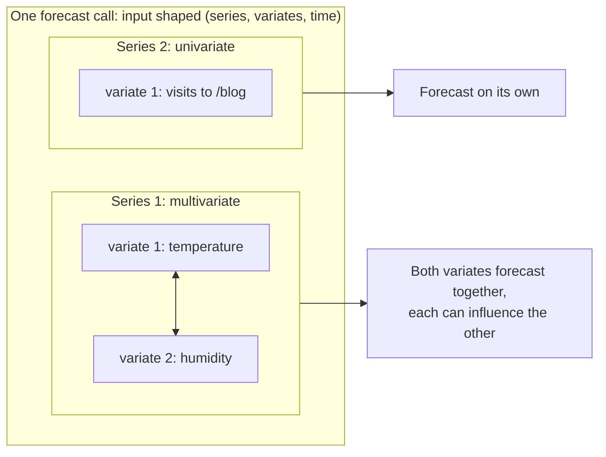

This project sends each page as **its own univariate series**, in one batch. Each page
is forecast independently; batching just makes it faster. The pages *could* be sent as
variates of one multivariate series. On data this sparse, though, there is little
shared signal for the model to use.

## Covariates

A **covariate** is extra information that may help predict the series, but which you
don't need predicted. The series you *do* want predicted is called the **target**.

For website visits, possible covariates include:

- the day of the week (people may browse less at weekends),
- whether a new post was published that day,
- whether you shared a link on social media,
- a public holiday.

Timestral sorts covariates by **when they are known**:

| Kind | Known for... | Example | Timestral argument |
|---|---|---|---|
| **Past-only** | the past only | number of social media mentions per day (you can't know next week's) | `past_covariates` |
| **Known-future** | the past *and* the forecast horizon | day of the week, holidays, a planned publication date | `known_covariates` |


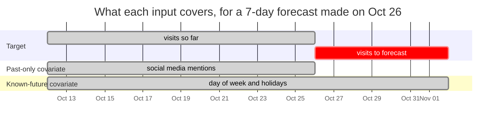

Known-future covariates are especially useful: if you tell the model "a post goes live
on Thursday", it can raise its forecast for Thursday. A past-only covariate can only
help the model understand the history better.

Covariates also come in two kinds of **values**:

- **Numeric**: a real quantity, such as temperature, price or ad spend.
- **Categorical**: a label from a fixed set, such as day of week (Mon...Sun), machine
  state (on / off / maintenance) or country. You pass categories as number codes
  (Monday = 0, ..., Sunday = 6). Since "Sunday = 6" isn't really six times "Tuesday = 1",
  Timestral converts each category to a number that means something. For one target,
  it uses that category's average target value in the history, so "Saturday" becomes
  "the average visits on Saturdays". This is called **target encoding**, and Timestral
  does it for you.


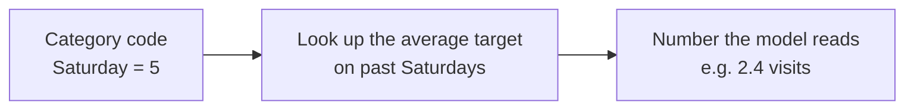

A covariate that is only 0 or 1 ("was there a launch today?") is an **indicator**.
Timestral recognises these automatically.

Covariates *condition* the forecast; they are not forecast themselves. The model reads
them as hints and only outputs a forecast for the target.


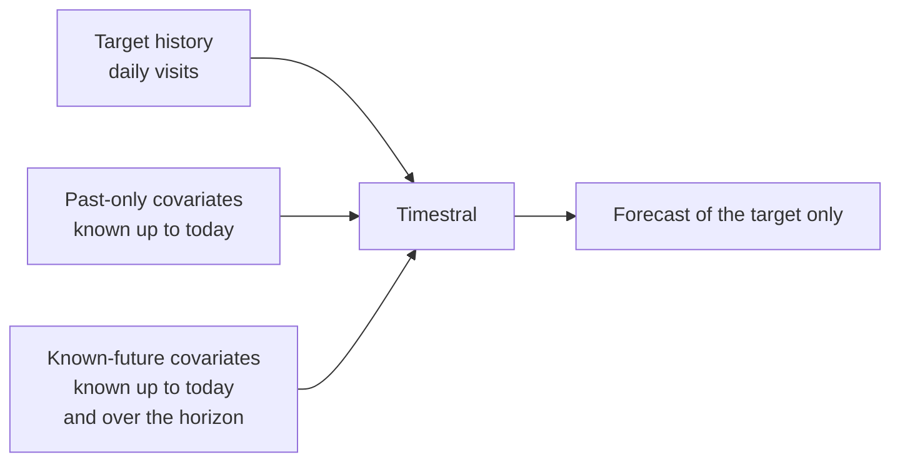

This project passes the day of the week as a known-future categorical covariate. On
this data it made no measurable difference, because a handful of visits a day has
little weekly rhythm. On busier data, such as a shop's sales, the effect is usually
much clearer.

## Missing values

Real data has gaps: a sensor goes offline, a tracking script breaks, a page didn't
exist yet. Timestral accepts **NaN** ("not a number") to mean *missing*, and simply
works around those slots.

Missing is not the same as zero. In this project, `/talks` was added in April 2026.
Its earlier months are marked missing, not 0, because "the page didn't exist" is a
different statement from "nobody visited". Filling them with 0 would make the model
think the page was unpopular for a year.

## Other details Timestral handles for you

You don't need these to use Timestral, but they explain some of its behaviour:

- **Non-negative values.** If every value in the context is 0 or more (visits,
  sales, counts), Timestral never predicts a negative value.
- **Scale doesn't matter.** Timestral rescales each series internally, so 5 visits a
  day and 5 million work equally well.
- **Patches.** Internally, Timestral reads the series in short chunks of consecutive
  steps, called *patches*, much like a language model reads words instead of letters.
- **How it was trained.** It was trained to make its quantiles right: a 90% quantile
  should be exceeded about 10% of the time, no more, no less. The scoring rule for
  that is called the *pinball loss*. Its 21 quantiles also never cross, so the 90%
  value is always at least the 80% value.

## Checking a forecast: backtesting

You can't know if a forecast for next month is good until next month is over. But you
*can* test the method on the past: **backtesting**.

1. Pick a **cutoff** date in the past, for example 2026-09-25.
2. Give the model only the data up to the cutoff.
3. Ask it to forecast the 30 days after the cutoff.
4. Compare its forecast with what really happened in those 30 days.

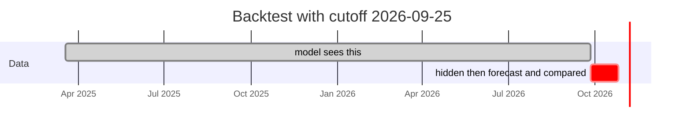

The key rule: **the model must not see the period it is judged on.** If it did, it
would be like grading a student on an exam they've already seen the answers to. Using
information you wouldn't have had at the time is called **look-ahead** (or *leakage*),
and it makes results look far better than they really are.

A single backtest is one sample: one month might be easy, the next one hard. Testing
several cutoffs (`--cutoff`) gives a fairer picture.


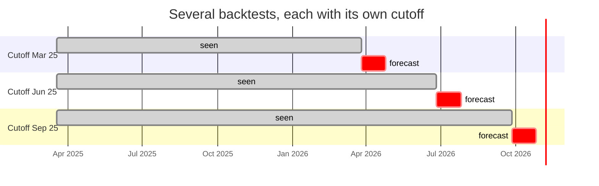

## Measuring error, and baselines

### MAE

The **mean absolute error (MAE)** is the average distance between the forecast and
what happened, ignoring whether the forecast was too high or too low:

```
day       forecast   actual   error
Mon              3        5       2
Tue              4        1       3
Wed              2        2       0
                                  ─
MAE = (2 + 3 + 0) / 3 = 1.67 visits per day
```

It is in the same unit as the data (visits per day), so it is easy to read. Lower is
better.

### Baselines

An error number means little on its own. Is an MAE of 1.1 good? It depends on how
hard the data is. So you compare with a **baseline**: a simple, almost lazy forecast
that any serious method should beat.

This project uses **last week**: "the next days will look like the last 7 days, over
and over". (Repeating the last full cycle like this is called a *seasonal naive*
forecast.) If a model can't beat that, it isn't adding anything.


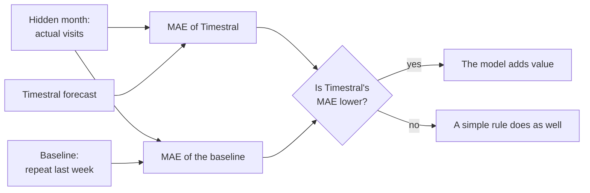

In the backtest, Timestral clearly beats this baseline on the busier series (all
pages, `/`) and roughly ties on the sparse pages. On pages with 0 or 1 visit on most
days, nearly any guess close to 0 scores about the same.

## Calibration: can the ranges be trusted?

A probabilistic forecast makes a promise: "the real value will fall inside my 80%
interval about 80% of the time". **Calibration** checks whether it keeps that promise.

You count how often the real values actually landed inside the interval. This share
is called **coverage**:

- about 80% → **well calibrated**: the ranges mean what they say;
- much less than 80% → **overconfident**: the ranges are too narrow, and you will be
  surprised too often;
- much more than 80% → **underconfident**: the ranges are too wide. It is safe, but
  less informative than it could be.


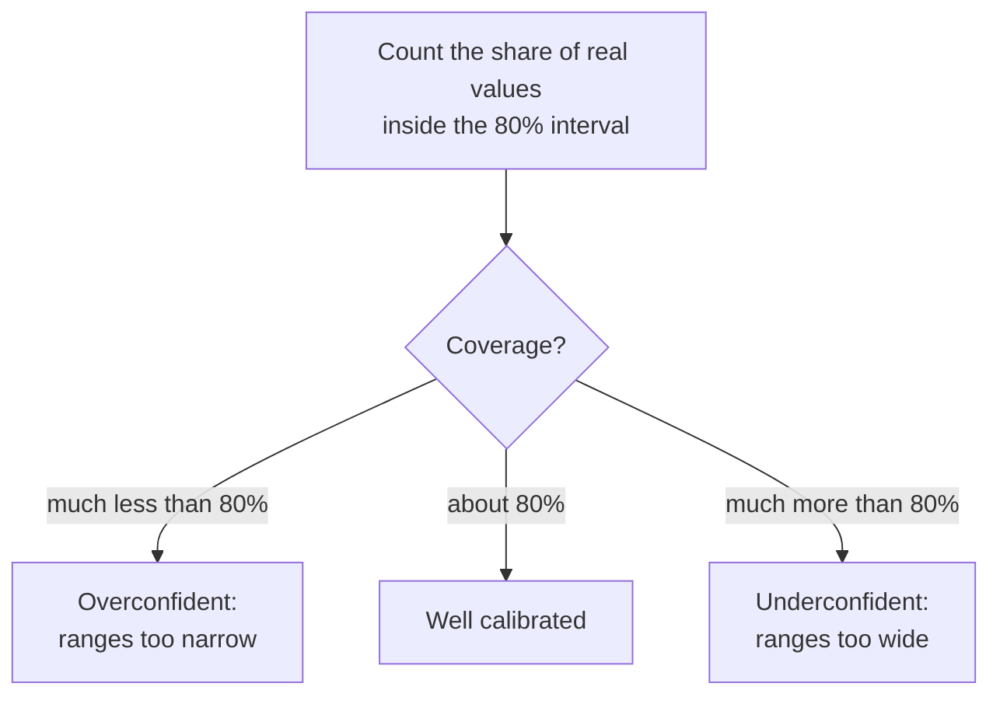

In this project's backtest, coverage was 87-97%: slightly too wide, which is the safer
side to be on.

Calibration matters because the ranges are what you base decisions on: "how much
server capacity do I need to be 99% safe?" is a question about a quantile, not about
the median.

## Anomaly detection with a forecaster

An **anomaly** (or *outlier*) is a value that doesn't fit the usual pattern: a sudden
traffic spike, a sensor reading that jumps, a day of sales far below normal.

Timestral has no separate "anomaly detection" feature. It doesn't need one: a
probabilistic forecaster already knows what "normal" looks like. The method:

1. For each past day, forecast that day **using only the days before it**.
2. If the real value falls far outside the forecast interval, flag it.

```
visits
  50 |                    ●  ← actual: 50, far above the band → anomaly
     |
  20 |  ░░░░░░░░░░░░░░░░░░░░░░░░░  ← top of the 98% interval
     |  ░░░░░░░░░░░░░░░░░░░░░░░░░
   0 |__░░░░░░░░░░░░░░░░░░░░░░░░░__
```

Step 1 matters for the same reason as in backtesting: if the model saw the spike when
forecasting that day, the spike would lift its own forecast, and might hide itself.
Forecasting each day only from the days before it is called **one-step-ahead**
forecasting (or *rolling* or *walk-forward* forecasting). It reproduces what a
forecaster running every night would have predicted.

Why this beats a fixed threshold like "alert above 30 visits":

- **It adapts.** A busy period raises the expected range and a quiet one lowers it, so
  30 visits can be normal in one month and remarkable in another.
- **It knows patterns.** If weekends are always quiet, a quiet Saturday isn't flagged.
- **It is tunable by probability.** Using the 98% interval means accepting that about
  2 in 100 normal days fall outside it anyway; a wider interval gives fewer, stronger
  alerts.

On very small counts, a value just outside the interval isn't interesting. One visit
to a page that usually gets none is technically "unexpected". This project requires a
minimum distance from the interval (`--min-excess`) to filter those out.

For the full picture (kinds of anomalies, tuning, pitfalls, running it live), see
[04-anomaly-detection.md](04-anomaly-detection.md).

An anomaly only says *that* something unusual happened, not *why*. On 2026-08-31 the
site got 50 visits, spread over 44 pages at about one each. Working out that this
looks like a crawler took a human looking at the data.

## What Timestral cannot do

- **Predict events it has no hint of.** A blog post going viral next Tuesday is
  invisible in the history. The model will show such spikes as *possible* (a wide
  upper range) but can't say *when*. Telling it about planned events through a
  known-future covariate helps.
- **Explain causes.** It finds patterns, not reasons. A forecast that rises in
  December says December has been busy before, not why.
- **Work from nothing.** With very little history, or a series that changed
  completely (a site redesign, a new product), the past says little about the future,
  and the forecast reflects that.
- **Turn noise into signal.** With 0-5 visits a day, much of the day-to-day movement is
  random. No model can predict that part; the honest answer is a wide range.

## Glossary

| Term | Meaning |
|---|---|
| **Anomaly** / outlier | A value that doesn't fit the usual pattern |
| **Backtest** | Testing a forecast on past data the model wasn't shown |
| **Baseline** | A deliberately simple forecast, used as a bar to beat |
| **Calibration** | Whether a model's probabilities hold true in practice |
| **Categorical** | A value that is a label from a fixed set (Mon, Tue, ...) rather than a quantity |
| **Context** | The past values the model is given |
| **Covariate** | Extra information that helps the forecast but isn't forecast itself |
| **Coverage** | The share of real values that landed inside an interval |
| **Cutoff** | In a backtest, the last day the model may see |
| **Foundation model** | A model trained once on broad data, then used on many tasks |
| **Horizon** | How many steps ahead to forecast |
| **Indicator** | A covariate that is only 0 or 1 (event / no event) |
| **Interval** | A range between two quantiles, such as 10%-90% (an 80% interval) |
| **Known-future covariate** | A covariate whose future values you already know (day of week, holidays) |
| **Look-ahead** / leakage | Accidentally using information from the period being predicted |
| **MAE** | Mean absolute error: average size of the forecast's misses |
| **Mean** | The average: total divided by count |
| **Median** | The middle value; the 50% quantile |
| **Multivariate** | Several measurements per time step, forecast together |
| **NaN** | "Not a number"; marks a missing value |
| **One-step-ahead** | Forecasting each step only from the steps before it |
| **Parameters** | The numbers a model learned in training; a rough measure of its size |
| **Past-only covariate** | A covariate known only up to the present |
| **Probabilistic forecast** | A forecast that gives a range of likely values with their probabilities |
| **Quantile** | A value with a stated chance of not being exceeded (90% quantile: exceeded 1 time in 10) |
| **Seasonality** | A pattern that repeats on a fixed cycle (weekly, yearly) |
| **Seasonal naive** | A baseline that repeats the last full cycle |
| **Target** | The series you want forecast |
| **Target encoding** | Turning a category into the average target value seen with it |
| **Time series** | Measurements taken at regular intervals, in order |
| **Time step** | One slot in a time series (one day, one hour) |
| **Trend** | A slow, sustained rise or fall |
| **Univariate** | One measurement per time step |
| **Variate** | One of the measurements in a multivariate series |
| **Zero-shot** | Using a model on new data without training it further |
