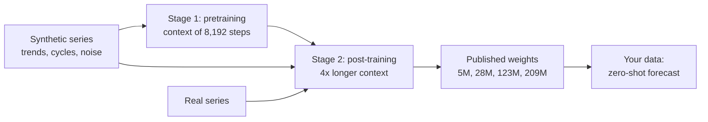
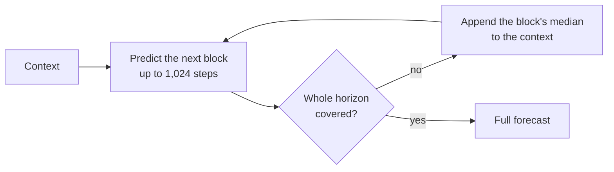
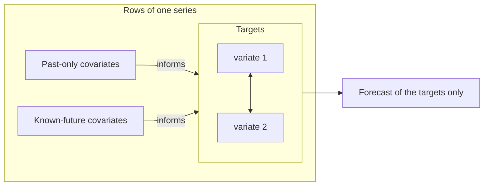
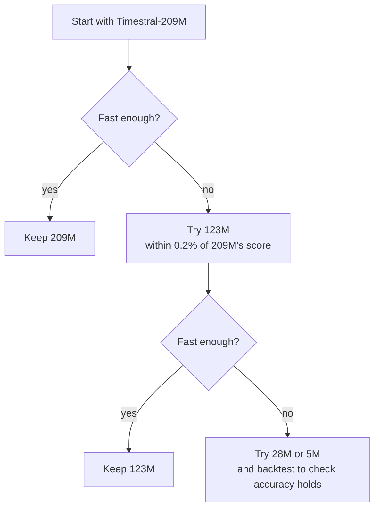
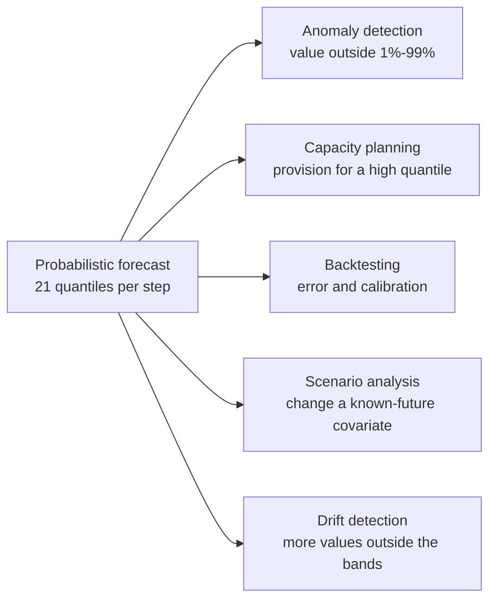

# What Timestral can do

A tour of Timestral's capabilities: what each one is, what it is good for, and how
this project uses it (or why it doesn't). The terms are explained in
[01-concepts.md](01-concepts.md); the code-level knobs are in
[03-python-library.md](03-python-library.md).

Sources: Mistral's [announcement](https://mistral.ai/news/timestral/), the
[GitHub repo](https://github.com/mistralai/timestral), and the source code of the
`timestral` 1.0.0 Python package installed in this project. Benchmark and speed numbers
are Mistral's own; I haven't reproduced them.

- [At a glance](#at-a-glance)
- [1. Zero-shot forecasting](#1-zero-shot-forecasting)
- [2. Probabilistic output: 21 quantiles](#2-probabilistic-output-21-quantiles)
- [3. Long context and any horizon](#3-long-context-and-any-horizon)
- [4. Many series at once](#4-many-series-at-once)
- [5. Multivariate forecasting](#5-multivariate-forecasting)
- [6. Covariates](#6-covariates)
- [7. Messy data: gaps, any scale, counts](#7-messy-data-gaps-any-scale-counts)
- [8. Four sizes, CPU friendly](#8-four-sizes-cpu-friendly)
- [9. Runs anywhere, offline included](#9-runs-anywhere-offline-included)
- [10. Fine-tuning (outside the open package)](#10-fine-tuning-outside-the-open-package)
- [What you build on top: anomaly detection and more](#what-you-build-on-top-anomaly-detection-and-more)
- [What it does not do](#what-it-does-not-do)
- [How accurate is it?](#how-accurate-is-it)

## At a glance

| Capability | In short | Used in this project? |
|---|---|---|
| Zero-shot forecasting | Forecast any series without training | Yes, everything is zero-shot |
| Probabilistic output | 21 quantiles per forecast step | Yes: intervals, median, mean |
| Long context | Up to 32,768 past steps | Yes: the 30-day forecast reads the last 32,768 hours (~3.7 years) |
| Any horizon | Long horizons are forecast block by block | Yes: 720 hours (30 days) in one pass, and 24-hour day-ahead blocks |
| Batches of series | Many independent series in one call | Yes: 5 countries at once; the anomaly replay sends 260 week-ahead forecasts (or 1,830 day-ahead ones) as rows of one batch |
| Multivariate | Related measurements forecast jointly | Tried, not used by default; see [section 5](#5-multivariate-forecasting) |
| Past-only covariates | Extra inputs known only up to now | No |
| Known-future covariates | Extra inputs known ahead (calendar, plans) | Yes, public holidays per country |
| Categorical covariates | Labels like weekday or machine state | No: holidays are a 0/1 indicator |
| Missing values | NaN gaps are handled | Yes, a few missing hours in France and Spain |
| Non-negative output | Counts never forecast below 0 | Automatic, but irrelevant: load never gets near 0 |
| CPU inference | No GPU needed | Yes |
| Anomaly detection | Not built in; easy to build from the intervals | Yes, built in `forecasting.py` |

## 1. Zero-shot forecasting

**What it is.** You give Timestral the history of any time series and it forecasts the
continuation, without being trained on that series. It learned general time-series
patterns (trends, cycles, decays after a spike, slow drift) during pre-training.

**How it was trained.** Mostly on *synthetic* data: generated series with trends,
seasonality and noise, combined into multivariate series with nonlinear relationships
between them. That was followed by a second stage on real and synthetic data with a
4x longer context. Using generated data lets Mistral claim that no benchmark data
leaked into training.

**What it means for you.** No training pipeline, no hyperparameter search, no "fit"
step. A new series, a new metric or a new customer can be forecast the moment data
exists. This project's whole interaction with the model is
`from_pretrained(...)` followed by `forecast(...)`.

## 2. Probabilistic output: 21 quantiles

**What it is.** For every future step, Timestral returns 21 quantiles, at levels 1%,
5%, 10%, 15%, ..., 90%, 95% and 99%. Together they describe the whole range of likely
values, not just one guess. The quantiles never cross: the 90% value is always at
least the 80% value.

**What it means for you.**

- **Intervals**: "between 38 and 44 GW at 18:00 tomorrow, with 80% probability"
  (10%-90% quantiles).
- **Risk-based planning**: provision for the 99% quantile, not the average.
- **Alert thresholds**: flag a value above the 99% quantile, which is how this
  project detects anomalies.
- **A best guess**: the median (50% quantile), or the mean derived from all 21. This
  project computes the mean in `forecasting.py`, because Timestral doesn't return it.

**Fixed levels.** You can't ask for a 97.5% quantile; only the 21 trained levels
exist. For other levels, interpolate between neighbours.

## 3. Long context and any horizon

**Context.** Timestral reads up to **32,768 past steps**: about 90 years of daily
data, 3.7 years of hourly data, or 11 months of 15-minute data. Give it more and it
keeps the most recent part.

**Horizon.** Internally it reads time in *patches* of 32 steps and predicts up to
32 patches (**1,024 steps**) in one pass. For longer horizons it predicts a block,
appends that block's median to the context, and continues from there. There is no
hard limit, but the further ahead, the more each block builds on earlier guesses
rather than real data, and the wider the uncertainty should be.

**What it means for you.** Long histories let the model see slow cycles (yearly
seasonality needs at least a couple of years). The 30-day horizon in this project
fits in a single pass.

## 4. Many series at once

**What it is.** `forecast()` takes a batch of series, shaped `(series, time)`, and
forecasts each one independently in one call.

**What it means for you.** Forecasting 1,000 products, servers or countries costs one
call per batch, not one model per series. This project sends the five countries as
one batch. The anomaly replay goes further: each of its forecasts (one per week and
country, 260 in a year; or one per day and country, 1,830, with `--horizon 24`)
becomes a row with its own window of history, sent in batches of 64. See `rolling()`
in `forecasting.py`.

**Different lengths.** All rows in a batch share one length. To batch histories of
different lengths, pad the shorter ones on the left with `NaN`, which Timestral treats
as missing. This project doesn't need to: every row in `rolling()` uses the same
window of 2,048 hours.

## 5. Multivariate forecasting

**What it is.** A series can have several *variates*: measurements that belong
together, such as a pump's vibration, temperature and pressure. Pass them as
`(series, variates, time)` and Timestral forecasts them **jointly**: its layers mix
information across variates, so a change in one can inform the forecast of another.

**What it means for you.** Interdependent signals are forecast with their
relationships in mind, instead of each in isolation. Mistral's example is a plant,
where pressure, temperature and vibration move together.

**In this project.** Each country is its own univariate series by default.
I tried two multivariate set-ups on day-ahead forecasts for September 2020
(2,048 hours of history, 209M model, no covariates):

| Set-up | Average error, separately | Jointly |
|---|---|---|
| The 5 countries as variates of one series | 1.80% | 1.78% |
| Germany's load with German solar and wind generation | 1.34% | 1.30% |

Both help slightly, and Germany gains the most from forecasting with solar and wind,
which both depend on the same weather. The gains are small, so the project keeps the
simpler univariate set-up. With weather-driven series, or with metrics that really
drive each other (a pump's pressure and vibration), the joint forecast matters more.

## 6. Covariates

**What it is.** Covariates are extra inputs that *inform* the forecast but aren't
forecast themselves. Timestral gives each row a role (target, past-only covariate or
known-future covariate), and its attention only lets information flow **from
covariates to targets**. A target's own future can't leak into its forecast.

| Kind | Known for | Examples |
|---|---|---|
| **Past-only** | the history only | number of support tickets, a competitor's price, upstream sensor readings |
| **Known-future** | history and forecast horizon | day of week, holidays, a production schedule, a planned shutdown, a weather forecast, a scheduled post |

Both kinds can be:

- **numeric**: a real quantity, such as temperature or ad spend;
- **0/1 indicators**: event or no event. Timestral detects a known-future row of only
  0s and 1s automatically;
- **categorical**: labels such as weekday or machine state (running, idle,
  maintenance). You pass them as number codes and the library encodes them for you.

**What it means for you.** Known-future covariates are the most valuable: they let you
tell the model about things you *know* will happen. With a production schedule as a
covariate, a planned load increase is expected instead of looking like a surprise.

**In this project.** Each country's public holidays are a known-future 0/1 indicator
(`holiday_indicator()` in `data.py`). Measured on day-ahead forecasts (2,048 hours of
history, 209M model), it makes no difference in an ordinary month and a large one
around holidays:

| Period | Average error without holidays | With holidays |
|---|---|---|
| September 2019 | 1.77% | 1.77% |
| 15 Dec 2019 - 15 Jan 2020 | 4.25% | 3.30% |

Italy gains the most over Christmas (6.41% → 3.82%). The flip side is cost: any
covariate makes Timestral about 4x slower. `--no-holidays` turns it off.

**What it doesn't have: weather.** Electricity demand depends heavily on temperature.
The grid operators feed weather forecasts into their models; this project gives
Timestral only past load and holidays. OPSD has no weather data, but a temperature
forecast would be the natural next known-future covariate.

**Requirements.** Not every checkpoint supports known-future covariates.
`forecaster.supports_known_covariates` tells you; both checkpoints used here (28M,
209M) return `True`.

## 7. Messy data: gaps, any scale, counts

- **Missing values**: put `NaN` where data is missing (or pass an `observation_mask`).
  Gaps in the middle, a late start, padding: all handled.
- **Any scale**: each series is normalised internally, so 5 visits a day and 5 million
  requests a second are treated alike. Different scales can share one batch: here
  Germany (~55 GW on average) sits next to Spain (~28 GW).
- **Counts and other non-negative data**: if every observed value is 0 or more, the
  forecast is clipped at 0. Forecasts of visits or sales are never negative.
- **Robustness to wild values**: forecasts are capped to a (very generous) range around
  what the history has seen, so a degenerate input can't produce absurd numbers.

## 8. Four sizes, CPU friendly

| Model | Hugging Face id | Download (fp32) | Notes from Mistral |
|---|---|---|---|
| Timestral-5M | `mistralai/Timestral-5M` | 21 MB | fastest: ~10 ms for a 1-day forecast from 3 weeks of 15-min data, on an 8-thread server CPU |
| Timestral-28M | `mistralai/Timestral-28M` | 111 MB | 5x faster than 209M; beats Chronos-2 (about 4x larger) on GIFT-Eval and TIME |
| Timestral-123M | `mistralai/Timestral-123M` | 490 MB | within 0.2% of the 209M score at 3/4 of its latency |
| Timestral-209M | `mistralai/Timestral-209M` | 837 MB | most accurate; ~140 ms in the same test |

All four share one architecture and training recipe, so switching is just a different
id. Measured in this project on a laptop CPU, 150 day-ahead forecasts (5 countries x 30
days, 2,048 hours of history each, with the holiday covariate) took **8.3 s with 28M**
and **49 s with 209M**, for an average error of 1.86% and 1.81%.

**What it means for you.** No GPU is required. Start with 209M for accuracy and drop
to a smaller size when latency or volume matters (for example the anomaly replay:
`--model mistralai/Timestral-28M`). A GPU works too (`device="cuda"`).

## 9. Runs anywhere, offline included

- The package is open source (Apache 2.0). The weights are on Hugging Face under a
  *Modified MIT* license; read it before commercial use.
- After the first download, models load from the local cache. Set `HF_HUB_OFFLINE=1`
  or pass `local_files_only=True` to make sure no network is used.
- Weights can be copied to a plain directory and loaded from disk, which suits
  on-premises, private-cloud and air-gapped deployments.
- Dependencies are small: PyTorch, NumPy, `safetensors`, `huggingface_hub`.

## 10. Fine-tuning (outside the open package)

The open package does **inference only**: there is no training or fine-tuning code.
Mistral offers fine-tuning on your own data, domain-specific covariates and control
of the training mix through **Mistral Forge**, its commercial platform. For most
uses, zero-shot is the intended starting point.

## What you build on top: anomaly detection and more

Some uses aren't built-in features, but follow directly from probabilistic forecasts:

- **Anomaly detection.** Forecast each step from the steps before it, then flag
  values outside a wide interval (such as 1%-99%). This is what `main.py anomalies`
  does. Mistral's own plant example uses Timestral the same way, as the "something is
  off" detector at the start of a larger workflow.
- **Capacity and inventory planning.** Use an upper quantile ("enough for 95% of
  days") instead of the median.
- **Backtesting and model comparison.** Hide a period, forecast it and score it
  (`main.py backtest`). The quantiles let you check calibration, not only error.
- **Scenario analysis.** Change a known-future covariate (a planned promotion, a
  shutdown) and compare the forecasts.
- **Drift detection.** Track how often real values fall outside the forecast intervals
  over time. A rising rate means the process is changing.

## What it does not do

- **No built-in anomaly detector, root-cause analysis or embeddings.** Mistral's plant
  example pairs Timestral with language-model agents for diagnosis. That is a
  surrounding system, not part of this package.
- **No explanation.** It doesn't say *why* it forecasts what it does, or which past
  values mattered most.
- **No knowledge of the outside world.** It only knows the numbers you give it. A
  launch, holiday, heatwave or lockdown it isn't told about (through a covariate) is
  invisible to it. In this project, no forecast saw the March 2020 lockdowns coming;
  the day-ahead forecasts caught up within days because they keep re-reading the
  latest history.
- **No custom quantile levels**, only the 21 fixed ones.
- **No training in the open package** (see [fine-tuning](#10-fine-tuning-outside-the-open-package)).
- **No miracles on noise.** On sparse, noisy data, much of the movement is random. The
  honest output there is a wide interval, which is what you get.

## How accurate is it?

Mistral reports, for **Timestral-209M**:

- **First among pretrained, zero-shot models** on the three main public benchmarks
  (GIFT-Eval, TIME and fev-bench), across all five reported metrics, from a single
  checkpoint without ensembling.
- In the **top ten of the full leaderboards** (all methods, including ones trained on
  the data): 83 entries on GIFT-Eval, 35 on TIME, 37 on fev-bench.
- Ahead of the previous state of the art with two-thirds of its parameters, and ahead
  of TimesFM-3 and Falcon-2.0 with fewer parameters.

These are Mistral's launch figures; they say a technical report with full results
will follow.

On this project's data (September 2020, five countries), Timestral-209M's day-ahead
forecasts were off by 1.5% (Germany) to 4.8% (Great Britain) on average. That beats
the grid operators' own published forecasts in Germany and Great Britain, and loses
to them in France, Italy and Spain, where the operators' weather-driven models are
very accurate (0.9% in Spain). It beat a "same hour last week" baseline everywhere.
See the [README](../README.md)
for the full numbers.
