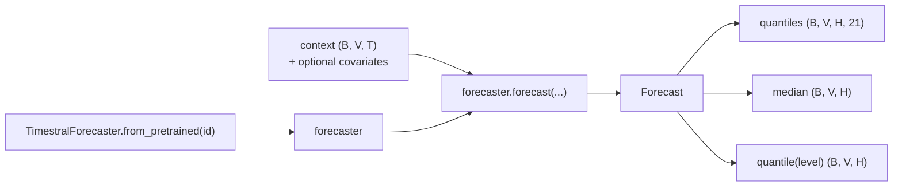
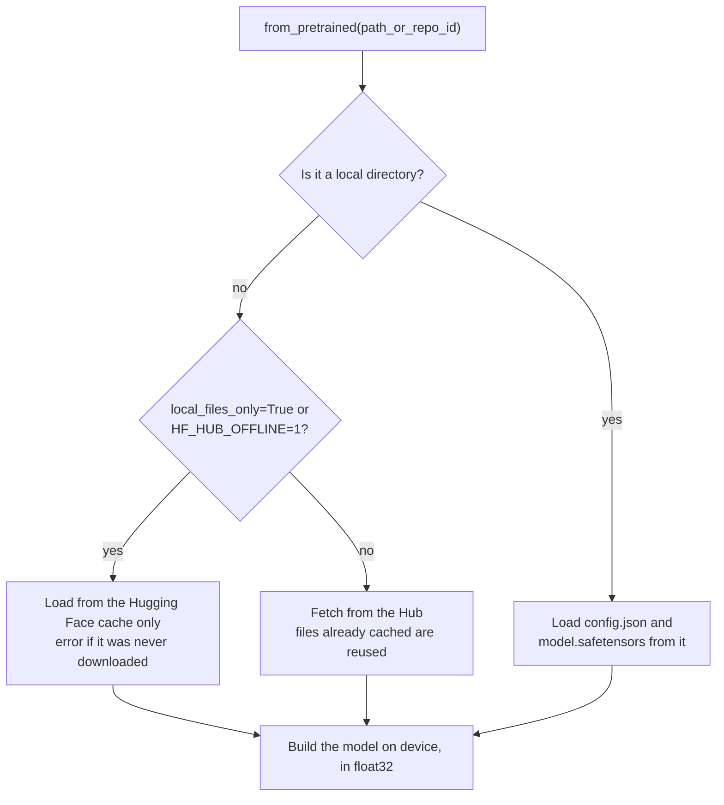
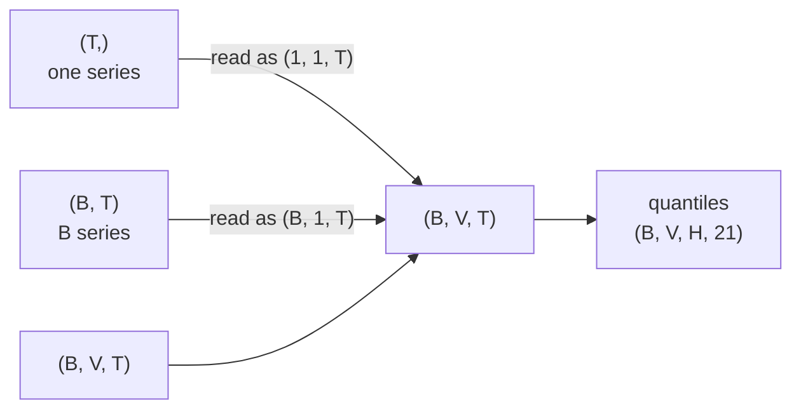
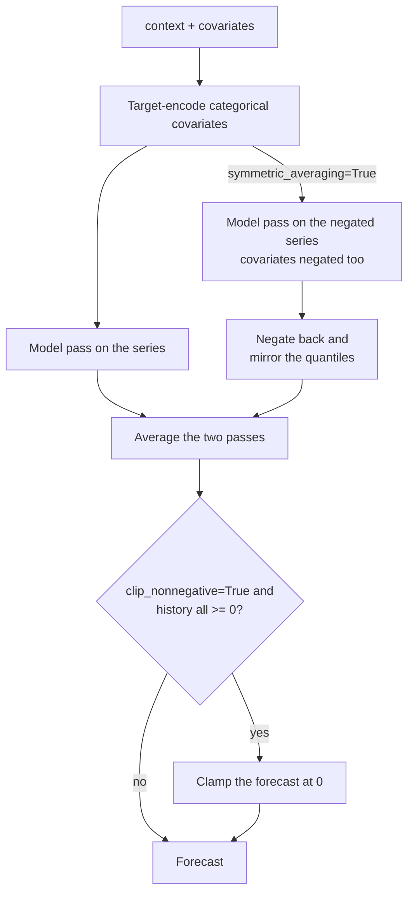

# The `timestral` Python library

A reference for the `timestral` package: how to install it, every argument you can
change, and what each one does. It is based on version **1.0.0** (from
[GitHub](https://github.com/mistralai/timestral)), read from the installed source code.
The timings and effects below were measured on this project's data, on a laptop CPU.

For what the model can do in general, see [02-capabilities.md](02-capabilities.md). For the
statistical terms, see [01-concepts.md](01-concepts.md).

- [Install](#install)
- [The whole API in 10 lines](#the-whole-api-in-10-lines)
- [Loading a model: `from_pretrained`](#loading-a-model-from_pretrained)
- [Forecasting: `forecast`](#forecasting-forecast)
- [Input shapes](#input-shapes)
- [Covariates in practice](#covariates-in-practice)
- [The result: `Forecast`](#the-result-forecast)
- [Behaviour switches: `symmetric_averaging` and `clip_nonnegative`](#behaviour-switches-symmetric_averaging-and-clip_nonnegative)
- [Advanced constructor options](#advanced-constructor-options)
- [The checkpoint config: `TimestralConfig`](#the-checkpoint-config-timestralconfig)
- [Performance tips](#performance-tips)
- [Errors you may hit](#errors-you-may-hit)
- [How this project uses it](#how-this-project-uses-it)

## Install

There is no PyPI package; install from GitHub (Python 3.10+, PyTorch 2.4+):

```sh
pip install git+https://github.com/mistralai/timestral.git
# or, as in this project:
uv add "timestral @ git+https://github.com/mistralai/timestral.git"
```

Dependencies: `torch`, `numpy`, `safetensors`, `huggingface_hub`. The package is
inference only; there is no training code.

## The whole API in 10 lines

```python
import numpy as np
from timestral import TimestralForecaster

forecaster = TimestralForecaster.from_pretrained("mistralai/Timestral-209M")

history = np.array([3, 5, 2, 0, 4, 7, 1, 3, 6, 2], dtype=float)  # one series, NaN = missing
result = forecaster.forecast(history, prediction_length=7)

result.median            # (1, 1, 7)      best guess per day
result.quantile(0.9)     # (1, 1, 7)      90% quantile per day
result.quantiles         # (1, 1, 7, 21)  all 21 quantiles
```

The package exports five names: `TimestralForecaster` (what you use), `Forecast` (what
it returns), and three lower-level ones you rarely need: `TimestralConfig`,
`TimestralModel` and `load_model`.




## Loading a model: `from_pretrained`

```python
TimestralForecaster.from_pretrained(
    path_or_repo_id,                 # Hugging Face id or local directory
    device="cpu",
    max_context=None,
    per_shot_horizon_patches=32,
    quantile_real_cap_k=1e4,
    revision=None,
    cache_dir=None,
    token=None,
    local_files_only=False,
)
```

| Argument | Default | What it does | When to change it |
|---|---|---|---|
| `path_or_repo_id` | (required) | A Hugging Face repo id such as `"mistralai/Timestral-28M"`, or a local directory containing `config.json` and `model.safetensors` | Pick the size; use a directory for offline or air-gapped setups |
| `device` | `"cpu"` | Where the model runs: `"cpu"`, `"cuda"`, `"cuda:1"`, or any other PyTorch device | You have a GPU and large batches |
| `max_context` | `None` (= 32,768) | The most past steps the model reads; older steps are dropped | To cap the cost of very long histories, or to test whether old data helps |
| `per_shot_horizon_patches` | `32` | Patches (of 32 steps) predicted per pass, capped at 32. Longer horizons take several passes | Rarely. Lower values mean more passes, each feeding its median back |
| `quantile_real_cap_k` | `1e4` | Clamps forecasts to `[min - k*s, max + k*s]` of the history, where `s` is the scale of the latest values. `0` turns it off | Rarely; it only stops absurd values on degenerate inputs |
| `revision` | `None` | A Hub branch, tag or commit to pin | Pin a version for reproducibility |
| `cache_dir` | `None` | Where downloads are stored (default: the Hugging Face cache, `~/.cache/huggingface/hub`) | Shared or read-only machines |
| `token` | `None` | Hugging Face token | Only for gated or private repos |
| `local_files_only` | `False` | Never use the network; load from the cache only | Offline runs. The env var `HF_HUB_OFFLINE=1` does the same |

The first load downloads two files once: `config.json` and `model.safetensors`.




| Model | Download | Batch of 260 series x 590 days, 30-day horizon (laptop CPU) |
|---|---|---|
| `mistralai/Timestral-5M` | 21 MB | not measured |
| `mistralai/Timestral-28M` | 111 MB | 1.2 s |
| `mistralai/Timestral-123M` | 490 MB | not measured |
| `mistralai/Timestral-209M` | 837 MB | 6.4 s |

**Precision.** Models load in float32, the precision Mistral validated. The lower-level
`timestral.load_model(path, device, dtype)` accepts another `dtype`, but anything other
than float32 is untested territory.

## Forecasting: `forecast`

```python
forecaster.forecast(
    context,                              # (B, V, T), (B, T) or (T,)
    prediction_length,                    # horizon, in steps
    observation_mask=None,
    past_covariates=None,                 # (B, C, T)
    known_covariates=None,                # (B, C, T + prediction_length)
    categorical_past_covariates=None,     # (B, C, T)
    categorical_known_covariates=None,    # (B, C, T + prediction_length)
    symmetric_averaging=True,
    clip_nonnegative=True,
) -> Forecast
```

`B` = number of series, `V` = variates per series, `T` = context length, `C` = number
of covariates.

| Argument | What it is |
|---|---|
| `context` | The history. NumPy array or torch tensor. `NaN` marks a missing value |
| `prediction_length` | How many steps to forecast. Any positive integer; above 1,024 the model works block by block |
| `observation_mask` | Optional boolean array shaped like `context`. `False` marks extra values to treat as missing, without editing the data |
| `past_covariates` | Numeric covariates known only over the history |
| `known_covariates` | Numeric covariates known over the history **and** the horizon. A row of only 0s and 1s is treated as an indicator |
| `categorical_past_covariates` | Category codes known only over the history |
| `categorical_known_covariates` | Category codes known over the history and the horizon |
| `symmetric_averaging` | See [behaviour switches](#behaviour-switches-symmetric_averaging-and-clip_nonnegative) |
| `clip_nonnegative` | See [behaviour switches](#behaviour-switches-symmetric_averaging-and-clip_nonnegative) |

## Input shapes

`context` accepts three shapes:

| Shape | Meaning | Example |
|---|---|---|
| `(T,)` | one series | `visits_per_day` |
| `(B, T)` | `B` independent series | 5 pages, one row each, as in this project |
| `(B, V, T)` | `B` series, each with `V` variates forecast jointly | 10 pumps x (vibration, temperature, pressure) |




Rules worth knowing:

- **All rows share one length `T`.** For histories of different lengths, pad the start
  with `NaN`. `one_step_ahead()` in `forecasting.py` does this to batch ~2,700
  histories of different lengths.
- **The time steps must be regular**: one per day, per hour, etc. Timestral has no
  notion of dates; fill missing slots with `NaN` (unknown) or 0 (truly zero),
  whichever is true.
- **Missing values**: `NaN` anywhere in the history is fine. But a series with *no*
  observed value at all does **not** raise an error: it silently comes back as a
  forecast of 0. Filter out empty series yourself.
- **Covariates may drop the `C` axis**: a `(B, L)` covariate is read as a single
  covariate, `(B, 1, L)`.

## Covariates in practice

```python
# Day of week, known for the future too, as a categorical covariate.
steps = np.arange(T + H)
weekday = (first_weekday + steps) % 7                      # codes 0..6
result = forecaster.forecast(
    context, H,
    categorical_known_covariates=weekday[None, None, :].astype(float),  # (1, 1, T + H)
)

# A planned launch on day T + 3, as a 0/1 indicator.
launch = np.zeros((1, 1, T + H)); launch[0, 0, T + 3] = 1
result = forecaster.forecast(context, H, known_covariates=launch)

# Several covariates: stack them along the C axis.
known = np.concatenate([launch, temperature_forecast], axis=1)     # (B, 2, T + H)
```

What to know:

- **Length must match exactly**: past covariates cover `T` steps, known ones
  `T + prediction_length`. A mismatch raises an `AssertionError` stating the expected
  shape.
- **Covariates are never forecast.** They only inform the target forecast;
  `result.quantiles` contains targets only.
- **Categorical codes can be any numbers.** Use `pandas.factorize` or a fixed mapping.
  `NaN` means a missing category. For univariate targets, the library *target-encodes*
  the codes: each category becomes the average target value seen with it in that
  series' history (helper: `timestral.covariate_encoding.target_encode`). A category
  that never appears in the history gets the series average. For multivariate targets
  there is no single target to average, so the raw codes are passed through.
- **Check support**: `forecaster.supports_covariates` and
  `forecaster.supports_known_covariates` say whether a checkpoint accepts covariates.
  Both are `True` for the 28M and 209M checkpoints.
- **Cost**: any covariate makes a forecast about **4x slower** (6.3 s → 26.5 s for the
  209M batch above, numeric or categorical alike), because the model then runs its
  full target-plus-covariate attention. Only add covariates that help; backtest with
  and without.

## The result: `Forecast`

`forecast()` returns a `Forecast`:

| Member | Shape | What it is |
|---|---|---|
| `quantiles` | `(B, V, H, 21)` | All quantiles, sorted along the last axis |
| `quantile_levels` | tuple of 21 | `(0.01, 0.05, 0.1, 0.15, ..., 0.9, 0.95, 0.99)` |
| `median` | `(B, V, H)` | The 50% quantile |
| `quantile(level)` | `(B, V, H)` | One quantile; `level` must be one of `quantile_levels` exactly, or it raises `ValueError` |

The values are **torch tensors**, even if you passed NumPy, and live on the model's
`device`. Convert with `.numpy()` on CPU, or `.cpu().numpy()` on a GPU. `V` is always
present: a `(B, T)` input comes back as `(B, 1, H)`, hence the `[:, 0]` in
`forecasting.py`.

There is no `mean` member. If you need totals over a horizon, estimate the mean from
the quantiles; `_mean()` in `forecasting.py` shows one way.

## Behaviour switches: `symmetric_averaging` and `clip_nonnegative`

Two options on `forecast()`, both on by default. Mistral calls the pair *clampsym*.




### `symmetric_averaging=True`

The model forecasts the series **and its upside-down copy** (every value negated, and
every covariate too), flips the second forecast back, and averages the two. This
cancels any tendency of the model to lean upwards or downwards, and usually makes
forecasts a little more stable.

- **Cost**: two model passes instead of one, so turning it off **halves the time**.
- **Effect here**: negligible. On this project's backtest, MAE moved from 1.367 to
  1.373 with 209M, and 80% coverage from 93% to 91%. Timing went from 6.4 s to 3.0 s.

Turn it off when speed matters more than the last bit of accuracy, such as large
batches or the anomaly replay. Backtest first.

### `clip_nonnegative=True`

If every observed value in a series' history is 0 or more, its forecast is clamped
at 0. Series with any negative history value are left alone.

- **Effect here**: with it off, the 1% quantile went down to -0.25 visits (209M) or
  -0.6 (28M), which is impossible for visit counts.
- Turn it off only for data that *can* go negative but happened not to in the
  history: temperatures in summer, profit and loss, deviations from a baseline.

## Advanced constructor options

`TimestralForecaster(model, ...)` takes the same `max_context`,
`per_shot_horizon_patches` and `quantile_real_cap_k`, plus one more:

| Argument | Default | What it does |
|---|---|---|
| `extreme_value_threshold` | `1e30` | For horizons over 1,024 steps, a fed-back median at or above this size is replaced by 0 |

It is only reachable by building the forecaster yourself:

```python
from timestral import TimestralForecaster, load_model

model = load_model("mistralai/Timestral-209M", device="cpu")
forecaster = TimestralForecaster(model, max_context=4096, extreme_value_threshold=1e12)
```

## The checkpoint config: `TimestralConfig`

Each checkpoint ships a `config.json` describing its architecture. You can read it as
`forecaster.config`. These values are fixed by the trained weights, and **changing
them breaks loading** (weights load with `strict=True`). They are useful to read,
not to tweak.

| Field | 28M | 209M | Meaning |
|---|---|---|---|
| `patch_size` | 32 | 32 | Time steps per patch; histories are left-padded to a multiple of it |
| `block_size` | 32 | 32 | Max patches predicted per pass, so 32 x 32 = 1,024 steps |
| `context_length` | 32,768 | 32,768 | Trained context; the default for `max_context` |
| `quantile_knots` | 21 levels | 21 levels | The quantile levels returned |
| `d_model` | 384 | 768 | Width of the network |
| `num_heads` | 6 | 12 | Attention heads per layer |
| `mlp_hidden_dim` | 1,024 | 2,048 | Width of each feed-forward layer |
| `block_schedule` | 12 layers | 24 layers | Layer types: `time` (attends across time) and `time_variate` (across time, then across variates/covariates), with every 4th layer a `time_variate` |
| `covariate_enabled` | true | true | Whether the checkpoint accepts covariates |

Useful derived properties: `forecaster.patch_size`, `forecaster.quantile_levels`,
`forecaster.config.num_quantiles`, `forecaster.supports_known_covariates`.

Fine-tuning, or a different architecture, is not possible with this package; Mistral
offers that through Mistral Forge.

## Performance tips

From the most to the least impact, as measured on this project:

1. **Skip covariates that don't help**: about 4x faster.
2. **Pick a smaller model**: 28M is about 5x faster than 209M.
3. **Turn off `symmetric_averaging`**: about 2x faster.
4. **Batch.** One call with many rows beats many calls with one row. Watch memory;
   chunks of a few hundred rows work well on a laptop (`one_step_ahead()` uses 256).
5. **Cap the context** with `max_context` if your histories are very long and old
   data doesn't help.
6. **Use a GPU** (`device="cuda"`) for large volumes.

Combining 1-3 on this project's anomaly replay should take it from ~5 minutes to
well under a minute (not measured end to end). Backtest first to check that accuracy
holds.

## Errors you may hit

| Message (abridged) | Cause | Fix |
|---|---|---|
| `context must be (T,), (B, T) or (B, V, T)` | Wrong number of dimensions | Reshape the input |
| `known_covariates must be (B=..., C, L)` | Covariate length or batch doesn't match | Known: `T + prediction_length`; past: `T` |
| `level 0.97 is not one of (...)` | Asked for an untrained quantile | Use one of the 21 levels |
| `this checkpoint cannot condition on known-future covariates` | The checkpoint doesn't support it | Check `supports_known_covariates`; use a past covariate or another checkpoint |
| `forecast produced N NaN values; the input is degenerate` | Numerically broken input | Check for infinities or absurd magnitudes |
| `... is neither a local directory nor a Hugging Face Hub repo you can access` | A typo in the id, or no network with nothing cached | Check the id; download once while online |

## How this project uses it

| Where | What it calls |
|---|---|
| `forecasting.load_forecaster` | `from_pretrained(model_id)` with all defaults; `--model` picks the size |
| `forecasting._forecast` | `forecast(context, prediction_length, categorical_known_covariates=weekday)`; symmetric averaging and clipping left on |
| `forecasting.forecast` | A `(5, T)` batch: site total + 4 pages, 30-day horizon; keeps the 10%, 50% and 90% quantiles, plus the mean from all 21 |
| `forecasting.one_step_ahead` | ~2,700 rows, NaN-padded to one length, horizon 1, in chunks of 256; keeps the 1%, 50% and 99% quantiles |
