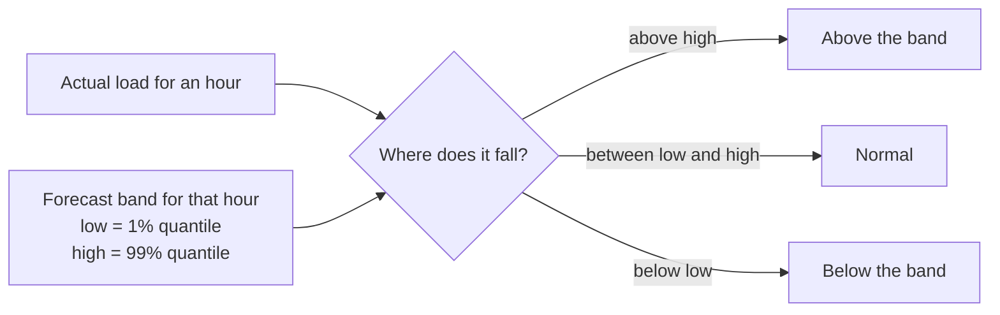
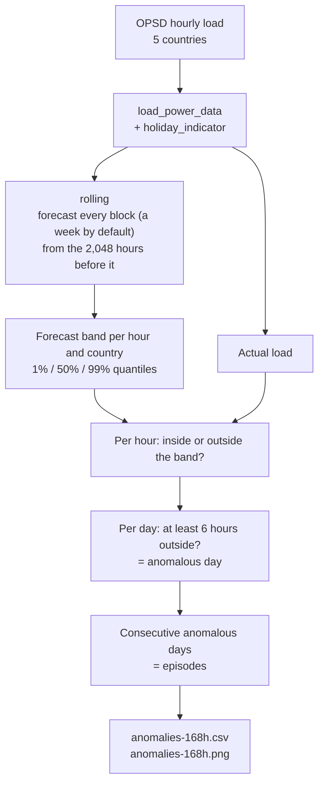
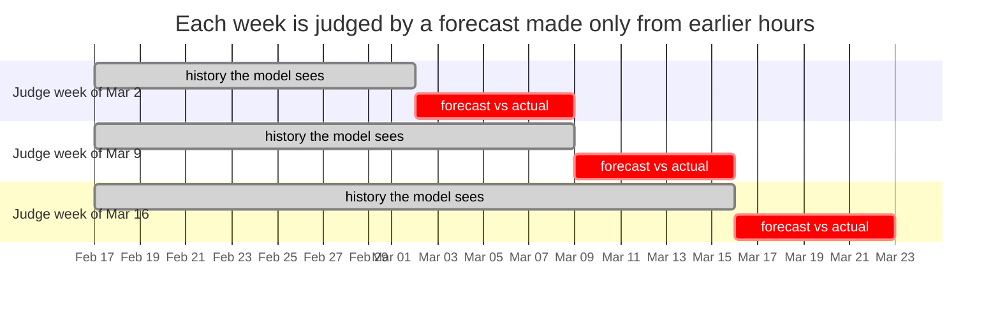
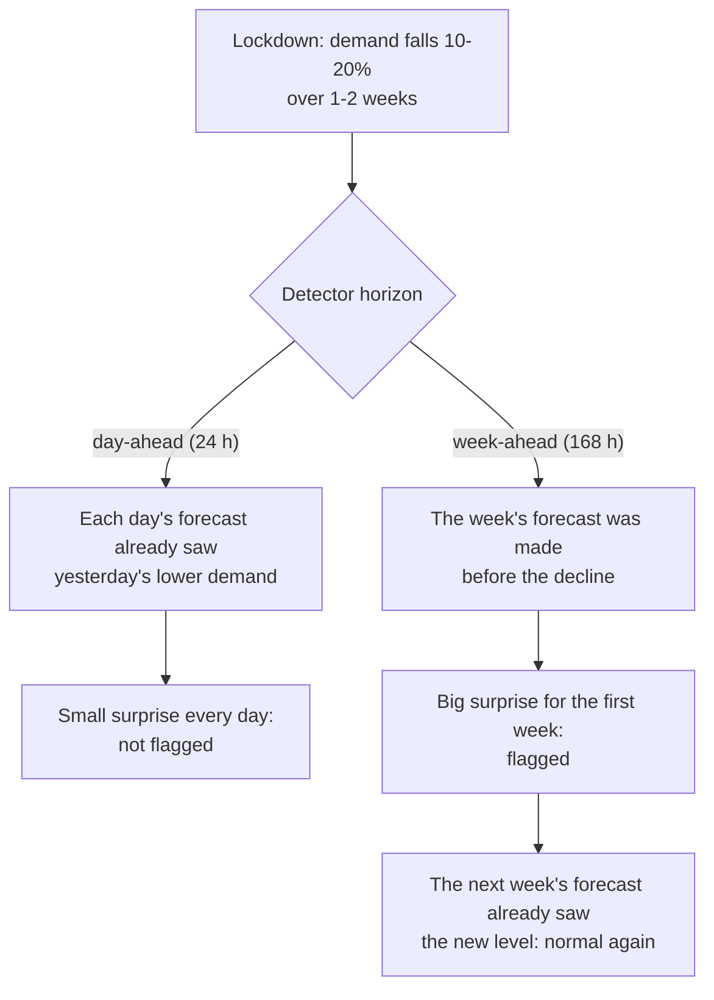
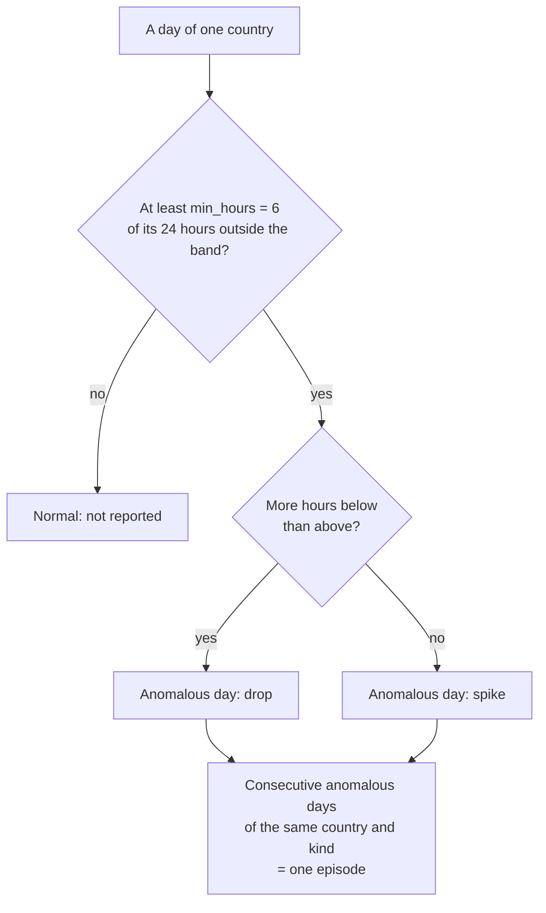
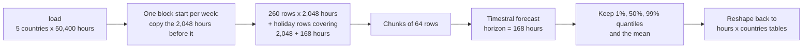

# Anomaly detection with a forecasting model

How this project finds unusual days in European electricity demand, why it works this
way, and how to tune it or reuse it on other data. Like
[01-concepts.md](01-concepts.md), it assumes no statistics background.

- [What an anomaly is](#what-an-anomaly-is)
- [Ways to detect anomalies](#ways-to-detect-anomalies)
- [The idea: an anomaly is a surprise](#the-idea-an-anomaly-is-a-surprise)
- [The pipeline](#the-pipeline)
- [Step 1: forecast each block without seeing it](#step-1-forecast-each-block-without-seeing-it)
- [The horizon decides what you can see](#the-horizon-decides-what-you-can-see)
- [Step 2: compare every hour with its band](#step-2-compare-every-hour-with-its-band)
- [Step 3: from hours to days to episodes](#step-3-from-hours-to-days-to-episodes)
- [How the code does it](#how-the-code-does-it)
- [Telling the model what is normal: the holiday covariate](#telling-the-model-what-is-normal-the-holiday-covariate)
- [Choosing the band: false alarms vs missed anomalies](#choosing-the-band-false-alarms-vs-missed-anomalies)
- [Results on this data](#results-on-this-data)
- [Pitfalls](#pitfalls)
- [Glossary](#glossary)

## What an anomaly is

An **anomaly** (or *outlier*) is a data point that doesn't fit the pattern of the rest.
There are three broad kinds:

| Kind | What it is | Electricity example |
|---|---|---|
| **Point** | One value far from normal | One day with demand 20% below normal: an unusual holiday, a data error |
| **Contextual** | A value that is normal in general, but not at *this* time | Sunday-level demand on a Tuesday |
| **Collective** / level shift | A run of values that is odd *together*, though each looks fine next to its neighbours | Weeks of demand 10-20% lower, as in the spring 2020 lockdowns |

A forecaster handles contextual anomalies for free, because "expected" already
includes the time of day, the day of the week and the season. Point anomalies are
easy. Level shifts are the hard part, and the reason the
[horizon](#the-horizon-decides-what-you-can-see) matters so much.

## Ways to detect anomalies

From simplest to most capable:

| Approach | How it works | Weakness |
|---|---|---|
| **Fixed threshold** | "Alert below 40 GW" | Doesn't adapt: 40 GW is normal on a Sunday night and alarming on a Tuesday noon |
| **Statistical rule** | "Alert beyond 3 standard deviations from the average" (a *z-score*) | Assumes values are spread symmetrically; ignores the daily, weekly and yearly cycles |
| **Seasonal decomposition** | Split the series into trend + cycles + leftover; alert on big leftovers | Needs the cycles set by hand, and enough clean history |
| **Machine-learning detector** | e.g. an isolation forest, trained on your data | Needs training, tuning and retraining per dataset |
| **Forecast-based** (this project) | Predict each value, alert when reality falls far outside the prediction | Only as good as the forecaster |

The forecast-based approach used to have a big cost: you needed a good forecasting model
per series. A **time series foundation model** like Timestral removes that cost. It
forecasts any series zero-shot, with no training, so forecast-based detection becomes
the easy option instead of the expensive one.

## The idea: an anomaly is a surprise

Instead of defining "abnormal" directly, define "normal" with a forecast, and call
anything far outside it an anomaly.

A probabilistic forecast doesn't give one number for each hour; it gives a range, with
probabilities (see [quantiles](01-concepts.md#probabilistic-forecasts-quantiles-and-intervals)).
This project uses the **1% and 99% quantiles**:

- the **99% quantile** (`high`): only about 1 hour in 100 should be above it;
- the **1% quantile** (`low`): only about 1 hour in 100 should be below it.

Between them is a **98% band**. An hour outside it is one the model considered very
unlikely: a surprise.



The band adapts by itself: it follows the daily and weekly rhythm, the season, and
public holidays when the model is told about them.

## The pipeline



## Step 1: forecast each block without seeing it

The most important rule: **the forecast for a period must not see that period.**

Suppose you instead fit a model to the whole history and compared each day with the
model's view of it. An unusual day would be part of what the model looks at, so it
would pull the "expected" value towards itself and partly hide. Using information you
wouldn't have had at the time is called **look-ahead** or **leakage**.

So the past is replayed block by block. Each block (a week by default) is forecast
only from the 2,048 hours (~12 weeks) *before* it. This is called **rolling** (or
*walk-forward*) forecasting. It reproduces exactly what a forecaster running every
Monday at midnight (UTC) would have predicted for the week ahead.



(The history bars are shortened in the chart; each really covers the 2,048 hours,
~12 weeks, before its week.)

## The horizon decides what you can see

How far ahead each forecast looks, the **horizon**, changes which anomalies the
detector can see at all. This is the most important lesson from this dataset.

The lockdowns didn't happen in one day: demand fell over one to two weeks as measures
tightened. Compare two detectors:

- **Day-ahead** (`--horizon 24`): every midnight, forecast the next 24 hours. Each day
  is judged against a forecast that already saw yesterday's lower demand, so every
  step of the decline looks like a small, unremarkable change.
- **Week-ahead** (`--horizon 168`, the default): every Monday, forecast the whole week.
  The first lockdown week is judged against a forecast made *before* the decline, so
  it stands out.



What each detector flagged around the lockdowns (both with the holiday covariate):

| Country | Lockdown starts | Day-ahead (24 h) | Week-ahead (168 h) |
|---|---|---|---|
| Italy | 10 March | nothing | 13-15 March, 9.8-12.4% below forecast |
| Spain | 15 March | nothing | 19 March, 11.4% below |
| France | 17 March | nothing | 19 March, 19.9% below |
| Great Britain | 23 March | nothing | 26 March, 13.4% below |
| Germany | 22 March | nothing | nothing (the drop was smaller, ~9%, and gradual) |

Overall, the day-ahead detector flagged 29 days over the year and the week-ahead one
52: the week-ahead bands are wider, but slow shifts and multi-day holidays such as
Christmas week stand out more.

Neither is "right". Day-ahead is what a control room needs: tight bands, sharp one-day
events, such as the daylight-saving switches or France's reopening day. Week-ahead is
better for shifts that build up over days. A real system could run both.

## Step 2: compare every hour with its band

For each hour and country, the code checks whether the actual load is below the 1%
line or above the 99% line. Then, per day, it counts those hours, and compares the
day's total energy with the forecast's total (the sum of the hourly means):

```
deviation % = (actual daily energy - expected daily energy) / expected daily energy x 100
```

Worked example, the largest lockdown day found (France, Thursday 19 March 2020, two
days into the lockdown), from the week-ahead forecast made on Monday 16 March:

| Hours below the 1% line | Hours above the 99% line | Actual energy | Expected energy | Deviation |
|---|---|---|---|---|
| 10 of 24 | 0 | 1,133,107 MWh | 1,414,085 MWh | -19.9% |

Ten hours below the band (more than the 6 required), none above: an anomalous day,
of kind "drop".

## Step 3: from hours to days to episodes

One hour outside a 98% band happens by chance about 2% of the time, so single hours
aren't worth reporting. The rules:



- **`--min-hours 6`**: a quarter of the day must be outside the band. Raise it for
  fewer, stronger alerts.
- **Episodes** group consecutive days, so Italy's 13-15 March is one line, not three.

## How the code does it

Two functions do the work: `rolling()` in `forecasting.py` (step 1) and
`run_anomalies()` in `main.py` (steps 2 and 3).

### Batching: one forecast call for a whole year

A year of week-ahead forecasts for 5 countries is 52 x 5 = 260 forecasts; day-ahead,
it is 366 x 5 = 1,830. Calling the model that many times would be slow. Instead,
`rolling()` builds them all as **rows of one big batch**: each row holds the 2,048
hours before its block.

```
row for DE, week of Mon 2020-03-02:  the 2,048 hours before 2020-03-02  -> forecast 168 hours
row for DE, week of Mon 2020-03-09:  the 2,048 hours before 2020-03-09  -> forecast 168 hours
...                                  └── every row: the same 2,048-hour window ──┘
```

Every row has the same length, so no padding is needed.



`rolling()` line by line:

| Code | What it does |
|---|---|
| `origins = pd.date_range(start, end - horizon, freq=horizon)` | The start of every block; a last block that would run past `end` is left out |
| `positions = history.index.get_indexer(origins)` | Where each block starts, as a row number in the data |
| `made = positions - gap` | Where each forecast is made: `gap` hours before its block (0 here; 16 in the backtest, to match the grid operators' publishing time) |
| `values[:, m - context:m]` | The `context` hours before each forecast, for every country |
| `covariate[:, m - context:p + horizon]` | The holiday flags over the history *and* the block: they are known in advance |
| `for first in range(0, len(contexts), batch_size)` | Send 64 rows at a time, to keep memory in check |
| `result.quantile(q)[:, 0, gap:]` | Keep the block's hours, for the 1%, 50% and 99% quantiles, plus `_mean` |
| `transpose(0, 2, 1, 3).reshape(...)` | From (blocks x countries x hours) back to one row per hour, one column per country |

`run_anomalies()` then lines these up with the actual load, counts the hours outside
the band per day (`resample("D")`), flags days with at least `min_hours`, groups them
into episodes (`_episodes()`) and writes `output/anomalies-<horizon>h.csv` and `.png`.

## Telling the model what is normal: the holiday covariate

Public holidays look exactly like anomalies: demand drops 15-30% for a day. Without
help, the detector flags them every time. Passing each country's public holidays as a
known-future covariate tells the model "this day is special", so it lowers its
forecast and the day is no longer a surprise.

| | Week-ahead, no holidays | Week-ahead, with holidays | Day-ahead, no holidays | Day-ahead, with holidays |
|---|---|---|---|---|
| Anomalous days in the year | 70 | 52 | 39 | 29 |
| Hours below the 1% line before the pandemic | 2.6% | 1.2% | 0.9% | 0.7% |

Days that disappear with the covariate (week-ahead) include New Year's Day, Good
Friday, 1 May, Ascension Day, German Unity Day, 14 July, Armistice Day and All Saints
in Italy and Spain. Not every holiday is fully absorbed: Easter Monday in Italy is
still flagged. What remains is mostly what
a national calendar doesn't know: Christmas week and other "bridge" days, regional
holidays such as Corpus Christi (11 June) and All Saints (1 November) in Germany,
England-only bank holidays in Great Britain (31 August), and the August shutdowns in
Italy and Spain.

## Choosing the band: false alarms vs missed anomalies

Every detector trades off two mistakes:

- a **false alarm** (*false positive*): flagging a day that was actually normal;
- a **missed anomaly** (*false negative*): not flagging a day that really was odd.

If the model's quantiles are accurate (*calibrated*), a band from 1% to 99% leaves
about 2% of perfectly normal hours outside it, by definition. Requiring 6 hours out of
24 turns that into very few false alarms, because chance misses are scattered, while
real anomalies affect whole days.

### Is the band honest here?

`main.py anomalies` checks this itself: over the months before the pandemic (October
2019 to February 2020), it counts how often actual load fell above the 99% line and
below the 1% line. About 1% each is expected.

| Detector (with holidays) | Hours above the 99% line | Hours below the 1% line |
|---|---|---|
| Week-ahead | 0.6% | 1.2% |
| Day-ahead | 0.7% | 0.7% |

Close to 1% on both sides: on this data, Timestral's outer quantiles mean what they say
(with the cap described under [pitfalls](#pitfalls)).

Ways to tune, in `main.py anomalies`:

| Knob | Fewer alerts | More alerts |
|---|---|---|
| Band (`low`/`high` in `rolling()`) | 1%-99% (Timestral's widest) | 5%-95%, 10%-90% |
| `--min-hours` | raise (e.g. 12) | lower (e.g. 3) |
| `--horizon` | 24 (adapts quickly, misses slow shifts) | 168 (sees slow shifts and multi-day holidays) |
| Holiday covariate | on (default) | `--no-holidays` |

## Results on this data

Week-ahead, with holidays (the default), from 30 September 2019 to 27 September 2020:
52 anomalous days in 28 episodes.


Each panel shows a country's daily energy: blue is actual, orange is what the
week-ahead forecast expected, red dots are anomalous days, and the dashed line is the
start of the lockdown. The orange line tracks the blue one closely except around
holidays, and it drops with the lockdown one week late, which is exactly how a rolling
forecaster behaves.

Looking up what happened on the most notable episodes:

| Days | Country | Deviation | What happened |
|---|---|---|---|
| 13-15 Mar 2020 | Italy | -11% | The national lockdown, from 10 March |
| 19 Mar 2020 | France | -20% | The lockdown, from 17 March |
| 19 Mar 2020 | Spain | -11% | The state of alarm, from 15 March |
| 26 Mar 2020 | Great Britain | -13% | The stay-at-home order, from 23 March |
| 11-14 May 2020 | France | +11% | The end of France's first lockdown on 11 May |
| 23-25 Dec 2019 | Germany, Italy, Spain | -15% to -19% | Christmas week, beyond the national holidays |
| 3-6 and 10-11 Aug 2020 | Italy | -12% to -13% | August holidays, when much of industry closes |
| 7-10 Nov 2019 | France | +17% | Probably an early cold spell: France heats largely with electricity (not checked against weather data) |
| 8 Dec 2019 | Great Britain | -16% | Not obvious from the data; the grid operator forecast this day almost exactly, so it was probably weather-driven |

Two lessons from the table:

- **The detector says *that*, not *why*.** Every explanation above came from a person
  checking the dates afterwards, and two are educated guesses.
- **"Unusual for Timestral" is not the same as "unusual".** Some flagged days were
  expected by forecasters who see the weather. A better-informed model (with a
  temperature covariate) would flag fewer, more interesting days.

The day-ahead detector (`--horizon 24`, `output/anomalies-24h.png`) flags 29 single
days instead, mostly sharp one-day events: the daylight-saving switches (27 October
2019 in France, 29 March 2020 in Germany and France), France's reopening day (11 May 2020),
days right after holidays, and a Friday in Great Britain (22 May 2020) when demand was
20% below forecast all day. The grid operator missed that one too (by ~12%); a sunny,
windy day reducing demand on the transmission grid is a plausible cause, but it isn't
verified here.

## Pitfalls

- **Adaptation hides slow changes.** A rolling forecaster re-reads the latest history,
  so a gradual shift becomes the new normal within one horizon. The day-ahead detector
  missed the lockdowns for exactly this reason; see
  [the horizon](#the-horizon-decides-what-you-can-see).
- **Clock changes.** The model sees UTC hours. On the two daylight-saving switches each
  year, the daily pattern moves by an hour in UTC, and some hours fall outside the
  band. Forecasting in local time, or masking those days, avoids it.
- **The calendar only knows what you tell it.** National holidays help, but Christmas
  week, bridge days and regional holidays still look like drops. Great Britain's
  national calendar in the `holidays` package even lacks Easter Monday and the
  late-August bank holiday, which are England and Wales only; using England's
  calendar (`subdiv="ENG"`) would cover most of Britain's demand.
- **What a weather-aware model would expect.** Some days are surprises to Timestral
  only because it doesn't see the weather.
- **Rare covariate values can make the band explode.** With the holiday covariate,
  the 99% line for Christmas Day in Great Britain reached 37.8 million MW, which would
  hide anything that week. This project caps forecasts with `quantile_real_cap_k=1`;
  see [03-python-library.md](03-python-library.md#capping-extreme-quantiles-quantile_real_cap_k).
- **Calibration matters.** The false-alarm rate is only ~2% if the model's quantiles
  are accurate. Check it on your own data, as `main.py anomalies` does.

## Glossary

| Term | Meaning |
|---|---|
| **Anomaly** / outlier | A value that doesn't fit the usual pattern |
| **Anomalous day** | Here: a day with at least `min_hours` hours outside the band |
| **Band** / interval | The range between two quantiles; here 1% to 99% |
| **Calibrated** | The model's probabilities hold in practice: ~1% of hours really are above its 99% line |
| **Collective anomaly** / level shift | A run of values that is odd together |
| **Contextual anomaly** | A value that is normal in general but not at that time |
| **Deviation %** | How far a day's actual energy was from the forecast's, in % |
| **Episode** | Consecutive anomalous days of the same country and kind |
| **False alarm** / false positive | A normal value flagged as an anomaly |
| **Horizon** | How far ahead each forecast looks: 24 hours (day-ahead) or 168 (week-ahead) |
| **Look-ahead** / leakage | Using information from the period being judged |
| **Missed anomaly** / false negative | A real anomaly that wasn't flagged |
| **Point anomaly** | A single value far from normal |
| **Quantile** | A value with a stated chance of not being exceeded |
| **Rolling forecast** / walk-forward | Forecasting each block only from the data before it, block after block |
| **Z-score** | Distance from the average, measured in standard deviations |
