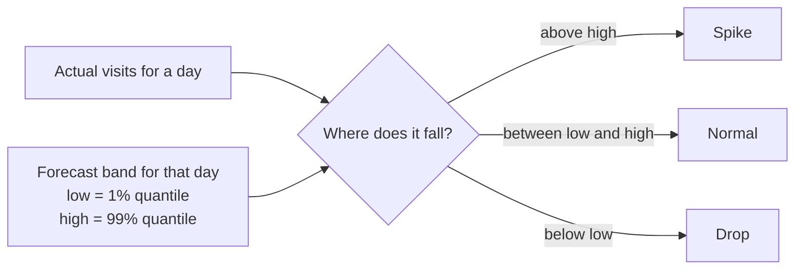
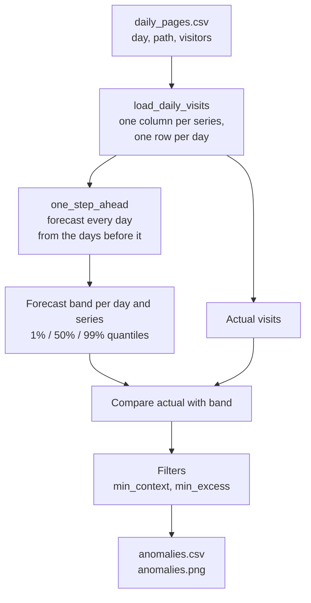
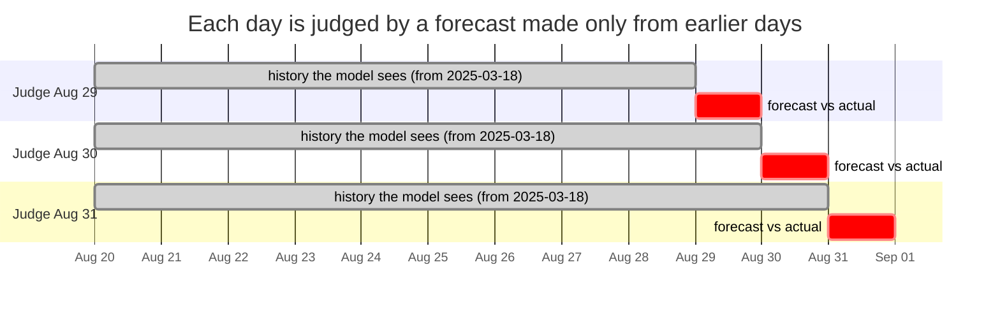
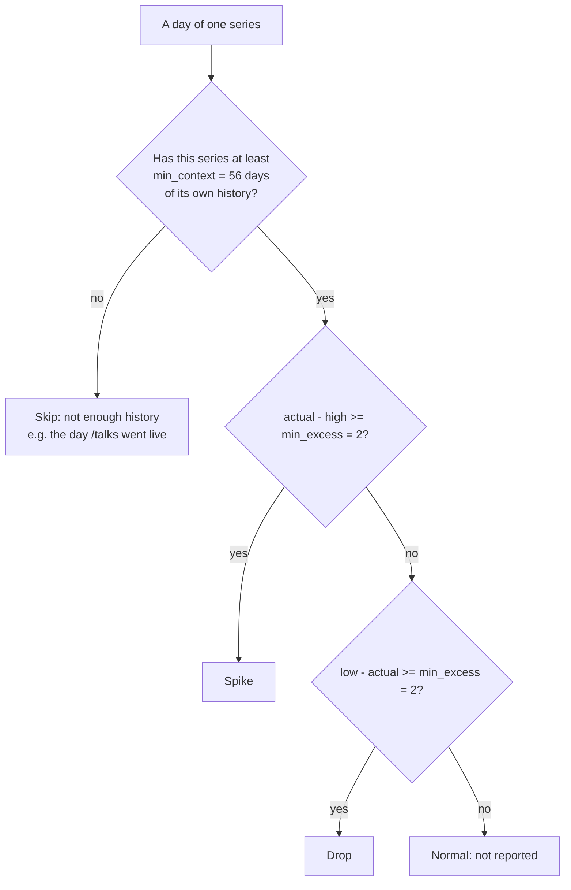
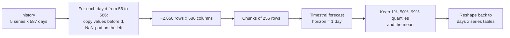
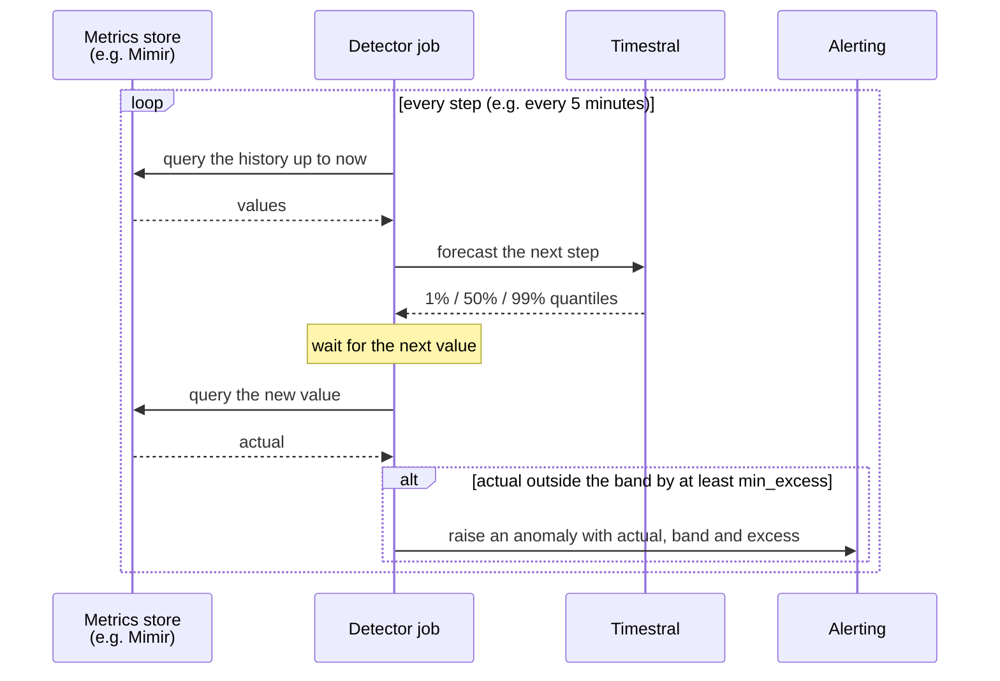

# Anomaly detection with a forecasting model

How this project finds unusual days in the website visits, why it works this way, and
how to tune it or reuse it on other data, such as server metrics. Like
[01-concepts.md](01-concepts.md), it assumes no statistics background.

- [What an anomaly is](#what-an-anomaly-is)
- [Ways to detect anomalies](#ways-to-detect-anomalies)
- [The idea: an anomaly is a surprise](#the-idea-an-anomaly-is-a-surprise)
- [The pipeline](#the-pipeline)
- [Step 1: forecast each day without seeing it](#step-1-forecast-each-day-without-seeing-it)
- [Step 2: compare reality with the forecast](#step-2-compare-reality-with-the-forecast)
- [Step 3: filter and rank](#step-3-filter-and-rank)
- [How the code does it](#how-the-code-does-it)
- [Choosing the band: false alarms vs missed anomalies](#choosing-the-band-false-alarms-vs-missed-anomalies)
- [Results on this data](#results-on-this-data)
- [Pitfalls](#pitfalls)
- [Running it live](#running-it-live)
- [Glossary](#glossary)

## What an anomaly is

An **anomaly** (or *outlier*) is a data point that doesn't fit the pattern of the rest.
There are three broad kinds:

| Kind | What it is | Website example | Server example |
|---|---|---|---|
| **Point** | One value far from normal | 50 visits on a day that usually gets 3 | A latency spike to 4 s |
| **Contextual** | A value that is normal in general, but not at *this* time | 20 visits on a Sunday at 4 am | Peak-hour traffic at midnight |
| **Collective** | A run of values that is odd *together*, though each one alone looks fine | A week of exactly 0 visits: the tracking script is broken | A metric that goes perfectly flat |

This project looks for **point anomalies**: single days with far more (or far fewer)
visits than expected. A forecaster also catches many contextual ones for free, because
"expected" already takes time patterns into account. Collective anomalies need
extra rules; see [pitfalls](#pitfalls).

## Ways to detect anomalies

From simplest to most capable:

| Approach | How it works | Weakness |
|---|---|---|
| **Fixed threshold** | "Alert above 30 visits" | Doesn't adapt: too sensitive on busy months, blind on quiet ones |
| **Statistical rule** | "Alert beyond 3 standard deviations from the average" (a *z-score*) | Assumes values are spread symmetrically; ignores trends and weekly cycles |
| **Seasonal decomposition** | Split the series into trend + weekly cycle + leftover; alert on big leftovers | Needs the cycle length set by hand, and enough clean history |
| **Machine-learning detector** | e.g. an isolation forest, trained on your data | Needs training, tuning and retraining per dataset |
| **Forecast-based** (this project) | Predict each value, alert when reality falls far outside the prediction | Only as good as the forecaster |

The forecast-based approach used to have a big cost: you needed a good forecasting model
per series. A **time series foundation model** like Timestral removes that cost. It
forecasts any series zero-shot, with no training, so forecast-based detection becomes
the easy option instead of the expensive one.

## The idea: an anomaly is a surprise

Instead of defining "abnormal" directly, define "normal" with a forecast, and call
anything far outside it an anomaly.

A probabilistic forecast doesn't give one number for tomorrow; it gives a range, with
probabilities (see [quantiles](01-concepts.md#probabilistic-forecasts-quantiles-and-intervals)).
This project uses the **1% and 99% quantiles**:

- the **99% quantile** (`high`): only about 1 day in 100 should be above it;
- the **1% quantile** (`low`): only about 1 day in 100 should be below it.

Between them is a **98% band**. A day outside it is one the model considered very
unlikely: a surprise.



The band adapts by itself: it rises in busy periods, falls in quiet ones, and follows
any weekly rhythm the model has picked up. That is the main advantage over a fixed
threshold.

## The pipeline



## Step 1: forecast each day without seeing it

The most important rule: **the forecast for a day must not see that day.**

Suppose you instead fit the model to the whole history at once and compared each day
with the model's view of it. A spike would be part of what the model looks at, so it
would pull the "expected" value up towards itself and partly hide. Statisticians call
using information you wouldn't have had at the time **look-ahead** or **leakage**.

So every day is judged by a forecast made only from the days *before* it. This is
called **one-step-ahead** (or *walk-forward*) forecasting. It reproduces exactly what a
forecaster running every night would have predicted for the next day.



Each judged day gets a history one day longer than the previous one. The first 56 days
(`--min-context`) are never judged, because there isn't enough history to know what
normal looks like.

## Step 2: compare reality with the forecast

For each day and series, two distances are computed:

```
spike = actual - high     positive when the day is above the band
drop  = low - actual      positive when the day is below the band
```

Worked example, the largest anomaly found (site-wide total, 2026-08-31):

| actual | low (1%) | median | high (99%) | spike | drop |
|---|---|---|---|---|---|
| 50 | 0 | 1.98 | 19.35 | 50 - 19.35 = **30.65** | 0 - 50 = -50 |

The spike distance is positive, so it's above the band. The size of the surprise,
`excess`, is the larger of the two distances: 30.65 visits.

## Step 3: filter and rank

Two filters keep the result useful on small numbers:



- **`--min-context`, per series.** A page added later (like `/talks`, in April 2026)
  needs 56 days of its *own* history. Otherwise its first visits would count as
  anomalies, since the model had only seen "nothing" before.
- **`--min-excess`.** A day must be at least 2 visits outside the band. On a page whose
  99% line is 0.4 visits, a single visit is technically outside the band, but nobody
  cares.

Finally, all anomalies are sorted by `excess`, biggest surprise first.

## How the code does it

Two functions do the work: `one_step_ahead()` in `forecasting.py` (step 1) and
`run_anomalies()` in `main.py` (steps 2 and 3).

### Batching: one forecast call instead of thousands

Step 1 needs a separate forecast for each of about 530 days, for each of 5 series:
about 2,650 forecasts. Calling the model 2,650 times would be slow. Instead,
`one_step_ahead` builds them all as **rows of one big batch**, each row holding the
history *before* its day.

The rows have different lengths (the history before day 56 is shorter than the history
before day 586), but a batch needs equal lengths. So shorter rows are **padded on the
left with NaN**, which Timestral treats as "missing", not as zero:

```
days counted from 0; v0 = visits on day 0 (2025-03-18)

row for day  56:  NaN NaN NaN ... NaN  v0  v1 ... v55        -> forecast day  56
row for day  57:  NaN NaN NaN ... v0   v1  v2 ... v56        -> forecast day  57
...
row for day 586:  v0  v1  v2  ...                    v585    -> forecast day 586
                  └──────────── 586 columns ────────────┘
```



Line by line:

| Code | What it does |
|---|---|
| `values = history.to_numpy().T` | The data as an array: one row per series, one column per day |
| `length = n_days - 1` | The longest history needed: everything before the last day |
| `targets = range(min_context, n_days)` | The days to judge; the first 56 are skipped |
| `contexts = np.full(..., np.nan)` | An all-NaN array: one row per (day, series) |
| `contexts[row, :, length - day:] = values[:, :day]` | Copy the days *before* `day` into the right end of the row; the rest stays NaN |
| `first_weekday[row] = ...` | The weekday of each row's first column, so the day-of-week covariate lines up with real dates |
| `contexts.reshape(-1, length)` | Flatten (days x series) into one list of rows |
| `for start in range(0, len(contexts), batch_size)` | Send 256 rows at a time, to keep memory in check |
| `_forecast(..., horizon=1)` | Forecast one day ahead for every row in the chunk |
| `result.quantile(q)` for 1%, 50%, 99%, plus `_mean` | Keep only the four numbers needed per row |
| `reshape(len(targets), n_series, 4)` | Back to (days x series), one table per quantile |

The result is a `QuantileForecast`: tables `low`, `median`, `high` and `mean`, indexed
by day, one column per series. `run_anomalies` then lines these up with the actual
visits and applies steps 2 and 3.

## Choosing the band: false alarms vs missed anomalies

Every detector trades off two mistakes:

- a **false alarm** (*false positive*): flagging a day that was actually normal;
- a **missed anomaly** (*false negative*): not flagging a day that really was odd.

The band width sets the balance. If the model's quantiles are accurate (*calibrated*),
a band from 1% to 99% leaves about 2% of perfectly normal days outside it, by
definition. At one value per day, that's about 7 false alarms per series per year;
at one value per minute, it's about 29 per series per *day*.

| Band | Normal days outside it | Use when |
|---|---|---|
| 10%-90% | ~20% | Exploring; you want to see everything a bit unusual |
| 1%-99% (this project) | ~2% | Daily data reviewed by a person |
| 1%-99% plus `min_excess` | fewer | Small counts, where tiny excesses are noise |
| Wider than the model offers | n/a | Timestral's widest quantiles are 1% and 99%; for stricter alerts, raise `min_excess` or require several anomalous steps in a row |

Ways to tune, in `main.py anomalies`:

| Knob | Fewer alerts | More alerts |
|---|---|---|
| Band (`low`/`high` in `one_step_ahead`) | 1%-99% | 5%-95%, 10%-90% |
| `--min-excess` | raise | lower to 0 |
| `--min-context` | raise | lower (but then early days are judged on little history) |

### Is the band honest here?

You can check calibration on the replay itself: count how often the real value landed
above the 99% line. If the model is calibrated, that should happen on about 1% of days.

| Series | Days checked | Days above the 99% line |
|---|---|---|
| all pages | 531 | 7 |
| `/` | 531 | 6 |
| `/blog` | 531 | 5 |
| `/cv` | 530 | 4 |
| `/talks` | 123 | 2 |
| **total** | **2,246** | **24 (1.07%)** |

1.07% against an expected 1%: on this data, Timestral's 99% line means what it says.
Of those 24 days, `--min-excess 2` keeps the 12 that were at least 2 visits above it.

## Results on this data

12 anomalies over 2025-05-13 to 2026-10-25, all spikes:


The orange band is the 98% band the model expected for each day; red dots are
anomalies. Looking up what happened on the biggest ones:

| Day | Series | Visits | Band top | What happened |
|---|---|---|---|---|
| 2026-08-31 | all pages | 50 | 19.35 | 44 different pages got ~1 visit each: looks like a crawler. No single page looks odd, so only the total catches it |
| 2025-12-19 | all pages, `/` | 34 | 15.38 | The home page jumped to 21 visits, along with `/blog`, `/talks`, `/cv` |
| 2026-07-16 | all pages | 32 | 21.75 | 27 visits to one old post on writing with Obsidian: probably shared somewhere |
| 2026-08-01 | all pages | 37 | 27.93 | The day a new post was published |
| 2026-09-15 | `/` | 21 | 12.41 | Home page jump, together with `/blog`, `/talks`, `/slides`, `/cv` |

Two lessons from the table:

- **Watch the total and the parts.** The crawler on 2026-08-31 is invisible on any
  single page but obvious in the site total. A single viral page is the opposite: clear
  on that page, diluted in the total.
- **The detector says *that*, not *why*.** Every explanation above came from a human
  looking at the raw data afterwards.

## Pitfalls

- **Masking after a spike.** A spike becomes part of the history for the following
  days, and the model widens its band, expecting after-shocks. A second spike soon
  after the first can then go unflagged. This happens in this data: on 2026-08-31 the 99% line was
19 visits; the day after the spike it was 67, and a week later, on 2026-09-08, still 38.
That day had 20 visits, which the pre-spike band would have flagged but the widened
band didn't. Whether that is a bug or a feature depends on your goal: spikes often do
come in clusters.
- **Drops can't be seen in sparse data.** With a few visits a day, the 1% line is
  almost always 0, and a count can't go below 0. In the replay, the 1% line was above 0 on only 11 of 2,246
days, and 3 days fell below it, all by less than the 2-visit `min_excess`. On busier data,
  drops (an outage, a broken tracker) are just as detectable as spikes.
- **Collective anomalies are missed.** A tracker that silently breaks and reports 0 for
  a week produces days that each look like a plausible quiet day. Catch these with an
  extra rule, such as "N zeros in a row", or by forecasting weekly totals.
- **A lasting change looks like a run of anomalies.** If traffic doubles permanently
  (a new audience), the first days are flagged; then the model, which re-reads the
  history every day, adapts. A run of consecutive anomalies usually means "something
  changed", not "many separate incidents".
- **Calibration matters.** The false-alarm rate is only ~2% if the model's quantiles are
  accurate. Check it on your own data, as in the section above.

## Running it live

The replay in this project judges the past. The same logic works live: every time a
new value arrives, compare it with the band forecast just before it.



Practical notes for live use:

- **Batch all series** into one forecast call per step, as `one_step_ahead` does.
- **Speed**: at 5-minute steps there is plenty of time. For thousands of series, use a
  smaller model (28M) and skip covariates; see the
  [performance tips](03-python-library.md#performance-tips).
- **Group consecutive anomalies** into one incident, to avoid an alert per step.
- **Store the bands**, not just the alerts. Showing the band next to the metric on a
  dashboard makes each alert self-explanatory.

## Glossary

| Term | Meaning |
|---|---|
| **Anomaly** / outlier | A value that doesn't fit the usual pattern |
| **Band** / interval | The range between two quantiles; here 1% to 99% |
| **Calibrated** | The model's probabilities hold in practice: ~1% of days really are above its 99% line |
| **Collective anomaly** | A run of values that is odd together |
| **Contextual anomaly** | A value that is normal in general but not at that time |
| **Excess** | How far outside the band a value is, in visits |
| **False alarm** / false positive | A normal value flagged as an anomaly |
| **Look-ahead** / leakage | Using information from the period being judged |
| **Masking** | An earlier anomaly widening the band so a later one goes unflagged |
| **Missed anomaly** / false negative | A real anomaly that wasn't flagged |
| **One-step-ahead** / walk-forward | Forecasting each step only from the steps before it |
| **Point anomaly** | A single value far from normal |
| **Quantile** | A value with a stated chance of not being exceeded |
| **Z-score** | Distance from the average, measured in standard deviations |
