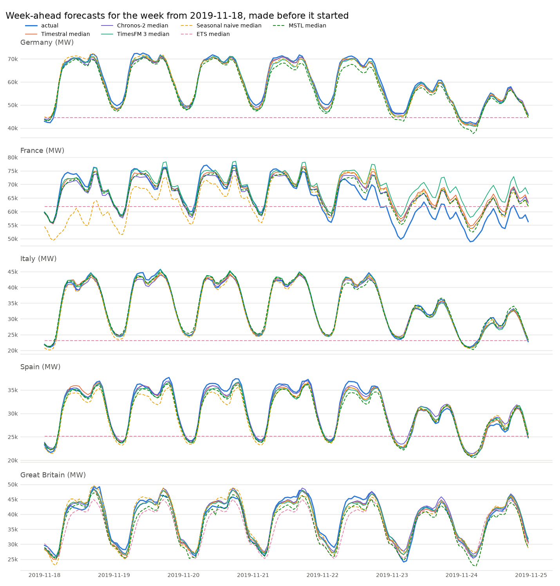
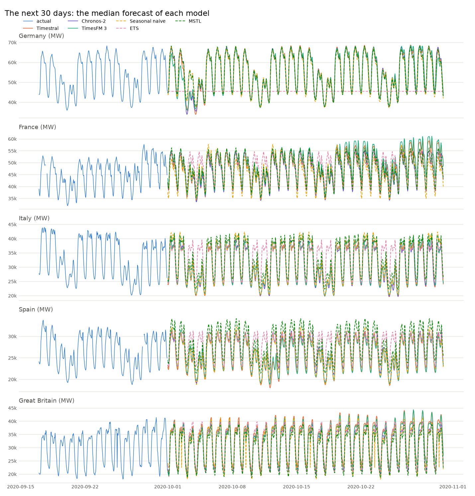
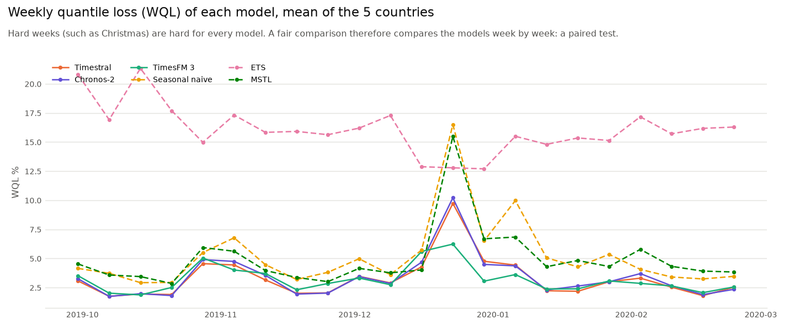
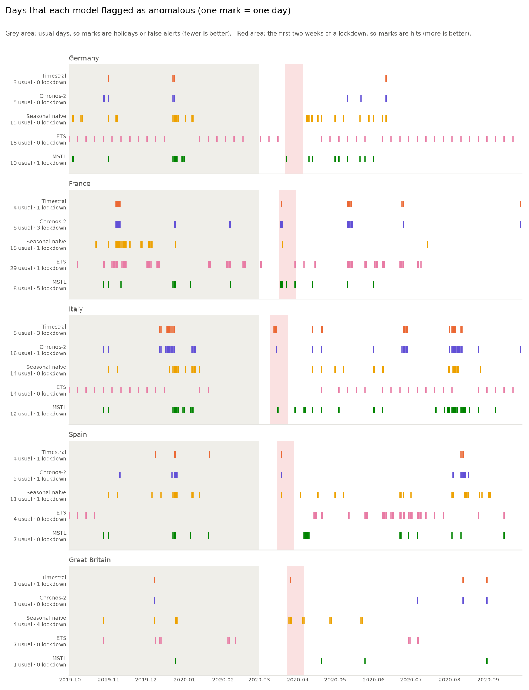
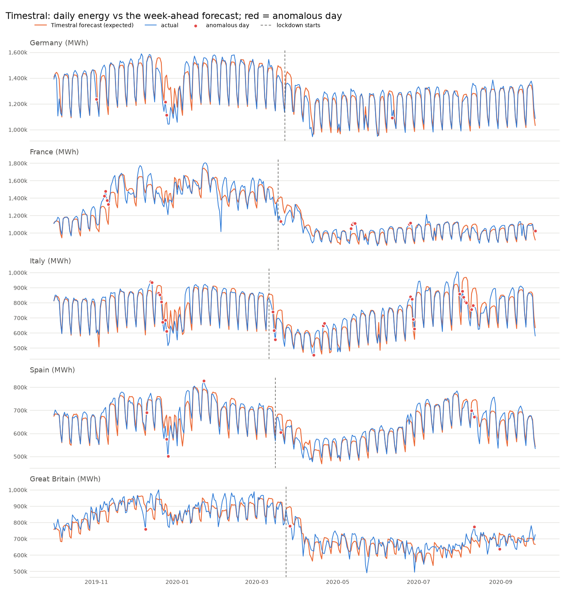
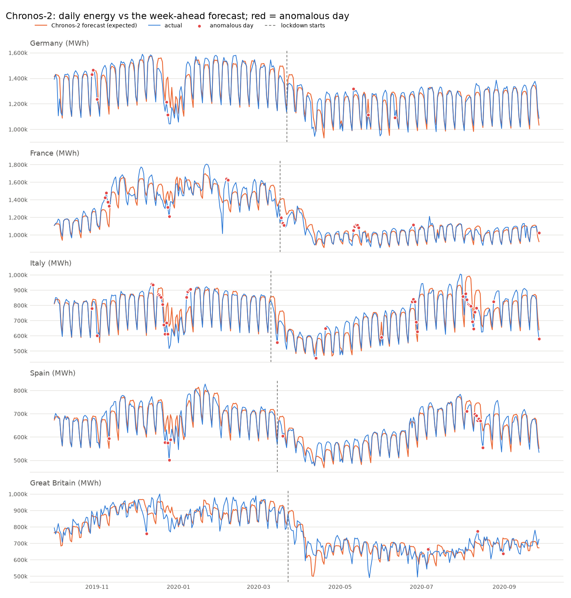
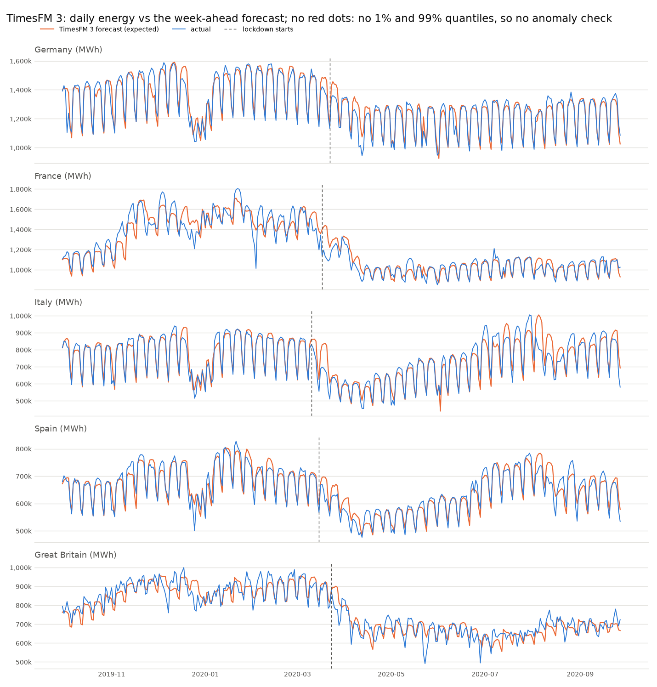
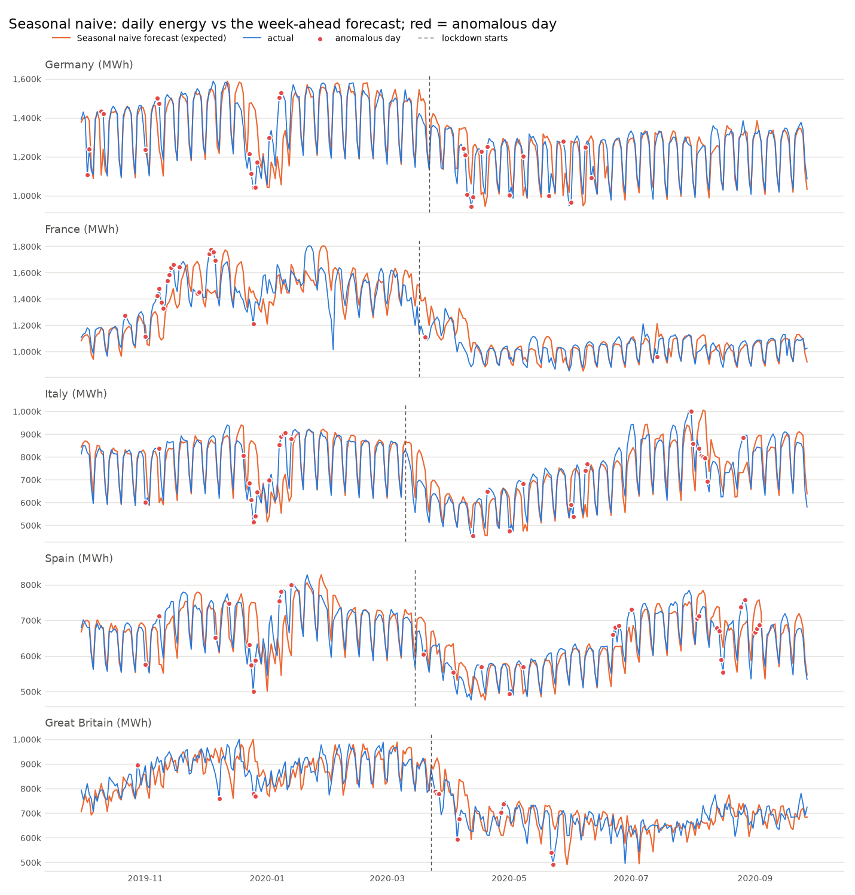
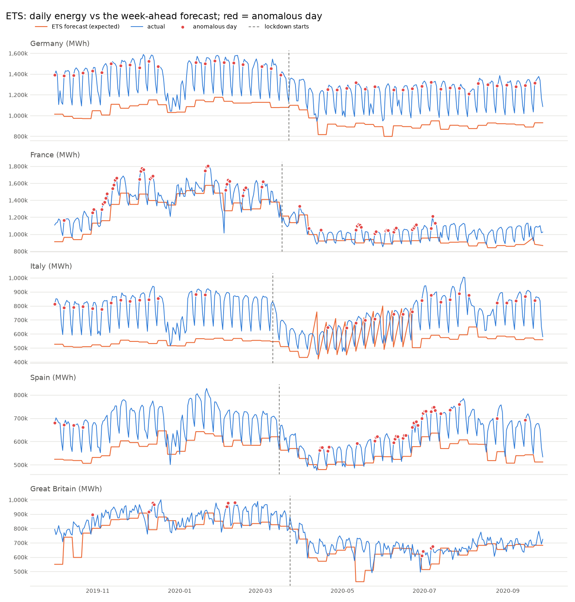
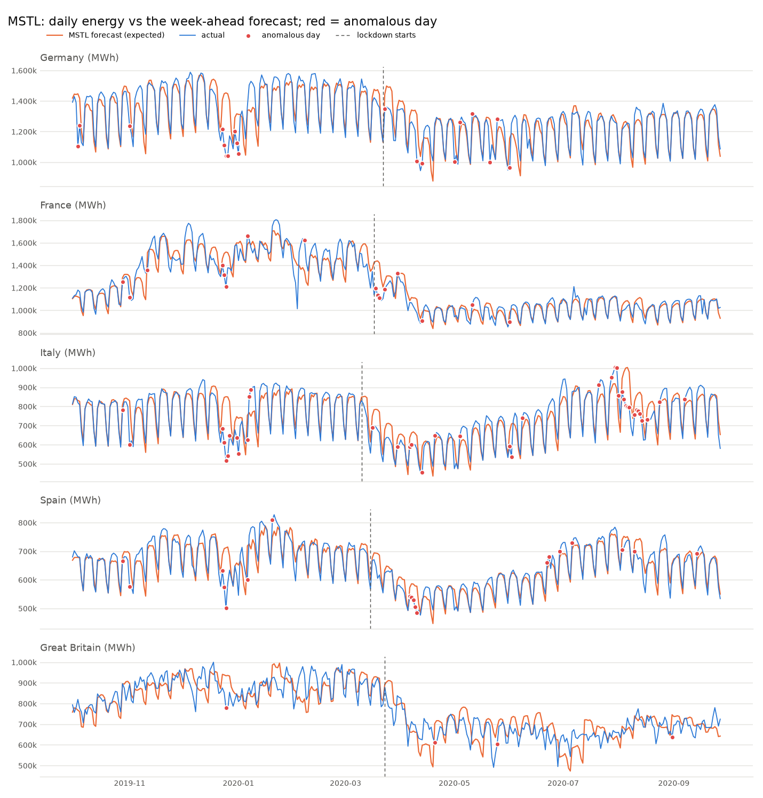

# Comparing models: three TSFMs and three classical baselines

This note compares three open-weight time series foundation models (Timestral, Chronos-2
and TimesFM 3) and three classical baselines (seasonal naive, ETS and MSTL) on the same
data, with the same procedure. It says which model is better at forecasting and at
anomaly detection, and it tests whether the differences are real or can be chance.

To get all the numbers and charts in this note:

```sh
uv run main.py compare
```

The command runs each model on the CPU (about 10 minutes for the six). It writes
`output/compare-summary.csv`, `output/compare-forecasting.csv`,
`output/compare-significance.csv`, `output/compare-anomalies.csv` and four charts. It also writes the usual `forecast` and
`anomalies` files for each model. The files of a model other than Timestral get the
name of the model as a suffix, for example `output/forecast-timesfm-3.png`.

- [The models](#the-models)
- [How we compare the models](#how-we-compare-the-models)
- [The scores, explained](#the-scores-explained): quantiles, MAPE, baseline, pinball loss,
  WQL, coverage, width, tail calibration
- [Summary: which model is better](#summary-which-model-is-better)
- [1. Forecasting](#1-forecasting)
- [2. Is the difference real?](#2-is-the-difference-real)
- [3. Anomaly detection](#3-anomaly-detection)
- [Models that we did not add](#models-that-we-did-not-add)
- [Limits of this comparison](#limits-of-this-comparison)

## The models

| | Timestral-209M | Chronos-2 | TimesFM 3 |
|---|---|---|---|
| Maker | Mistral AI | Amazon | Google |
| Hugging Face id | `mistralai/Timestral-209M` | `amazon/chronos-2` | `google/timesfm-3.0-pytorch` |
| Parameters | 209 million | 120 million | 331 million |
| Licence | open weights | Apache-2.0 | Apache-2.0 |
| Longest history it reads | 32,768 steps | 8,192 steps | 15,360 steps |
| Quantile levels | 21: 1%, 5%, ..., 95%, 99% | 21: 1%, 5%, ..., 95%, 99% | 9: 10%, 20%, ..., 90% |
| Known-future covariates (the holidays) | yes | yes | yes |
| Command-line name | `timestral` (default) | `chronos-2` | `timesfm-3` |

The important difference is the quantile levels. TimesFM 3 gives only 10% to 90%. It
has no 1% and no 99% quantile, so it cannot do this project's anomaly check, which
uses the 1%-99% range. We score TimesFM 3 on forecasting only.

### The classical baselines

A TSFM is useful only if it is better than the simpler methods that already exist. Thus
the comparison also has three classical models from the
[statsforecast](https://github.com/Nixtla/statsforecast) library (Nixtla). For how they
work, see [08-classical-baselines.md](08-classical-baselines.md).

| | Seasonal naive | ETS | MSTL |
|---|---|---|---|
| Method | each hour = the same hour one week earlier | exponential smoothing; AutoETS selects the form, with a daily cycle or without a cycle | daily and weekly cycles removed with STL, the rest forecast with ETS |
| Cycles that it knows | weekly (it copies a whole week) | daily at most (here, usually none) | daily and weekly |
| Range | from the past week-to-week changes | from its own error model | from its own error model |
| Holidays | no | no | no |
| Command-line name | `seasonal-naive` | `ets` | `mstl` |

The baselines are different from the TSFMs in two ways. They are **fitted again on each
12-week history** (they learn only from this data), and they **do not get the holiday
indicator**, because they have no input for it. Their ranges give all the levels that
the scores need (1%, 5%, 10%, ..., 90%, 95%, 99%), so they can also do the anomaly check.

In the code, each model is one class in `forecasting.py` (`TimestralModel`,
`Chronos2Model`, `TimesFM3Model`, and `StatsBaseline` for the three baselines). Each class changes the project's arrays into the
input format of its library, and changes the result back into the same `RawForecast`.
The rest of the code does not know which model it uses. To add a model, you add one
class.

## How we compare the models

### The rule: same input, same questions, same scores

A comparison is fair only if the models get exactly the same task. Thus every model gets:

- the same data: hourly demand of the same five countries;
- the same history for each forecast: the 2,048 hours (about 12 weeks) before it;
- the same extra input: a 0/1 public-holiday indicator for each country, for the history
  and for the hours that it forecasts (the TSFMs only; the baselines cannot use it);
- the same forecasts to make: one forecast for each week from 30 September 2019 to
  27 September 2020, for each country (52 weeks × 5 countries = 260 forecasts);
- the same scores, calculated by the same code.

No TSFM is trained or adjusted on this data: all three are used zero-shot, with the
default settings of their libraries. The baselines are fitted on each history, also with
default settings. The settings were not changed after we saw the results (for ETS, we
tested other settings and report them in section 1, but kept the first one).

### Step 1: forecast the past without looking at it

We cannot score a forecast of the future, because we do not know the future yet. Thus we
forecast the past. But each forecast may use only the data from before its week. This
is a **rolling-origin evaluation** (also called a *walk-forward backtest*):

```
            week 1           week 2           week 3          ...
history ███████████│░░░░░░░│
history ██████████████████│░░░░░░░│
history █████████████████████████│░░░░░░░│
        ███ = what the model sees (the 12 weeks before)   ░░░ = what it forecasts, then we score it
```

The model never sees the hours that we score. This is the same as a forecaster that ran
every Sunday at midnight. If the model could see the scored hours, its scores would be
too good, and the comparison would mean nothing.

The anomaly check needs exactly these forecasts. Thus one set of forecasts gives both
results: the forecasting scores and the anomalies.

### Step 2: score the forecasts on usual days

A forecast is good if it is near the actual demand on usual days. We cannot expect any
model to forecast the COVID-19 lockdowns. Thus we score the forecasts only on the usual
days before the pandemic: from 30 September 2019 to 29 February 2020 (22 weeks, about
18,000 hours over the five countries).

We use four scores. The first is the main score.

| Score | What it measures | Better |
|---|---|---|
| **WQL** (weighted quantile loss) | The quality of the whole forecast: the median and the range together | lower |
| **MAPE** (mean absolute percentage error) | How far the median is from the actual demand, in % | lower |
| **Hours in the 80% range** | If the range is honest: about 80% of hours must be between the 10% and the 90% quantile | nearest to 80% |
| **Width of the 80% range** | How precise the range is, as % of the demand | lower, but only if the 80% is correct |

Each score is explained, with examples, in [The scores, explained](#the-scores-explained).

**Why WQL is the main score.** These models do not give one number. They give a range
of possible values (the quantiles). MAPE scores only the median, and ignores the range.
WQL scores each quantile with the *pinball loss*:

- If the actual value is above the 90% quantile, the loss is large: the forecast said
  this was improbable.
- If the actual value is below the 90% quantile, the loss is small: this is what the
  90% quantile said.

We add the pinball loss of the 9 deciles (10%, 20%, ..., 90%) over all hours, and divide
by the total demand. A model gets a low WQL only if its median is near the actual value
**and** its range has the correct width. A range that is too narrow is punished when the
actual value goes outside it. A range that is too wide is punished on every hour. WQL is
the standard score of the public benchmarks for these models (for example GIFT-Eval and
fev-bench), and it is an approximation of the CRPS (continuous ranked probability
score). We use the deciles because all six models give them, so the score is the same
for all.

**The baselines.** A score has meaning only in comparison with simpler methods. The
weakest is seasonal naive ("same hour last week"); MSTL is the strongest of the three. A
useful TSFM must be better than all of them.

### Step 3: score the anomaly detection

Anomaly detection has a different question: does the model raise an alert when, and
only when, something unusual happens? We use four scores:

| Score | What it measures | Better |
|---|---|---|
| **Hours outside 1%-99% before the pandemic** (main score) | If the 1% and 99% lines are in the correct position. On usual days, 1% of hours must be below the 1% line and 1% above the 99% line: 2% in total | nearest to 2% |
| **Anomalous days before the pandemic** | How many alerts on usual days. Some are real events (Christmas, bridge days), but most of the difference between models is false alerts | lower |
| **Lockdown days found** | Anomalous days in the first 14 days of each of the five lockdowns | higher |
| **Lockdowns found** | Countries where the model found at least one lockdown day, of 5 | higher |

For tail calibration, see [The scores, explained](#tail-calibration-the-score-for-anomaly-detection).

**Why tail calibration is the main score.** The anomaly rule is "6 or more hours outside
the 1%-99% range". A model with a 1%-99% range that is too narrow sends more alerts on
usual days. A model with a range that is too wide misses real events. Thus the position
of the 1% and 99% lines decides the quality of the alerts. We measure it on usual days,
where we know that the answer must be 2%.

The lockdowns are the only events in the data that we know are real anomalies. But there
are only five, and they are not independent: they all occurred within two weeks. Thus
these scores are a check, not the main score.

### Step 4: test whether a difference is real

Two models with a WQL of 3.18% and 3.21% can be equally good: with other weeks, the order
could change. Thus we test each pair of models with a **paired comparison**: both models
forecast the same weeks, so we compare them week by week.

- **Win counts:** in how many of the 22 usual weeks (and of the 110 country-weeks) model
  A has the lower WQL than model B.
- **The Diebold–Mariano test:** for each week, the difference in WQL between the two
  models (mean of the 5 countries). If the models are equally good, the mean difference
  is 0. The test gives a **p-value**: the probability of a difference at least this large
  if the models were equally good. With 6 models there are 15 pairs, so the p-values are
  adjusted with the Holm method. A difference is "real" when the adjusted p-value is
  below 0.05.

For the idea behind paired tests and the Diebold–Mariano test, with an example, see
[01-concepts.md](01-concepts.md#is-a-difference-real-paired-comparisons). The code is
`evaluation.py`.

### Step 5: one winner for each row

The summary table has one row for each score and one column for each model. For each
row, the "better" column names the model with the best value, by the rule of that row
(lowest, highest or nearest to the target). The winner of each section is the winner of
its main score. The other rows explain why. One more row says whether the WQL winner is
clearly better than the second model (Step 4).

## The scores, explained

This section explains each score with small examples. The numbers in the examples are
round numbers, not data from the project. For the basic terms (quantile, interval,
median), see also [01-concepts.md](01-concepts.md).

### Quantiles: what the models give

A model does not give one number for each hour. It gives a set of **quantiles**. The
*q* quantile is the value that the model expects the demand to stay below with
probability *q*. For example, for one hour:

| Quantile | Value | Meaning |
|---|---|---|
| 10% | 47,000 MW | 1 chance in 10 that the demand is lower than this |
| 50% (median) | 51,000 MW | the best single estimate: equal chances above and below |
| 90% | 53,000 MW | 9 chances in 10 that the demand is lower than this |

Two quantiles make a **range** (an *interval*). The range from 10% to 90% is the **80%
range**: the demand must be in it on 8 hours of 10. The range from 1% to 99% is the
**98% range**: the demand must be outside it on only 2 hours of 100. The anomaly check
uses this range.

All the scores below compare these quantiles with the **actual** demand of the same hour.

### MAPE: how far the median is from the actual value

**MAPE** (mean absolute percentage error) uses only the median. For each hour, calculate
the difference between the median and the actual value, as a percentage of the actual
value. Ignore the sign: too high and too low count the same. Then calculate the mean
over all hours.

| Hour | Median forecast | Actual | Difference | As % of the actual |
|---|---|---|---|---|
| 07:00 | 51,000 MW | 50,000 MW | 1,000 MW | 2.0% |
| 08:00 | 38,000 MW | 40,000 MW | 2,000 MW | 5.0% |
| 09:00 | 60,000 MW | 60,000 MW | 0 MW | 0.0% |
| | | | **MAPE** | **(2.0 + 5.0 + 0.0) / 3 = 2.3%** |

- **Lower is better.** A MAPE of 4% means that the median is, on average, 4% away from
  the actual demand.
- **Percentages make countries comparable.** An error of 1,000 MW is small in Germany
  (about 60,000 MW) and large in Spain (about 28,000 MW).
- **The limit of MAPE:** it does not look at the range. Two models with the same median
  get the same MAPE, also if one has a correct range and the other has a range that is
  much too narrow. Thus MAPE alone cannot compare these models.

### The baseline: is the model useful?

A MAPE of 4% has no meaning alone: is that good or bad for this data? Thus we compare it
with a **baseline**, a simple method that any useful model must beat. Our baseline is
**"same hour last week"**: the forecast for Tuesday 10:00 is the actual demand of the
Tuesday before at 10:00. This method already knows the daily and the weekly cycle. It
has a MAPE of 6.0% on our data. The three TSFMs have 4.2-4.4%, so all three are useful.

### Pinball loss: the score for one quantile

To score a quantile, we use the **pinball loss** (also called the *quantile loss*). For
the *q* quantile with value *f*, and the actual value *y*:

- if the actual value is **above** the quantile (*y* > *f*): loss = *q* × (*y* − *f*)
- if the actual value is **below** the quantile (*y* < *f*): loss = (1 − *q*) × (*f* − *y*)

The two cases have different weights. This is how the loss knows what a quantile
promised. Example: the actual demand is 50,000 MW.

| Quantile | Value | Actual is | Loss | Why |
|---|---|---|---|---|
| 90% | 53,000 MW | below, by 3,000 | (1 − 0.9) × 3,000 = **300** | small: a 90% quantile must be above the actual value on most hours |
| 90% | 48,000 MW | above, by 2,000 | 0.9 × 2,000 = **1,800** | large: the model said "90% sure that the demand stays below 48,000", and it was wrong |
| 50% | 51,000 MW | below, by 1,000 | 0.5 × 1,000 = **500** | the two sides have the same weight for the median |

Thus a 90% quantile that is 2,000 MW too low costs 6 times more than one that is 3,000
MW too high. The best position for each quantile, over many hours, is exactly the
position where it is correct: for the 90% quantile, where 90% of actual values are below
it. A model gets the lowest loss only when it puts each quantile at its true position.

For the median, the pinball loss is half of the absolute error (0.5 × 1,000 = 500 for a
difference of 1,000 MW).

### WQL: the score for the whole forecast

**WQL** (weighted quantile loss) adds the pinball loss of several quantiles. Then it
divides by the actual demand, so that the result is a percentage, as MAPE is:

```
WQL = 2 × (sum of the pinball losses of all quantiles, over all hours)
      ─────────────────────────────────────────────────────────────────
          (number of quantiles) × (sum of the actual values)
```

This project uses the 9 deciles (10%, 20%, ..., 90%), because all six models give
them. The factor 2 changes the half in the pinball loss back to a full error. Thus, for
the median alone, WQL is the same as the absolute error in %: a difference of 1,000 MW at
50,000 MW gives a WQL of 2 × 500 / 50,000 = 2%, and a MAPE of 2%. With all the quantiles,
WQL is the percentage error of the whole forecast, not only of the median.

Example: one hour, actual demand 52,500 MW, three models with the same median (51,000 MW)
but different ranges. To keep it short, we use only the 10%, 50% and 90% quantiles.

| | 10% | 50% | 90% | Loss 10% | Loss 50% | Loss 90% | Total | WQL |
|---|---|---|---|---|---|---|---|---|
| A: correct range | 47,000 | 51,000 | 53,000 | 0.1 × 5,500 = 550 | 0.5 × 1,500 = 750 | 0.1 × 500 = 50 | 1,350 | **1.71%** |
| B: range too narrow | 49,500 | 51,000 | 52,000 | 0.1 × 3,000 = 300 | 750 | 0.9 × 500 = 450 | 1,500 | 1.90% |
| C: range too wide | 40,000 | 51,000 | 60,000 | 0.1 × 12,500 = 1,250 | 750 | 0.1 × 7,500 = 750 | 2,750 | 3.49% |

(WQL = 2 × total / (3 × 52,500).)

- All three models have the same median, so they have **the same MAPE** (2.9%). MAPE
  cannot see the difference.
- **B is punished** because the actual value is above its 90% quantile: its range was too
  narrow.
- **C is punished** because its 10% and 90% quantiles are far from the actual value: its
  range is so wide that it says almost nothing.
- **A has the best WQL**: its range was wide enough, but not wider.

On hours when the actual value is near the median, the narrow range of B has a lower loss
than A. Over thousands of hours, these hours and the hours outside the range balance.
The model with the lowest total is the model whose quantiles are nearest to their true
positions. Thus WQL rewards a forecast that is both **accurate** (good median) and
**honest** (correct range), and this is why it is the main forecasting score.

WQL is the standard score of the public benchmarks for these models (for example
GIFT-Eval and fev-bench). It is an approximation of the CRPS (continuous ranked
probability score), which is the same idea with all quantiles, not only 9.

### Hours in the 80% range: is the range honest?

Count the hours when the actual value is between the 10% and the 90% quantile, as a
percentage of all hours. This is the **coverage** of the 80% range.

| Coverage | Meaning |
|---|---|
| about 80% | **calibrated**: the range means what it says |
| much less than 80%, for example 72% | **overconfident**: the range is too narrow, and the model is surprised too often |
| much more than 80%, for example 90% | **underconfident**: the range is too wide. It is safe, but it gives less information |

Example: over 1,000 hours, the actual value was in the 80% range on 767 hours. The
coverage is 76.7% (TimesFM 3 on our data): a little too narrow.

### Width of the 80% range: how precise is the range?

For each hour, the width is the 90% quantile minus the 10% quantile, as a percentage of
the actual value. Then calculate the mean. Example: 10% = 47,000 MW, 90% = 53,000 MW,
actual 50,000 MW: the width is 6,000 / 50,000 = 12%.

A narrow range is more useful, **but only if its coverage is correct**. It is easy to
make a narrow range: it is difficult to make a narrow range that is also correct. Thus
always read the width together with the coverage. TimesFM 3 has the narrowest range
(12.3%), but its coverage (76.7%) shows that part of this precision is not real.

### Tail calibration: the score for anomaly detection

The anomaly check uses the 1% and 99% quantiles (the **tails** of the forecast). On usual
days, the actual value must be below the 1% line on 1% of the hours and above the 99%
line on 1% of the hours: **2% in total**. We count these hours before the pandemic, when
the days are usual.

| Hours outside 1%-99% | Meaning | Effect on the alerts |
|---|---|---|
| about 2% | the lines are in the correct position | the alerts are reliable |
| more than 2%, for example 3.1% (Chronos-2) | the range is too narrow | more false alerts on usual days |
| less than 2%, for example 0.5% | the range is too wide | real events can stay inside the range, and the check misses them |

Why this matters: the rule is "a day is anomalous when 6 or more of its hours are outside
the range". With correct lines, 6 such hours in one day are improbable on a usual day. If
the lines are too narrow, usual days get 6 hours outside more often, and they become
false alerts. Thus the position of the tails decides the quality of the alerts, and this
is the main anomaly score.

WQL does not measure this. It uses only the deciles (10% to 90%), so a model can have a
good WQL and bad tails. This is why Chronos-2 is close to the other models in
forecasting, but worse in anomaly detection.

## Summary: which model is better

From `output/compare-summary.csv`:

| Section | Criterion | Timestral | Chronos-2 | TimesFM 3 | Seasonal naive | ETS | MSTL | Better |
|---|---|---|---|---|---|---|---|---|
| forecasting | **WQL %** (main score, lower is better) | 3.21 | 3.33 | **3.18** | 5.09 | 16.07 | 4.83 | TimesFM 3 |
| forecasting | MAPE % of the median (lower is better) | 4.24 | 4.38 | **4.19** | 6.02 | 17.75 | 5.47 | TimesFM 3 |
| forecasting | hours in the 80% range (best: 80) | **81.1** | 77.1 | 76.7 | 83.1 | 78.2 | 89.8 | Timestral |
| forecasting | width of the 80% range % (lower is better) | 13.95 | 13.07 | **12.29** | 22.44 | 89.53 | 29.34 | TimesFM 3 |
| forecasting | is the WQL winner clearly better than the second? (Diebold–Mariano) | second | | best | | | | **no clear winner** (p = 0.91) |
| cost | seconds for the 260 week-ahead forecasts (CPU) | 95 | 26 | 41 | **4** | 87 | 32 | Seasonal naive |
| anomalies | **hours outside 1%-99% before the pandemic %** (main score, best: 2) | **1.8** | 3.1 | not possible | 5.9 | 5.1 | 3.8 | Timestral |
| anomalies | anomalous days before the pandemic (fewer = fewer false alerts) | **20** | 35 | not possible | 62 | 72 | 38 | Timestral |
| anomalies | lockdown days found, first 14 days (more is better) | 6 | 5 | not possible | 6 | 1 | **7** | MSTL |
| anomalies | lockdowns found, of 5 countries (more is better) | **4** | 3 | not possible | 3 | 1 | 3 | Timestral |

**Forecasting: the three TSFMs are equal, and all three are clearly better than the
baselines.** TimesFM 3 has the lowest WQL (3.18%), but the Diebold–Mariano test finds no
clear difference from Timestral (3.21%, adjusted p = 0.91) or Chronos-2 (3.33%, adjusted
p = 0.91). Timestral even has the lower WQL in 14 of the 22 weeks: TimesFM 3's lead comes
mostly from the week of Christmas (see [section 2](#2-is-the-difference-real)). All three
TSFMs are clearly better than every baseline (adjusted p ≤ 0.004): their WQL is about a
third lower than that of MSTL, the best baseline.

**Anomaly detection: Timestral is better.** Its 1%-99% range is the most honest (1.8% of
usual hours outside it, target 2%). Thus it sends the fewest alerts on usual days (20).
Chronos-2's range is too narrow (3.1%, 35 alerts), and the baselines' ranges are worse
(3.8-5.9%, 38-72 alerts). MSTL found one more lockdown day than Timestral (7 against 6),
but with almost twice as many alerts on usual days. TimesFM 3 cannot do this check.

**Speed: seasonal naive is the fastest** (it only copies the last week), and of the TSFMs,
Chronos-2 is the fastest. The times change between runs on the same laptop: in another run,
Timestral took 167 seconds, not 95.

## 1. Forecasting

Week-ahead forecasts, scored from 30 September 2019 to 29 February 2020. The per-country
values are in `output/compare-forecasting.csv`.

**WQL %** (lower is better):

| Country | Timestral | Chronos-2 | TimesFM 3 | Seasonal naive | ETS | MSTL |
|---|---|---|---|---|---|---|
| Germany | 2.76 | 2.77 | **2.50** | 4.40 | 19.23 | 4.52 |
| France | **3.86** | 3.98 | 4.31 | 5.88 | 9.45 | 4.24 |
| Italy | 2.89 | 3.18 | **2.61** | 5.52 | 26.99 | 5.43 |
| Spain | 2.45 | 2.55 | **2.42** | 4.45 | 16.45 | 4.06 |
| Great Britain | 4.12 | 4.17 | **4.06** | 5.21 | 8.22 | 5.91 |
| **Mean** | 3.21 | 3.33 | **3.18** | 5.09 | 16.07 | 4.83 |

**MAPE %** (lower is better):

| Country | Timestral | Chronos-2 | TimesFM 3 | Seasonal naive | ETS | MSTL |
|---|---|---|---|---|---|---|
| Germany | 3.71 | 3.64 | **3.25** | 5.00 | 21.21 | 5.20 |
| France | **4.94** | 5.08 | 5.48 | 7.10 | 11.00 | 5.23 |
| Italy | 3.76 | 4.11 | **3.40** | 5.75 | 28.79 | 5.79 |
| Spain | 3.15 | 3.28 | **3.11** | 5.03 | 17.39 | 4.31 |
| Great Britain | **5.63** | 5.76 | 5.69 | 7.22 | 10.36 | 6.82 |
| **Mean** | 4.24 | 4.38 | **4.19** | 6.02 | 17.75 | 5.47 |

**Hours in the 80% range** (best: 80) **and width of the range** (% of the demand):

| Model | Hours in the 80% range | Width of the 80% range |
|---|---|---|
| Timestral | **81.1** | 14.0 |
| Chronos-2 | 77.1 | 13.1 |
| TimesFM 3 | 76.7 | **12.3** |
| Seasonal naive | 83.1 | 22.4 |
| ETS | 78.2 | 89.5 |
| MSTL | 89.8 | 29.3 |

The values for each country are in `output/compare-forecasting.csv`.

What the numbers show:

- **The TSFMs are much better than the baselines.** Their WQL is 3.2-3.3%; the best
  baseline, MSTL, has 4.8%. The TSFMs know the daily and the weekly cycle, and the
  holidays, from a 12-week history without any fitting. They are better in every country,
  with one exception: in France, TimesFM 3 (4.31%) is a little worse than MSTL (4.24%).
- **MSTL is the best baseline, but its range is too wide.** Its median is only a little
  better than seasonal naive (MAPE 5.5% against 6.0%), and its WQL is a little better
  (4.8% against 5.1%). But the test in section 2 finds no clear difference between the
  two. Its 80% range contains 90% of the hours: it is too careful.
- **ETS fails on this task.** AutoETS selects the form of ETS that fits each history best.
  In 75 of the 110 country-weeks it selected ETS(A,N,N): no trend and **no cycle at all**.
  Its forecast is then a flat line at the latest level (see the dashed pink line in the
  chart below), and its range becomes wider with each hour ahead, until it is about as
  wide as the demand itself (90%). We tested other forms on a sample of 20 windows: ETS
  with a forced daily cycle (median error 13%, but only 46% of hours in its 80% range)
  and ETS with a weekly cycle (14%), against 5% for MSTL. None is a useful baseline, so we
  kept the default. This is the reason why methods such as MSTL exist: ETS alone cannot
  model a daily and a weekly cycle together.
- **The medians of the TSFMs are almost the same.** The chart below shows one usual
  week. The TSFM medians are almost on the same line, and they make the same errors. For example, in
  France on 23 and 24 November 2019, all three TSFMs expected more demand than occurred.
  The dashed lines are the baselines.
- **The ranges are different.** Timestral's 80% range contains 81% of the hours: it is
  honest. The ranges of Chronos-2 and TimesFM 3 contain only 77%: they are a little too
  narrow. TimesFM 3 has the narrowest range, but part of that precision is false: in
  France, only 72% of the hours were in its 80% range.
- **WQL combines the two.** TimesFM 3's better medians balance its too-narrow ranges.
  Thus its WQL is almost the same as Timestral's.
- **The week-ahead errors are larger than day-ahead errors.** A forecast for 7 days
  ahead is more difficult than a forecast for tomorrow. Thus these MAPE values (3-6%)
  are higher than the day-ahead values in older versions of this project (1.5-5%).



The next chart shows the forecast of each model for the 30 days after the end of the data
(October 2020). There is no actual demand to compare with. The TSFM forecasts are
similar, but not the same: for example, in France, Chronos-2 expects a lower demand at the
end of October than the two other TSFMs.



The forecast of each model, with its 80% range, is in `output/forecast.png` (Timestral)
and `output/forecast-<model>.png` for the other models, for example
`output/forecast-mstl.png`.

## 2. Is the difference real?

The WQL values in section 1 are averages over 22 weeks. To know whether one model is
really better than another, we compare them week by week on the same weeks (see [Step
4](#step-4-test-whether-a-difference-is-real)).



The chart shows the WQL of each week, for each model (mean of the five countries). Two
things are clear:

- **The WQL changes more from week to week than from model to model.** The week of
  Christmas (from 23 December) has a WQL of 6-10% for the TSFMs and 13-16% for the
  baselines; a usual week in October has 2-3%. Thus the averages alone cannot show a
  small difference between models: they must be compared on the same weeks.
- **The TSFMs go up and down together.** The three solid lines are almost on top of each
  other, except in the weeks around Christmas.

**TimesFM 3 (the lowest WQL) against each other model**, from
`output/compare-significance.csv`:

| Other model | WQL TimesFM 3 − other | Weeks TimesFM 3 better (of 22) | Country-weeks TimesFM 3 better (of 110) | DM statistic | p-value | p-value (Holm) | Verdict |
|---|---|---|---|---|---|---|---|
| Timestral | −0.08 | 8 | 52 | −0.36 | 0.72 | 0.91 | no clear difference |
| Chronos-2 | −0.19 | 10 | 53 | −0.88 | 0.39 | 0.91 | no clear difference |
| MSTL | −1.74 | 21 | 97 | −4.03 | 0.001 | 0.004 | TimesFM 3 is better |
| Seasonal naive | −1.97 | 22 | 97 | −4.01 | 0.001 | 0.004 | TimesFM 3 is better |
| ETS | −12.91 | 22 | 106 | −21.11 | < 0.001 | < 0.001 | TimesFM 3 is better |

(The WQL differences here are means of the weekly WQL, so they are a little different from
the differences of the WQL over all hours in section 1.)

How to read the table:

- **TimesFM 3 against Timestral: no clear difference.** TimesFM 3 has the lower WQL on
  average, but Timestral is better in 14 of the 22 weeks. The p-value is 0.72: a
  difference this large is very probable if the two models are equally good. The reason is
  in the chart: in the week of Christmas, TimesFM 3 has a WQL of 6.2% and Timestral 9.7%.
  This one week gives TimesFM 3 its lead. Without this week, Timestral has the lower
  average (2.97% against 3.06%), and the difference is still not significant (p = 0.53).
- **Timestral against Chronos-2: probably a small difference, but not proven.** The raw
  p-value is 0.025, below 0.05. But after the Holm adjustment for 15 pairs, it is 0.10.
  Thus Timestral is probably a little better than Chronos-2, but these 22 weeks do not
  prove it.
- **Every TSFM against every baseline: a real difference.** TimesFM 3 is better than MSTL
  in 21 of 22 weeks and better than seasonal naive in all 22, with adjusted p-values of
  0.004. Timestral and Chronos-2 give the same result against the baselines: all nine
  pairs "TSFM against baseline" are clear differences (all 15 pairs are in
  `output/compare-significance.csv`).
- **MSTL against seasonal naive: no clear difference** (adjusted p = 0.91). The
  stronger classical method is not clearly better than copying last week here.

**Conclusion:** on this data, "which TSFM forecasts better" has no clear answer. The
choice between them must use other criteria: the anomaly check (section 3), the speed, or
the licence. "TSFM or classical baseline" has a clear answer: the TSFMs.

## 3. Anomaly detection

TimesFM 3 is not in this section: it has no 1% and 99% quantile. The three baselines are,
because their ranges give these levels.

**Percentage of hours outside the lines**, from 30 September 2019 to 29 February 2020
(target: 1% in each column):

| Model | Below 1% | Above 99% | Total (target 2) |
|---|---|---|---|
| Timestral | 1.2 | 0.6 | **1.8** |
| Chronos-2 | 1.7 | 1.3 | 3.1 |
| Seasonal naive | 2.7 | 3.1 | 5.9 |
| ETS | 0.2 | 5.0 | 5.1 |
| MSTL | 3.2 | 0.6 | 3.8 |

The values for each country are printed by `main.py compare`. ETS has almost no hours
below its 1% line, but 5% above its 99% line: its range is in the wrong place, not only too
narrow. MSTL has the opposite problem: too many hours below its 1% line.

**Anomalous days** (6 or more hours outside the 1%-99% range), the full year:

| Country | Timestral | Chronos-2 | Seasonal naive | ETS | MSTL |
|---|---|---|---|---|---|
| Germany | 4 | 8 | 29 | 43 | 19 |
| France | 12 | 18 | 20 | 54 | 16 |
| Italy | 25 | 37 | 30 | 33 | 40 |
| Spain | 7 | 13 | 31 | 37 | 19 |
| Great Britain | 4 | 4 | 13 | 11 | 4 |
| **Total** | **52** | **80** | **123** | **178** | **98** |



Each mark is one anomalous day. The two shaded periods tell you what a mark means:

- **Grey area: the usual days before the pandemic** (to 29 February 2020). A mark there is
  a holiday or a false alert, so fewer marks is better. Timestral has 20 marks in the grey
  area, Chronos-2 35, MSTL 38, seasonal naive 62 and ETS 72.
- **Red area: the first 14 days of each lockdown.** A mark there is a hit, so more marks is
  better. MSTL has 7, Timestral and seasonal naive 6, Chronos-2 5 and ETS 1.
- The label of each row gives these two counts for that model and country, for example
  "16 usual · 1 lockdown" for Chronos-2 in Italy.

The anomaly plot of each model, with the daily energy, is in
[The anomaly plot of each model](#the-anomaly-plot-of-each-model) below.

- **ETS flags almost every Monday** in Germany and Italy: the regular row of marks, all
  of them "spikes". Each forecast is made at Sunday midnight. A flat forecast continues
  the low level of Sunday night, so the usual Monday demand is far above its range. This
  is the same weakness as in section 1.
- **Seasonal naive copies last week, with its accidents.** When the last week had a
  holiday, the next week looks wrong. Thus it flags many usual days.

- **Chronos-2 finds almost all the days that Timestral finds** (45 of 52). Both models
  find the main events: the start of the lockdowns, the reopening of France in May 2020,
  the Christmas weeks and the August closures in Italy.
- **Chronos-2 finds 35 more days.** This agrees with its narrower tails. Some extra days
  are real events, for example Christmas Eve and Christmas Day in France, more days of
  the August closures in Spain, and 22 May 2020 in Germany (the bridge day after
  Ascension Day). Other extra days have no clear cause, for example 28-29 October 2019 in
  Germany and 7-10 January 2020 in Italy. These are probably false alerts.

**The lockdowns:** anomalous days in the first 14 days, and the first such day:

| Country | Lockdown starts | Timestral | Chronos-2 | Seasonal naive | ETS | MSTL |
|---|---|---|---|---|---|---|
| Italy | 10 March | 3 (from 13 March) | 1 (15 March) | 0 | 0 | 1 (16 March) |
| Spain | 15 March | 1 (19 March) | 1 (19 March) | 1 (19 March) | 0 | 0 |
| France | 17 March | 1 (19 March) | 3 (from 18 March) | 1 (20 March) | 1 (30 March) | 5 (from 18 March) |
| Germany | 22 March | 0 | 0 | 0 | 0 | 1 (23 March) |
| Great Britain | 23 March | 1 (26 March) | 0 | 4 (from 25 March) | 0 | 0 |

Timestral found more days in Italy, where the lockdown came first. MSTL found the most days
in France and the only day in Germany; seasonal naive found the most days in Great
Britain. But both baselines also send two to three times as many alerts on usual days, so
a lockdown alert from them is less informative. Both models find only the
first days of each lockdown, because of the procedure: after one week, the lockdown is in
the history, and the models expect the low demand. See
[04-anomaly-detection.md](04-anomaly-detection.md).

### The anomaly plot of each model

The same plot as in the README, for each model: the actual daily energy (blue), the energy
that the model expected (the sum of its hourly mean forecasts, in orange) and a
red dot on each anomalous day. The dashed line is the start of the lockdown. All six plots
use the same week-ahead forecasts as the tables above.

**Timestral.** The expected energy follows the actual energy closely on usual days. The
red dots are on the main events: Christmas, the start of the lockdowns, the reopening of
France in May and the August closures in Italy.



**Chronos-2.** Almost the same expected energy as Timestral, but more red dots, because its
1%-99% range is narrower: for example in Italy in late October and early January.



**TimesFM 3.** There are no red dots: TimesFM 3 has no 1% and 99% quantiles, so it cannot do
the anomaly check. The plot still shows its expected energy. It follows the actual energy as
closely as the other TSFMs, and after each lockdown starts it is too high for one to two
weeks, like the others. The model sees the same surprises, but without the tails it cannot
say which are improbable.



**Seasonal naive.** The expected energy is the actual energy of the week before, so the
expected line is the blue line moved one week to the right. After a holiday or an unusual
week, the next week's expectation repeats it. Thus it has many red dots on usual days.



**ETS.** The expected energy is a series of flat steps: one level for each week, far below
the weekday demand in Germany, Italy and Spain. This is the flat ETS(A,N,N) forecast
explained in [08-classical-baselines.md](08-classical-baselines.md#ets-exponential-smoothing).
The regular red dots are Mondays. In Italy from April to June, AutoETS chose other forms,
and the expected line goes up and down in each week.



**MSTL.** The expected energy has the correct weekly shape, but it does not know holidays:
at Christmas it expects a usual week, and the actual energy is far below it. It also has
many red dots in Italy in August, when the closures change the weekly pattern.



## Models that we did not add

We examined other open-weight models. These are the reasons that they are not in the
comparison:

| Model | Maker | Why it is not in the comparison |
|---|---|---|
| Toto (`Datadog/Toto-Open-Base-1.0`) | Datadog | Made for observability data, and its samples give any quantile, so it could do the anomaly check. But the `toto-ts` package requires `numpy==1.26.4`, `pandas==2.2.3`, `torch==2.7.0` and `transformers==4.52.1`. These conflict with this project, which needs pandas 3 and transformers 5. Its loader also does not work with the current `huggingface_hub`. With a workaround, it had not finished one batch of 5 week-ahead forecasts (256 samples) after 25 minutes on the CPU, so we stopped it. We do not know whether the cause was the slow sampling or a slow download. |
| TiRex | NX-AI | We installed it: it gives only the 10%-90% quantiles (no anomaly check), and it takes no covariates. TimesFM 3 already shows the case of a model with deciles only. |
| Moirai 2.0 | Salesforce | Not tested. Its model card describes 10%-90% quantiles only, and a non-commercial licence. |

## Limits of this comparison

- There is one data set (electricity demand) and one year. The result can be different
  on other data.
- Each model has default settings, a 2,048-hour history and the holiday covariate. We
  did not try other settings.
- There are only 22 usual weeks. The test finds no clear difference between the TSFMs,
  but more weeks or more series could show a small difference.
- The baselines do not get the holiday indicator, and they use default settings. A
  baseline with holidays (for example, a regression with calendar features) would be
  stronger.
- WQL uses only the deciles. Timestral and Chronos-2 also give the 1%, 5%, 95% and 99%
  quantiles, and WQL does not score them. The anomaly scores do.
- The times are from one laptop CPU (MacBook Air M1). On a GPU, the times are different.
