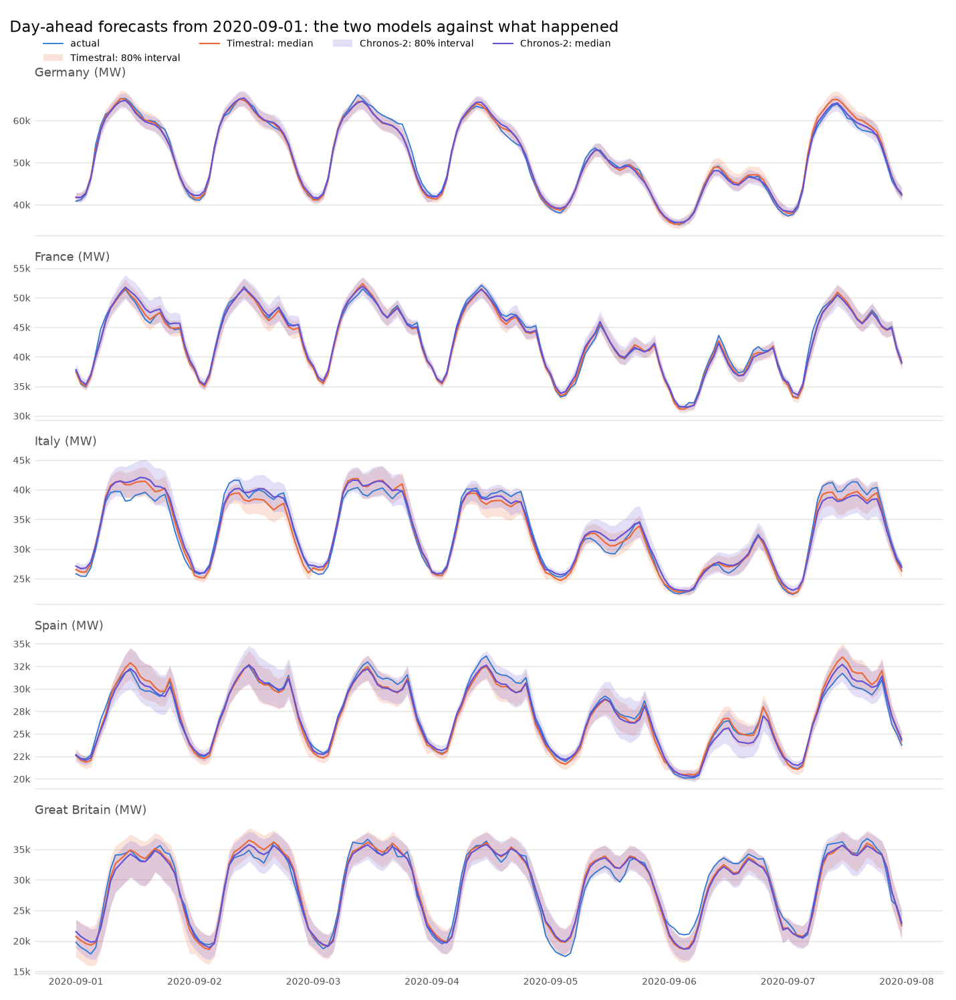
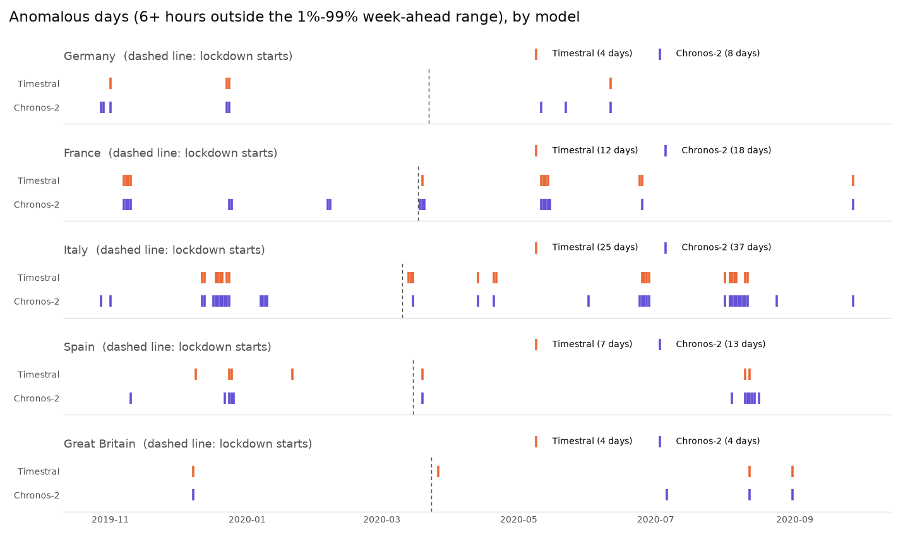

# Timestral and Chronos-2: the same experiment with two models

This note compares two time series foundation models on the same data and with the same
procedure:

- [Timestral-209M](https://mistral.ai/news/timestral/) from Mistral AI (209 million
  parameters). This is the model that the rest of the project uses.
- [Chronos-2](https://huggingface.co/amazon/chronos-2) from Amazon (120 million
  parameters, Apache-2.0 licence, package `chronos-forecasting`).

To get all the numbers in this note:

```sh
uv run main.py compare
```

The command runs the backtest and the anomaly check from the [README](../README.md)
with both models, on the CPU. It writes `output/compare-backtest.csv`,
`output/compare-backtest.png`, `output/compare-anomalies.csv` and
`output/compare-anomalies.png`. To run any other command with Chronos-2, add
`--model chronos-2`, for example `uv run main.py --model chronos-2 anomalies`. These
files get a `-chronos-2` suffix, so they do not replace the Timestral files.

- [What is the same, and what is different](#what-is-the-same-and-what-is-different)
- [1. Forecasting](#1-forecasting)
- [2. Anomaly detection](#2-anomaly-detection)
- [Which model to use](#which-model-to-use)
- [Limits of this comparison](#limits-of-this-comparison)

## What is the same, and what is different

Both models get exactly the same input. For each forecast, a model sees the 2,048 hours
(about 12 weeks) before it, and a 0/1 public-holiday indicator for each country. The
holiday indicator is a known-future covariate: the model also gets its values for the
hours that it forecasts. Both models give the same 21 quantile levels (1%, 5%, 10%, ...,
95%, 99%). Thus the bands, the scores and the anomaly rule are the same for both.

| | Timestral-209M | Chronos-2 |
|---|---|---|
| Maker | Mistral AI | Amazon |
| Parameters | 209 million | 120 million |
| Longest history it reads | 32,768 steps | 8,192 steps |
| Longest forecast in one pass | 1,024 steps | 1,024 steps |
| Quantile levels | 21, fixed | 21 (1%, 5%, ..., 95%, 99%) |
| Mean forecast | no; this project calculates it from the quantiles | yes |
| Covariates | past-only and known-future | past-only and known-future |
| Install | from GitHub | from PyPI |

The 8,192-step limit of Chronos-2 has no effect on the backtest and the anomaly check,
because they use 2,048 hours. It has an effect on `main.py forecast`: Timestral reads
the last 32,768 hours (about 3.7 years), and Chronos-2 reads only the last 8,192 hours
(about 11 months).

In the code, the two models are two classes in `forecasting.py`, `TimestralModel` and
`Chronos2Model`. Each one changes the project's arrays into the input format of its
library, and changes the result back into the same `RawForecast`. The rest of the code
does not know which model it uses.

## 1. Forecasting

The backtest: for each day from 1 to 30 September 2020, each model forecasts the 24
hours of the day at 08:00 UTC on the day before. This is the time when the grid operators
publish their forecasts.

| Country | Timestral MAPE % | Chronos-2 MAPE % | Grid operator MAPE % | Last week MAPE % | Timestral in 80% range | Chronos-2 in 80% range | Timestral 80% width % | Chronos-2 80% width % |
|---|---|---|---|---|---|---|---|---|
| Germany | **1.50** | 1.55 | 2.03 | 2.26 | 87% | 85% | 5.9 | 5.8 |
| France | 1.80 | 1.99 | **1.65** | 2.94 | 79% | 77% | 5.6 | 5.6 |
| Italy | 2.21 | 2.37 | **1.89** | 5.14 | 89% | 85% | 8.0 | 8.8 |
| Spain | 1.91 | 2.09 | **0.92** | 4.18 | 86% | 84% | 7.9 | 8.2 |
| Great Britain | 4.76 | **4.61** | 6.50 | 6.72 | 80% | 80% | 16.2 | 16.1 |
| **Mean** | **2.44** | 2.52 | 2.60 | 4.25 | 84% | 82% | 8.7 | 8.9 |

- **MAPE** is the mean absolute percentage error: on average, how many percent the median
  forecast is away from the actual demand. Lower is better.
- **In 80% range** is the percentage of hours that are between the 10% and the 90%
  quantile. It must be near 80%.
- **80% width** is the mean width of that range, as a percentage of the actual demand.
  When the coverage is correct, a narrower range is better.



The chart shows the first week of the backtest. The two medians are almost on the same
line.

**The accuracy is almost the same.** Timestral is better in four countries, and Chronos-2
is better in Great Britain. The largest difference is 0.19 percentage points (France and
Spain). On average, the error is 2.44% for Timestral and 2.52% for Chronos-2. Each model
makes the same errors on the same days. For example, on 1 September both models expected
more demand in Italy than occurred.

**Both models beat the grid operators in Germany and Great Britain.** The grid operators
were better in France, Italy and Spain. The grid operators use weather forecasts, and the
models do not. Both models are much better than the "same hour last week" baseline.

**The 80% ranges are correct for both models.** Timestral puts 84% of hours in its 80%
range. Thus its range is a little too wide. Chronos-2 puts 82% of hours in the range, which
is a little nearer to 80%. The widths are almost the same (8.7% and 8.9%).

**Chronos-2 is approximately 3.7 times faster.** On the CPU of a laptop, the 150
day-ahead forecasts took 51 seconds with Timestral and 14 seconds with Chronos-2. One
reason: by default, Timestral runs each forecast two times (on the series and on the
series upside down) and averages the results. See
[03-python-library.md](03-python-library.md).

**Conclusion for forecasting:** you can use either model. Their forecasts and their 80%
ranges are equally good on this data.

## 2. Anomaly detection

The anomaly check: from 30 September 2019 to 27 September 2020, each model forecasts
each week (168 hours) from the 2,048 hours before that week. A day is anomalous if 6 or
more of its hours are below the 1% quantile or above the 99% quantile. See
[04-anomaly-detection.md](04-anomaly-detection.md).

### The tails decide the result

For anomaly detection, the 80% range is not important. The 1% and 99% quantiles are
important, because they decide which hours are "outside". Before the pandemic, the
demand was usual. Thus approximately 1% of the hours must be below the 1% line, and 1%
must be above the 99% line.

Percentage of hours outside the lines, from 30 September 2019 to 29 February 2020:

| Country | Timestral below 1% | Timestral above 99% | Chronos-2 below 1% | Chronos-2 above 99% |
|---|---|---|---|---|
| Germany | 2.0 | 0.0 | 2.0 | 0.3 |
| France | 0.1 | 1.2 | 0.8 | 2.9 |
| Italy | 2.1 | 0.9 | 3.2 | 2.7 |
| Spain | 1.1 | 0.6 | 2.0 | 0.6 |
| Great Britain | 0.8 | 0.2 | 0.7 | 0.2 |
| **Mean** | **1.2** | **0.6** | **1.7** | **1.3** |

The target is 1% in each column, thus 2% in total. Timestral has 1.8% of hours outside
its lines. Chronos-2 has 3.0%: its 1%-99% range is too narrow. The difference is largest
in Italy (5.9% of hours outside, three times the target) and above the line in France
(2.9%).

Thus the two models give equally good ranges in the middle (10%-90%), but different
ranges in the tails (1% and 99%).

### Anomalous days

| Country | Timestral days | Chronos-2 days | Both | Only Timestral | Only Chronos-2 |
|---|---|---|---|---|---|
| Germany | 4 | 8 | 4 | 0 | 4 |
| France | 12 | 18 | 11 | 1 | 7 |
| Italy | 25 | 37 | 22 | 3 | 15 |
| Spain | 7 | 13 | 5 | 2 | 8 |
| Great Britain | 4 | 4 | 3 | 1 | 1 |
| **Total** | **52** | **80** | **45** | **7** | **35** |



Each mark is one anomalous day. The top row of each country is Timestral, and the bottom
row is Chronos-2.

**Chronos-2 finds almost all the days that Timestral finds.** 45 of the 52 Timestral days
are also Chronos-2 days. Both models find the same main events: the start of the
lockdowns, the reopening of France in May 2020, the Christmas weeks and the August
closures in Italy.

**Chronos-2 finds 35 more days.** This agrees with its narrower tails: more hours are
outside the range, so more days have 6 or more such hours. Some of the extra days are
real events:

- Christmas Eve and Christmas Day in France.
- More days of the August closures in Spain and Italy.
- 22 May 2020 in Germany: the "bridge day" after Ascension Day (21 May), when many people
  do not work.

Other extra days have no clear cause, for example 28-29 October 2019 in Germany and
7-10 January 2020 in Italy. In an alert system, these are probably false alerts. The full
list is in `output/compare-anomalies.csv`.

### The lockdowns

Anomalous days in the first 14 days of each lockdown, and the first such day:

| Country | Lockdown starts | Timestral days | Timestral first | Chronos-2 days | Chronos-2 first |
|---|---|---|---|---|---|
| Italy | 10 March | 3 | 13 March | 1 | 15 March |
| Spain | 15 March | 1 | 19 March | 1 | 19 March |
| France | 17 March | 1 | 19 March | 3 | 18 March |
| Germany | 22 March | 0 | - | 0 | - |
| Great Britain | 23 March | 1 | 26 March | 0 | - |

Neither model is clearly better here. Timestral found more days and an earlier day in
Italy, and it found Great Britain. Chronos-2 found more days and an earlier day in
France. Neither model found Germany, where the decrease in demand was small.

Both models find only 0-3 days of each lockdown. This is because of the procedure, not
the models: each week is forecast from the 12 weeks before it. When the lockdown has
continued for one week, that week is in the history, and the models expect the low
demand. Thus only the first days are a surprise. See
[04-anomaly-detection.md](04-anomaly-detection.md).

**Conclusion for anomaly detection:** Timestral is better on this data. Its 1% and 99%
lines are nearer to the correct position, so it sends fewer false alerts. With
Chronos-2 you get about 1.5 times as many anomalous days. Some are real events, but some
are probably false alerts. To use Chronos-2 for alerts, you must make the rule stricter,
for example with `--min-hours 8`. But then you adjust the rule for the model and the
data, and the project tries to avoid that work. We did not test this.

The anomaly check took 100 seconds with Timestral and 26 seconds with Chronos-2.

## Which model to use

| If you need | Use |
|---|---|
| Day-ahead forecasts and 80% ranges | either model; Chronos-2 is faster |
| Alerts from the 1% and 99% quantiles, without adjustment | Timestral |
| A history longer than 8,192 steps | Timestral |
| A PyPI package, or an Apache-2.0 licence | Chronos-2 |
| Many forecasts on a CPU | Chronos-2 |

## Limits of this comparison

- There is one data set (electricity demand), one backtest month (September 2020) and one
  year of anomaly checks. The result can be different on other data.
- Each model has default settings, a 2,048-hour history and the holiday covariate. We did
  not try other settings.
- Chronos-2 can let the five countries inform each other in one forecast
  (`cross_learning=True`). This project forecasts each country alone with both models. We
  did not test this option.
- The times are from one laptop CPU. On a GPU, or with Timestral's
  `symmetric_averaging=False`, the times are different.
