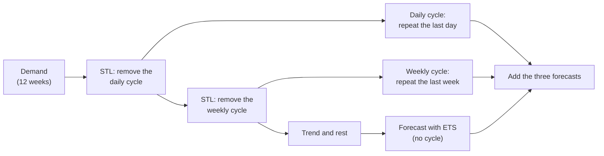

# Classical baselines: seasonal naive, ETS and MSTL

`main.py compare` scores the three TSFMs against three classical forecasting methods. This
note explains what a baseline is, how each of the three methods works, how this project
uses them, and what their results show.

For the short version, see the [README](../README.md#4-compare-models). For the results of
all models, see [06-comparing-models.md](06-comparing-models.md).

- [Why baselines](#why-baselines)
- [How this project runs the baselines](#how-this-project-runs-the-baselines)
- [Seasonal naive](#seasonal-naive)
- [ETS: exponential smoothing](#ets-exponential-smoothing)
- [MSTL: decomposition into cycles](#mstl-decomposition-into-cycles)
- [Results](#results)
- [Stronger classical methods that are not included](#stronger-classical-methods-that-are-not-included)
- [References](#references)

## Why baselines

A **baseline** is a simple forecasting method that a new method must beat. Without a
baseline, a score has no meaning: an error of 4% can be very good for one series and very
bad for another. With a baseline, the question is clear: does the new method add value?

Baselines have different strengths:

| Kind | Example | What it shows if a model beats it |
|---|---|---|
| **Naive** | "same as the last value", "same hour last week" | The model learned something. This is the minimum. |
| **Classical statistical** | ETS, ARIMA, MSTL | The model is better than methods that have been used for decades, are fast and need no GPU. This is the real test. |
| **Professional** | the grid operators' forecasts, which use weather data | The model is competitive with a tuned system with more information. |

Comparing TSFMs only with each other cannot show whether TSFMs are useful at all. Thus
`compare` includes one naive baseline (seasonal naive) and two classical ones (ETS and
MSTL). They come from [statsforecast](https://github.com/Nixtla/statsforecast) (Nixtla),
a fast implementation of the classical methods in the book *Forecasting: Principles and
Practice*.

## How this project runs the baselines

The baselines get the same forecasts to make as the TSFMs: one week-ahead forecast for
each week and country, each from the 2,048 hours (about 12 weeks) before it. There are
three differences:

| | TSFMs | Baselines |
|---|---|---|
| Learning | none: pretrained, used zero-shot | **fitted again on each 12-week history** (260 fits per method) |
| Holiday indicator | yes | **no**: these methods have no input for it |
| Missing hours in the history | accepted | filled by linear interpolation first (statsforecast does not accept missing values) |

**From intervals to quantiles.** statsforecast gives *central intervals* (for example
an 80% interval), not quantiles. Each central interval gives two quantiles:

| Interval (`level`) | Lower end | Upper end |
|---|---|---|
| 20% | 40% quantile | 60% quantile |
| 40% | 30% quantile | 70% quantile |
| 60% | 20% quantile | 80% quantile |
| 80% | 10% quantile | 90% quantile |
| 90% | 5% quantile | 95% quantile |
| 98% | 1% quantile | 99% quantile |

The point forecast is the 50% quantile (the median), because the intervals are symmetric
around it. Thus the baselines give the 9 deciles that WQL needs, and the 1% and 99%
quantiles that the anomaly check needs. The code is `StatsBaseline` in `forecasting.py`.

## Seasonal naive

**The idea:** each hour will be the same as the same hour one season earlier. Here the
season is one week (168 hours):

```
forecast for Tuesday 10:00  =  actual demand on the Tuesday before, at 10:00
```

It knows the daily and the weekly cycle without any calculation, because it copies a whole
week. It is the method "same hour last week" in the README.

**The range.** statsforecast calculates the week-to-week changes in the history: for each
hour, the actual value minus the value one week earlier. The standard deviation of these
changes, *σ*, is the typical error of the method. The range is then a normal distribution
around the forecast, with standard deviation *σ* for the first week ahead (√2 × *σ* for
the second week, and so on). For a week-ahead forecast, the range has the same width for
all 168 hours.

**Strengths:** very fast (4 seconds for all 260 forecasts), no parameters, and the
correct daily and weekly shape.

**Weaknesses:** it copies one week **with all its accidents**. If last week had a holiday,
a cold day or a strike, the forecast repeats it. It also cannot follow a change in level,
for example the slow increase of demand in autumn.

## ETS: exponential smoothing

**The idea of exponential smoothing:** the forecast is a weighted average of the past, in
which recent values have more weight than old values. The weights decrease by the same
factor at each step back. With a smoothing parameter *α* = 0.5:

| Value | latest | 1 step back | 2 steps back | 3 steps back | ... |
|---|---|---|---|---|---|
| Weight | 0.5 | 0.25 | 0.125 | 0.0625 | ... |

A large *α* follows the latest values quickly; a small *α* gives a smoother forecast that
changes slowly.

**The components.** ETS keeps up to three running estimates, and updates each one with
each new value:

- the **level**: the current value without the cycle;
- the **trend**: the slope of the level (optional);
- the **seasonal** pattern: one value for each position in the cycle, for example 24
  values for the hours of a day (optional).

The name ETS describes the form: **E**rror, **T**rend, **S**easonal. Each letter is **A**
(additive), **M** (multiplicative), **N** (none), or **Ad** (additive damped, for the
trend). For example:

| Form | Trend | Seasonal | Forecast |
|---|---|---|---|
| ETS(A,N,N) | none | none | a **flat line** at the latest level ("simple exponential smoothing") |
| ETS(A,A,N) | additive | none | a straight line with the latest slope |
| ETS(A,N,A) | none | additive | the latest level plus the repeated seasonal pattern |
| ETS(M,Ad,M) | damped | multiplicative | a slope that flattens, times a seasonal pattern |

For the simplest form, ETS(A,N,N), the update is:

```
new level = old level + α × (actual value − old level)
forecast for every future hour = the latest level
```

**AutoETS** fits each allowed form and selects the one with the lowest **AICc**
(corrected Akaike information criterion). AICc measures how well a form fits the history,
with a penalty for each extra parameter. A form with a seasonal part has 24 more values
to estimate, so it must fit much better to be selected.

**The range.** ETS has an error model, so it can calculate how uncertain each forecast is.
The uncertainty grows with each step ahead, because each step adds new random errors. For
ETS(A,N,N), the variance of the error *h* steps ahead is σ² × (1 + (*h* − 1) × α²). For
an hourly series and a 168-hour horizon, *h* is large, so the range becomes very wide.

**The limit on cycles.** ETS has only one seasonal pattern. In statsforecast it keeps at
most 24 seasonal values, so for hourly data it can model the daily cycle but not the
weekly cycle (168 values). Electricity demand has both: Monday at 10:00 is different from
Sunday at 10:00.

**What happened in this project.** `compare` uses `AutoETS(season_length=24)`, with the
default settings:

- In **75 of the 110** country-weeks, AutoETS selected ETS(A,N,N): no trend and **no cycle
  at all**. The daily pattern did not lower the AICc enough to justify 24 more values. The
  forecast is then a flat line at the level of Sunday midnight, when each forecast is made.
- Thus its median error is very large (18%), and its 80% range is about as wide as the
  demand itself (90%).
- In the anomaly check, almost every Monday in Germany and Italy is a "spike": the flat
  forecast continues the low level of Sunday night, and the usual Monday demand is far
  above its range.

We tested two other settings on a sample of 20 windows. Neither is a useful baseline:

| Setting | Median error (MAPE) | Hours in the 80% range (target 80) |
|---|---|---|
| default, as in `compare` | 18% | 76% |
| daily cycle forced (`model="ZNA"`) | 13% | 46% (much too narrow) |
| weekly cycle (`season_length=168`) | 14% | 80% |
| MSTL, for comparison | 5% | 92% |

We kept the default, so that the settings were not chosen after we saw the results. The
lesson: ETS alone is not suitable for hourly data with two cycles. This is the problem
that MSTL solves.

## MSTL: decomposition into cycles

**The idea:** first divide the series into parts, then forecast each part with a simple
method, then add the forecasts.

```
demand  =  daily cycle  +  weekly cycle  +  trend and rest
           (24 hours)      (168 hours)      (everything else)
```

**Step 1: decomposition with STL.** STL (*Seasonal-Trend decomposition using LOESS*,
Cleveland and others, 1990) separates one cycle from a series. LOESS is a *local
smoothing*: each point is replaced by a weighted average of the points near it. STL uses
it to estimate a smooth seasonal pattern that can change slowly in time. **MSTL**
(*Multiple STL*, Bandara, Hyndman and Bergmeir, 2021) applies STL several times, one cycle
after the other, from the shortest to the longest: here first the daily cycle (24 hours),
then the weekly cycle (168 hours). What is left is the trend and the rest.



**Step 2: forecast each part.**

- Each **cycle** is forecast with seasonal naive: its last day (or last week) is repeated.
  Because STL smooths the cycles, this is more stable than copying the raw last week.
- The **trend and rest** has no cycle left, so a non-seasonal ETS can forecast it well. In
  statsforecast the default is `AutoETS(model="ZZN")`: any error and trend, no season.

**The range** comes only from the ETS forecast of the trend and rest. The cycles are added
as if they were certain. Over 168 hours, the ETS range grows (see above), so the MSTL range
is wide.

**Strengths:** it knows both cycles, it is robust to one unusual week (the cycles are
smoothed over the 12 weeks), and it is fast (about 30 seconds for all 260 forecasts).

**Weaknesses:** it assumes that the parts are **added** and that each cycle has a **fixed
shape** in the near future. In reality the daily shape changes with the weekday and the
season (for example, the evening peak moves as the days become shorter), and the parts
interact. It also does not know holidays.

## Results

Week-ahead forecasts on the usual days (October 2019 to February 2020), and the anomaly
check over one year. All values from `main.py compare`:

| | Seasonal naive | ETS | MSTL | Best TSFM |
|---|---|---|---|---|
| WQL % (lower is better) | 5.09 | 16.07 | 4.83 | 3.18 (TimesFM 3) |
| MAPE % of the median | 6.02 | 17.75 | 5.47 | 4.19 (TimesFM 3) |
| Hours in the 80% range (target 80) | 83.1 | 78.2 | 89.8 | 81.1 (Timestral) |
| Width of the 80% range % | 22.4 | 89.5 | 29.3 | 12.3 (TimesFM 3) |
| Hours outside 1%-99% before the pandemic (target 2) | 5.9 | 5.1 | 3.8 | 1.8 (Timestral) |
| Anomalous days before the pandemic | 62 | 72 | 38 | 20 (Timestral) |
| Seconds for 260 forecasts (CPU) | 4 | 87 | 32 | 26-95 |

What the results show:

- **MSTL is the best baseline**, but it is not clearly better than seasonal naive: the
  paired test gives an adjusted p-value of 0.91 (see
  [06-comparing-models.md](06-comparing-models.md#2-is-the-difference-real)). Its median
  is a little better, but its range is too wide (90% of hours in the 80% range).
- **Every TSFM is clearly better than every baseline**: about a third lower WQL than MSTL,
  in 21 or 22 of the 22 weeks (adjusted p ≤ 0.004). Part of this gap can be the holiday
  indicator, which only the TSFMs get.
- **The ranges are the largest difference.** The baselines' ranges come from simple error
  models (normal errors that grow with each step), so they are about twice as wide as the
  TSFMs' ranges. The TSFMs learned realistic ranges in their pretraining.
- **For anomaly detection, the baselines' tails are too narrow or in the wrong place.**
  Seasonal naive has too many hours outside on both sides (2.7% below its 1% line, 3.1%
  above its 99% line), MSTL too many below its 1% line (3.2%), and ETS too many above its
  99% line (5.0%). Thus they send about two to four times as many alerts on usual days as
  Timestral.

## Stronger classical methods that are not included

The three baselines use default settings and no calendar information. Stronger classical
or machine-learning baselines exist, and some could close part of the gap:

| Method | What it adds |
|---|---|
| **Regression with calendar features** | hour, weekday and holiday indicators as inputs; simple and often strong for electricity demand |
| **AutoARIMA with exogenous inputs** | ARIMA models can use the holiday indicator (statsforecast supports this) |
| **TBATS** | several cycles, including cycles that are not whole numbers, with a Box-Cox transformation |
| **Prophet** | trend, several cycles and holidays in one additive model |
| **Gradient boosting** (for example LightGBM with `mlforecast`) | learns from lagged values and calendar features; often wins forecasting competitions such as M5 |

A baseline with the holiday indicator would make the comparison with the TSFMs fairer.

## References

- Rob J. Hyndman and George Athanasopoulos, *Forecasting: Principles and Practice* (3rd
  edition), free at [otexts.com/fpp3](https://otexts.com/fpp3/): simple methods including
  seasonal naive (chapter 5), STL and MSTL decomposition (chapter 3), exponential smoothing
  and ETS (chapter 8).
- Rob J. Hyndman, Anne B. Koehler, J. Keith Ord and Ralph D. Snyder, *Forecasting with
  Exponential Smoothing: The State Space Approach* (2008): the ETS model family and its
  prediction intervals.
- Robert B. Cleveland, William S. Cleveland, Jean E. McRae and Irma Terpenning, *STL: A
  Seasonal-Trend Decomposition Procedure Based on Loess* (1990).
- Kasun Bandara, Rob J. Hyndman and Christoph Bergmeir, *MSTL: A Seasonal-Trend
  Decomposition Algorithm for Time Series with Multiple Seasonal Patterns* (2021).
- [statsforecast documentation](https://github.com/Nixtla/statsforecast): the
  implementation used here.
